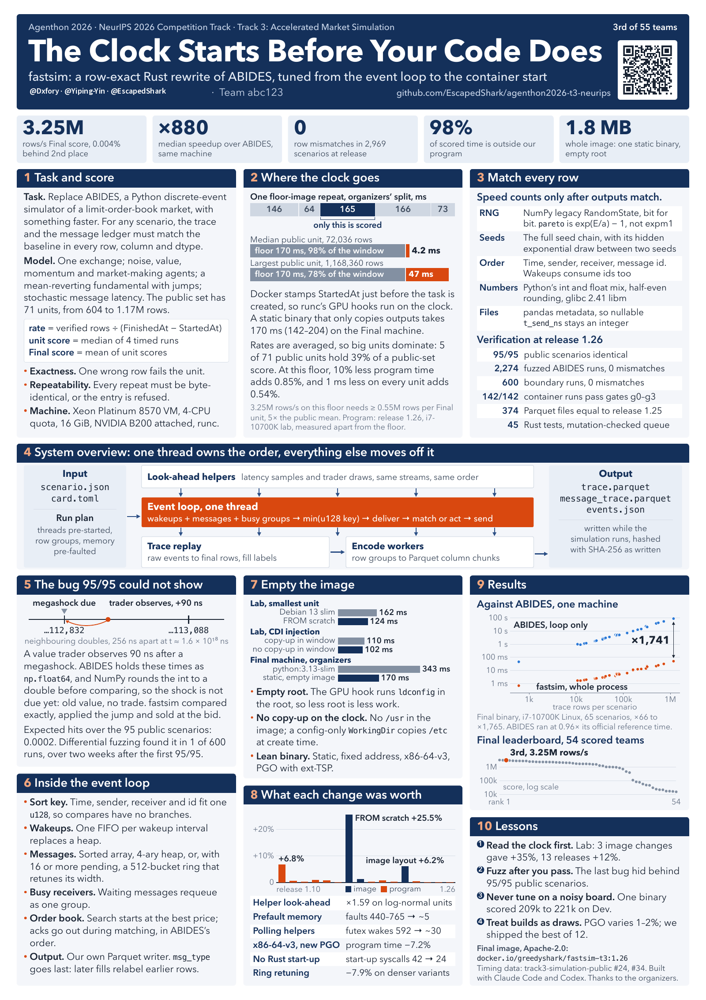

# Agenthon 2026 — Team abc123

**Team abc123 at Agenthon 2026, the NeurIPS 2026 Competition Track. T3 Prize, 3rd of 55, official score 3,249,452.2547 (3.25M verified rows/s on the team poster, 0.004% from 2nd place). T2 Forecasting, 8th of 87. T4 Explainability, 26th of 63. T1 Coding, 48th of 61. fastsim: row-exact Rust rewrite of ABIDES, same-machine median 880× across 65 scenarios (range 66–1,765×). Member handles are in [`TEAM.md`](TEAM.md).**

Public showcase of verifiable AI agents for quantitative finance and **financial-semantics processing** across all four tracks.

[中文简版](README.zh-CN.md)

## Results

Official Final leaderboard, team ranks, read 2026-11-09. Evidence: [`results/RESULTS.md`](results/RESULTS.md) and <https://www.agenthon.net/>.

| Track | Rank | Score |
|---|---|---|
| **T3 Simulation** | **3 / 55** (top-3 prize) | **3,249,452.2547** |
| T2 Forecasting | 8 / 87 | −0.9689 |
| T4 Explainability | 26 / 63 | 0.3779 |
| T1 Coding | 48 / 61 | 0.0357 |

Team abc123 competed in **all four tracks**. T3's third place is a prize position under the published top-3 rule. T4 line: **T4 Explainability track 26/63**.

**880×** is the same-machine median of the ABIDES simulation loop against the fastsim whole process, 65 scenarios, range 66–1,765×. The official Final score is **3,249,452.2547**.

## Poster

Team poster *The Clock Starts Before Your Code Does* — byline `@Dxfory · @Yiping-Yin · @EscapedShark` — scheduled for **12 December 2026** at the NeurIPS 2026 Agenthon Workshop in Atlanta.



## The competition

Agenthon 2026 is a four-track NeurIPS 2026 Competition Track on verifiable AI for quantitative finance. Each submission is a Docker agent. The sandbox runs offline. Before a score is computed, the run passes four gates: g0 integrity, g1 schema, g2 cutoff and resource limits, g3 domain semantics. The score is computed on sealed held-out units.

Official tasks, starter packs, and datasets stay upstream under CC BY-NC 4.0:

- <https://github.com/Agenthon-2026/Agenthon2026-public>
- <https://www.agenthon.net/>

## What we built

Agent building and financial-semantics processing were the common thread: each track is a sandboxed agent that computes, cites, or simulates under hard resource and cutoff gates.

| Track | In this tree | In one paragraph |
|---|---|---|
| T1 Coding | [`tracks/t1-coding`](tracks/t1-coding/README.md) | A Python write–run–repair agent (`stack14-thin-v1`) with a hard request cap, atomic admission of model code, and an isolated rerun. `qfkit` and `qfruntime` are libraries with explicit arguments. A task id stays an input, and the libraries return computed values. |
| T2 Forecasting | [`tracks/t2-forecasting`](tracks/t2-forecasting/README.md) | Numeric forecaster v2.7.7. Each change is a pre-registered profile (FOMC-week rate shift, a monthly sibling nowcast, then that nowcast's width). Earlier profiles still reproduce the previous draws. |
| T3 Simulation | [`tracks/t3-simulation`](tracks/t3-simulation/README.md) | A link to the public Rust rewrite, `fastsim`. The canonical source stays in that repository. |
| T4 Explainability | [`tracks/t4-explainability`](tracks/t4-explainability/README.md) | `t4agent` v21.14. Code computes the facts; the House model judges inside a request cap; claims are verbatim spans; fitted artefacts are admitted when the task cutoff is late enough for that capability. |

The internal notes under each `src/` directory are often in Chinese. The track READMEs above are the English overview: what the code does, which checks were recorded, and how to run an offline test.

## How we checked the work

The official gates were the specification. Local checks were written to mirror them, and a candidate image was exercised in a restricted container before the team treated it as submittable.

- **T1.** The exported tree checks that image defaults match the profile (`scripts/thin_defaults.py check`) and imports `qfkit` and `qfruntime`. The full unit-test package and the official tasks stay in the upstream track repository. During development, a separate fix loop used an independent review pass on each round, on a clean archive, with hashed probes. That record is the case study below. Its pytest counts are path checks.
- **T2.** The bundled README records a pre-submission checklist (source tests, a fuzz, public cards in a constrained container, identity against the registered arm). Re-running `test_forecast.py` uses the official public units from the track repository, kept upstream of this tree.
- **T3.** Row-level comparison with the Python reference, as recorded in [`results/RESULTS.md`](results/RESULTS.md). Those engineering figures are the team's, recorded beside the official Final score.
- **T4.** Cutoff policy and the label/point consistency gate have offline tests that run inside this export (79 passed in this workspace on 2026-11-09). Broader tests use the public track repository. Outcome-selected constants are disclosed in `ARTIFACT_PROVENANCE.md` on T2 and T4, including the practice-unit exception, so a later reader can see which choices were kept after looking at scores.

Private units, hidden labels, checker oracles, and the canary registry stay with the organisers.

## How the team used several models

Plans, implementation, and review were different jobs. One model drafted a specification and the tests that should fail. Another implemented on its own branch. A third re-ran the probes on an archive and wrote what the probes had failed to see. The team decided which preset was admitted onto a real model endpoint. Regressions and abandoned arms stayed in the notes.

The short version of that arrangement is [`docs/workflow.md`](docs/workflow.md). The diagram of the sandbox and the four agents is [`docs/architecture.md`](docs/architecture.md). The long version, for the Track 1 development loop from audit v3 through v8, is [`docs/case-study-t1-fix-loop.md`](docs/case-study-t1-fix-loop.md): what the probes caught, what was fitted to the probes, what remained out of reach, and why a later clock constant stopped both lanes.

## Layout

```
README.md                 this file
README.zh-CN.md           short Chinese version
TEAM.md                   member handles
LICENSE                   Apache License 2.0
NOTICE                    copyright and third-party notes
results/RESULTS.md        official Final table, then the development snapshot
docs/architecture.md      sandbox diagram
docs/workflow.md          how we used several models
docs/case-study-t1-fix-loop.md
docs/case-study-t1/       findings by version
docs/assets/              team poster (handle byline PNG)
tracks/t1-coding          Final-line Python agent, qfkit, qfruntime, build
tracks/t2-forecasting     v2.7.7 forecaster and pipeline notes (card data stays upstream)
tracks/t3-simulation      link to the public fastsim repository
tracks/t4-explainability  t4agent v21.14 source and tests
scripts/export_candidate.sh
scripts/leak_scan.sh
```

`scripts/export_candidate.sh` rebuilds the three source trees from an allowlist on the local machine. `scripts/leak_scan.sh` reports credential-shaped strings and identifiers outside the public set.

## Links

- Competition site / Final leaderboard: <https://www.agenthon.net/>
- Public Track 3 (`fastsim`): <https://github.com/EscapedShark/agenthon2026-t3-neurips>
- Team poster: [`docs/assets/agenthon-2026-t3-poster-team.png`](docs/assets/agenthon-2026-t3-poster-team.png)

## License

Apache License 2.0. See [`LICENSE`](LICENSE) and [`NOTICE`](NOTICE).

- Track 3 (`fastsim`) is linked. Its Apache-2.0 NOTICE stays upstream.
- Official Agenthon materials are CC BY-NC 4.0 and stay at the upstream links.
- Official packages such as `qfbench2-common` keep their upstream non-commercial terms in their own distribution.
- `backtrader` (GPL-3.0) may appear in Track 1 container environments. This tree's Python sources ship the agent libraries named in the track READMEs.
