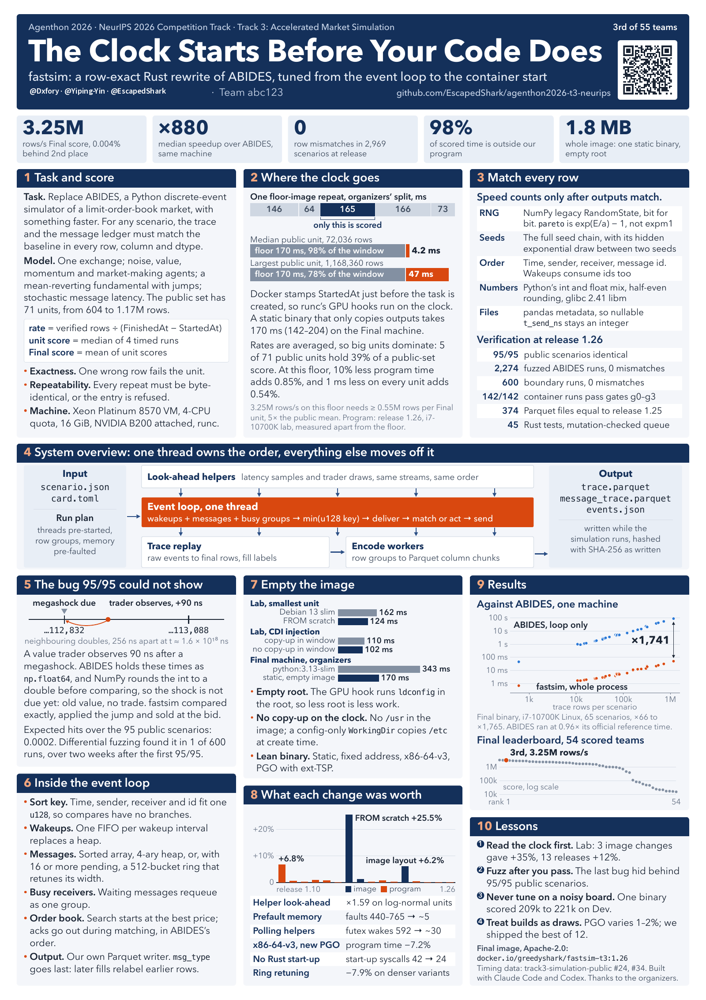

# Agenthon 2026 — 团队 abc123（中文简版）

**Team abc123** 在 [Agenthon 2026](https://www.agenthon.net/)（NeurIPS 2026 Competition Track）的公开作品库。我们构建可验证的量化金融 AI 智能体，并做**金融语义处理**，四条赛道都参赛。对外只写团队 **abc123**。成员名单见 [TEAM.md](TEAM.md)。英文全文见 [README.md](README.md)。

## 成绩

官网 Final，团队名次，2026-11-09 读取。依据见 [results/RESULTS.md](results/RESULTS.md)。

| 赛道 | 名次 | 分数 |
|---|---|---|
| T1 编程 | 48 / 61 | 0.0357 |
| T2 预测 | 8 / 87 | −0.9689 |
| **T3 仿真** | **3 / 55**（前三名获奖） | **3,249,452.2547** |
| T4 可解释性 | 26 / 63 | 0.3779 |

团队四赛道参赛。T3 第 3 名为获奖名次。T4 口径：**模型可解释性赛道 26/63**。

## 海报

团队海报《The Clock Starts Before Your Code Does》（byline 仅 handle：`@Dxfory · @Yiping-Yin · @EscapedShark`）将于 **2026-12-12** 在亚特兰大 **NeurIPS 2026 Agenthon Workshop** 展示。

## 比赛

Agenthon 2026 是 NeurIPS 2026 竞赛单元中的量化金融可验证 AI，四条赛道。提交物是沙箱里的 Docker agent，先过 g0–g3（完整性、格式、截止日与资源、领域语义），再在密封题目上计分。官方题目与数据包不放进本库，只保留链接：<https://github.com/Agenthon-2026/Agenthon2026-public> ，成绩页 <https://www.agenthon.net/>。

## 各赛道做了什么

智能体构建与金融语义处理是主线：每条赛道都是在硬资源与 cutoff 门禁下计算、引用或仿真的沙箱智能体。

- **T1 编程。** Python 的写码–运行–修补循环（`stack14-thin-v1`），请求有硬上限，模型代码原子准入，在隔离进程里重跑。`qfkit` / `qfruntime` 是显式参数的库，不按题号给答案。说明见 [tracks/t1-coding](tracks/t1-coding/README.md)。
- **T2 预测。** 数值预测器 v2.7.7。改动事先登记：FOMC 周利率中心、月度同伴现测、以及该现测的宽度。旧 profile 仍能复现上一版。说明见 [tracks/t2-forecasting](tracks/t2-forecasting/README.md)。
- **T3 仿真。** 不复制代码，只链接我们的公开仓库，Rust 重写 `fastsim`：<https://github.com/EscapedShark/agenthon2026-t3-neurips>。
- **T4 可解释预测。** `t4agent` v21.14。代码先算事实，House 模型只做有边界的判断；claim 是逐字引用；拟合结果能否使用由题目 cutoff 决定。说明见 [tracks/t4-explainability](tracks/t4-explainability/README.md)。

## 怎么验证

本地检查对齐官方门禁，镜像在受限容器里跑过再谈提交。T2、T4 把「看过结果才留下的参数」写在 `ARTIFACT_PROVENANCE.md`。T1 开发期还有一轮独立复审：审计 → 规格 → 修复 → 换一份归档再审。记录在 [docs/case-study-t1-fix-loop.md](docs/case-study-t1-fix-loop.md)。那里的 pytest 数字是路径检查，不是榜单分。

## 多模型流程与目录

规格、实现、独立复审分给不同的编码模型，由团队决定。短说明见 [docs/workflow.md](docs/workflow.md)，结构图见 [docs/architecture.md](docs/architecture.md)。

`tracks/` 下放三条赛道的源码导出和 T3 的链接，`results/` 放成绩，`docs/assets/` 放团队海报，`scripts/` 是白名单导出和泄露扫描。成员名单是 [TEAM.md](TEAM.md)。

## 链接

- 赛事官网与 Final 榜：<https://www.agenthon.net/>
- T3 公开库（`fastsim`）：<https://github.com/EscapedShark/agenthon2026-t3-neurips>
- 团队海报：[docs/assets/agenthon-2026-t3-poster-team.png](docs/assets/agenthon-2026-t3-poster-team.png)

## 许可证

Apache License 2.0。见 [`LICENSE`](LICENSE) 与 [`NOTICE`](NOTICE)。

- T3（`fastsim`）只链接、不合并源码，其 Apache-2.0 NOTICE 留在上游库。
- 官方赛题与材料为 CC BY-NC 4.0，本库只给链接。
- `qfbench2-common` 等官方包保留上游非商用条款，本库不重新分发。
- `backtrader`（GPL-3.0）仅可能出现在 T1 容器环境中；本库源码不 import、不附带。
