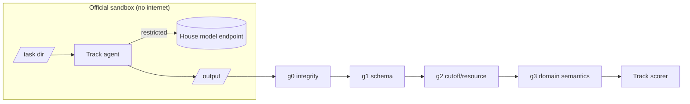

# Architecture

**T1 thin loop:** contract request → code request → isolated execution → feedback → repair,
with a hard request cap (≤25), atomic acceptance of model code, best-attempt retention.

**T2:** numeric forecaster; each change is a pre-registered experiment with a held-out test window.

**T3:** Rust `fastsim`; differential check against the Python reference on every scenario.

**T4:** code computes facts first → House model judges → cited rationale; per-task cutoff policy
(`artifact_policy.py`) decides which fitted artefacts may be used.
