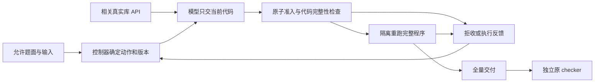

# T1 Coding

**Quant-finance coding agents**

Build a Docker agent that solves quantitative finance coding tasks under pytest and financial-invariant checks.

| Verb | Metric | Gate |
|---|---|---|
| solve | pass@1 | pytest + invariants |

更新：2026-10-06。本页是当前仓库的技术入口；项目结果及执行顺序由本地 `T1_总体方案与执行路线.md` 维护。源码实现、工程验收、真实解题、镜像发布和官方提交分别记录。

## 准备顺序

1. 固定任务接口、允许输入、交付、依赖、资源约束和原始 checker。
2. 用公开86题分析方法、数据结构、单位与数值约定、交付形式的共性和缺口，不建立题号到预写答案的路由。
3. 搭建可复现的 Docker agent、隔离执行和独立 checker，冻结源码、镜像、模型、题源和预算。
4. 准备通用数值与数据工具，并确认真实 API。题型、计算模块、公式是研发检索层级；统一语义先约束选库并贯穿计算与检查。
5. 真实测试按一题→三题→六题逐步推进，前一档完整通过后再扩展；组件齐备不能替代解题验证。

## 分工

| 部分 | 责任 |
|---|---|
| 单一 House 模型 | 解释当题语义、选择方法、生成当前计算及检查；根据实际证据修复 |
| 通用库 | 提供可复用 API 和数值原语，不自动选题、不提供整题答案 |
| 控制器 | 在请求前绑定动作、版本、修改范围；检查载荷、输入位置、预算、进展及完成门 |
| 隔离 worker | 清空旧输出，在新进程中运行完整累计程序，返回真实退出状态、诊断和产物 |
| 外部评测 | 用原 checker 给出完整任务结果 |

## 单题流水线

1. **理解输入与合同。** 允许输入位置由运行环境映射确定；题面继续决定方法、单位、样本、随机数和交付。显式解析日期、检查行数和对齐；库可用不保证模型会采用。
2. **生成首个可执行计算。** 默认 thin 模式有一次短合同请求；实验 direct 模式直接生成最小必要计算及独立检查。推理和写计划同样消耗模型 token。
3. **按当前状态确定动作。** 空程序或必须整份恢复时 REPLACE；具名未完成定义采用 BUNDLE。实际失败位置可准确绑定当前已执行版本时，REPAIR_UNIT 只替换一个完整同类顶层节点。成功执行且版本一致、无 pending 时，APPEND_STEP 接收新增代码，原程序前缀逐字节保留。若回复重复完整旧程序，仅在旧主体、导入和作用域边界都能核对时提取新段；新增导入不得覆盖旧名称。模型不填写动作、版本或补丁位置。
4. **先验证，再执行。** 只接收原始Python或唯一完整Python围栏。APPEND_STEP和局部修复的所有length回复整段拒收；追加还拒收纯声明、没有新段的旧脚本、修改或缺失的旧前缀、重复已接纳的有效追加段及引入stub/pending的组合。每次direct回复都记录准入结果、原因、前后版本及是否恢复前缀，最后一次拒收也保留。初始／旧恢复的真实EOF仍由ProgramVersion保留前缀和未完成义务。任何未就绪版本不能执行。
5. **观察实际进展。** direct模式只有新的规范AST版本真正运行exit0才清零无进展计数；文本、注释、pending变化、拒收、失败执行不清零。同AST回复原子拒收，保持当前程序和义务。两次无成功执行停止；原有每版本一次强制替换恢复机会仍受原请求、绝对时间和执行预留约束。
6. **完成全量交付并评分。** 每次运行清空旧输出，前置计算、随机性和必要调用须能从源代码重建。文件齐全及内部检查只是完成门，只有原checker全过才记任务成功；checker未运行则保留未验证。

实现入口是 `t1_phase1/thin.py`，由 `baseline.solve` 的独占分支调用，profile为 `stack14-thin-v1`。`code_step.py`负责追加范围和规范AST身份；`program_version.py`负责完整性和绑定组；`local_repair.py`负责错误位置对应单元。默认direct关闭；本轮仅修改显式direct路径，默认短合同路径保持。

模型提示附带所引用的少量 NumPy/SciPy API 的真实安装态 Returns 文档（最多4项、总共4000字符），解释元组返回值、形状和空数组条件。文档只帮助模型理解 API，不替它重写公式，也不证明正确性。

追加不自动包装函数、搬移入口或改变作用域。前缀恢复先运行原程序，再执行新增导入和新段；不承诺与任意重排整份脚本等价。无法无歧义分段的回复直接拒收。函数局部变量不会变成共享变量；相同赋值和函数调用也不一定语义等价。因此静态重复规则是保守的协议规则，不是数学无进展证明；代码可覆盖运行变量和产物，提前退出也可能绕过尾部。执行进展不证明新增计算有用或正确，仍需实际输出、数值关系和外部检查。

## 成本与资源

| 工作 | 模型 token | 其它成本 |
|---|---|---|
| 本地读取、AST、版本和预算检查 | 不新增；传给模型后计输入 | CPU、I/O、墙钟 |
| 解释、计划、思考、生成与修复 | 计输入和输出 | 请求、接口等待、墙钟 |
| 程序执行、调库、计算、断言、绘图 | 不新增调用 | CPU、内存、磁盘、墙钟 |
| 反馈送入下一轮 | 计输入与后续输出 | 剩余请求和时间 |
| 独立checker | 不属于agent推理 | 独立评测资源 |

镜像按请求类型设置思考：`T1_THIN_CONTRACT_THINKING=low_effort`、`T1_THIN_CODE_THINKING=off`（取值on/low_effort/off/budget:<1-2048>）；某类型未设置时才回落到旧的`T1_THIN_THINKING`（默认on；off映射False，low_effort映射True，数值budget仅与on兼容）。low_effort不是已证明的硬token限额。当前开发实验显式direct1/low_effort，每回复4,000、最多12请求、agent420秒、checker300秒、2CPU/6GiB；这些是本地冻结协议，不能冒充官方资源或成绩。

内存/时间/输出限制独立执行；OOM计数未知不补零，SIGKILL不直接判OOM。不通过缩减规定样本、方法或精度换取通过。统计请求、已知usage、未知usage、执行、交付和checker结果；`thin_successful_advances`与`thin_no_progress`分别记录执行进展和连续停滞，不作为金融分数。

## 验收与维护

先验证有意义的失败回归、源码测试、安装态与隔离边界，再做冻结现场的一次正常推进复验；通过后另开原题空程序的完整测试。局部fixture不得进入整题输入，不重复尝试到成功。历史失败保留独立记录，不拼接为一次通过。

通用运行时与额外策略仍按profile默认关闭，启用需要真实任务证据。只清理本任务被替代的镜像和可再生缓存，保留源码、固定输入及原始回放。GitHub源码推送、公开匿名拉取和正式提交分别验收。
