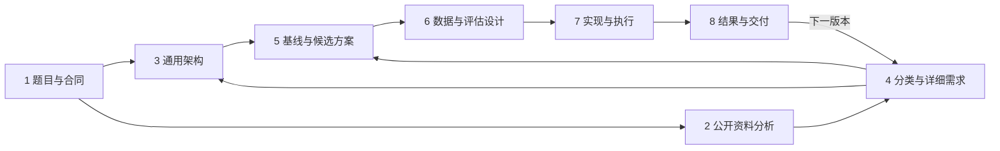
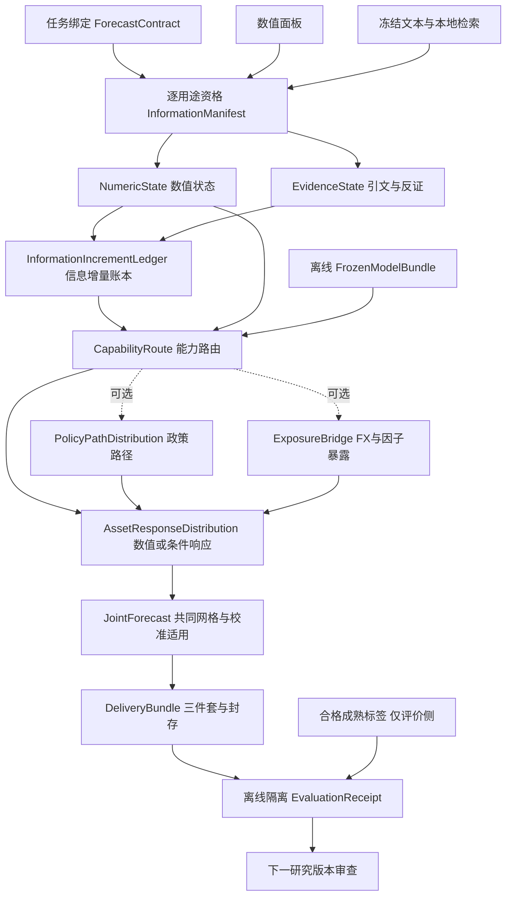

# T2 流水线：从题目、公开卡片到架构、验证与交付

**2026-10-12 Final 打包适配与离线验证完成：** 当前 profile 打包预检、离线 Final descriptor / 合成 key 两文件 ZIP 已通过；新候选补入完整 provenance 后重新验收 108/108、324 个产物哈希与旧镜像一致，56 项工具测试通过。见[本轮结果](contracts/final-packaging-2026-10-12/RESULT.md)。后续顺序是：独立交付审查 → 确认公开镜像发布并验证匿名拉取 → 真实团队包 → 确认正式上传，见[当前打包与发布门](contracts/final-packaging-2026-10-12/README.md)。ranked 卡片由官方在提交关闭后生成，不能将取得它们列为上传前置。镜像未公开、未正式上传。下列较早日期记录保留其历史身份，不再作为当前提交顺序。

**2026-10-12 当前合同本地工程验收通过：** 同一 v2.7.0 数值源码在 common v2.6.0 / Track `a2c93e7` 下，104 张历史公开卡 + 4 个短期限/有序轴/单位边界案例 **108/108 通过**，0失败/回退/遗漏；7次独立目录重复交付字节一致，130个单元测试通过。旧配置与历史收据保留，数值源码未改。见[工程结果与证据](contracts/current-contract-2026-10-11/RESULT.md)。真实 ranked Final 的 panels/grid/generator、截止资格与平台接受仍待绑定；镜像未发布、未上传比赛。

**2026-10-11 确认可行性收口：** 本轮新增合格名册为0，当前状态 `insufficient_new_confirmation_support`；不实施/运行位置×形状诊断，不创建科学注册，不采用。固定 B_VAR 拒绝、四块已揭盲开发身份及生产v2.7.0不变；早期历史空档/其他资产和独立N仍未知。下一任务是当前合同兼容与完整 ranked Final 工程绑定，实际 panels/grid/generator、观测可用性和验收仍未建立。见[决定与重开条件](contracts/confirmation-feasibility-2026-10-11/DECISION.md)、[来源审计](contracts/confirmation-feasibility-2026-10-11/SOURCE_FEASIBILITY.md)、[覆盖矩阵](contracts/confirmation-feasibility-2026-10-11/COVERAGE_MATRIX.md)。这些审计的历史行号固定解析于 aligned base `dd272ebbda62428dd816e225829cf7ed796e45ef`，不随本次入口插入偏移。

**当前纯价格 B_VAR 四块稳健性实验已完成，拒绝固定配方的有界 F3 研究采用（`reject_fixed_B_VAR_for_scoped_research`）。** 61训练／36校准／4新结果块、8/8有效，0失败/遗漏/重试/回退，单科学进程、0网络/外部模型调用。full B_VAR/V27 均值 0.7518253187/0.7563976959，仅改善 **0.6044938%**、**1/4胜**，UST composite/variogram/80%覆盖受损，16门中5门失败。旧五窗6.374983%仅为发现背景，未池化或救门；固定配方停止，不证明所有VAR无用。操作块严格错开但统计独立未验证、有效独立N未知；current-vintage/non-PIT及既往raw词法暴露保留，日历中性评估仍继承policy-selected训练/校准。独立[结果复审](contracts/price-var-robustness-2026-10-11/reviews/result-review.md) accepted（0 Critical / 0 Important / 0 Minor）；[完整结果](contracts/price-var-robustness-2026-10-11/RESULT.md)、[summary](contracts/price-var-robustness-2026-10-11/results/run-v1/summary.json)、[归档映射](contracts/price-var-robustness-2026-10-11/archive_manifest.json)。`production_adoption=false`，生产仍v2.7.0。

**这是 T2 唯一完整主文档。** 八个模块分别说明任务、资料、架构、需求、方案、评估、执行和结果。首次阅读顺着模块 1–8；日常工作从当前模块进入。精确合同、逐卡证据、实验和发布收据作为附件，用于核对细节。

**此前政策均值五起点实验已完成，固定候选拒绝继续（`reject_fixed_candidate_for_continuation`）。** 61训练／36校准／5评估、25/25有效槽位，0失败/遗漏/重试/回退，0网络/外部模型调用。C_VAR−B_VAR=+0.0162499048（+3.025383%），C_VAR−V27=−0.0203228496（−3.542468%）；纯价格B_VAR较V27均值改善6.374983%、较B_old改善1.914395%，说明直接胜v2.7不能替代匹配消融。新用途输入/标签隔离、注册及执行复审在科学运行前提交、唯一预测封存后评分均已执行；[完整结果](contracts/policy-mean-new-cohort-2026-10-11/RESULT.md)与[归档映射](contracts/policy-mean-new-cohort-2026-10-11/archive_manifest.json)绑定实际字节。五个current-vintage时间窗有已知词法暴露，独立N/独立采用确认未建立；结论仅针对这组固定policy-mean表征/模型，不否定所有政策、文本/RAG或T2研究。独立算术核验通过，独立[结果复审](contracts/policy-mean-new-cohort-2026-10-11/reviews/result-review.md) accepted（0 Critical / 0 Important / 0 Minor）；生产仍v2.7.0、`production_adoption=false`。

**旧政策传导五臂实验已完成，H1/H2均拒绝采用。** 固定61训练／36校准／46评估、230/230槽位成功，0失败/遗漏/重试，单科学进程、0网络/外部模型调用。H1 C_mean−B=−0.0468815003（−3.669109%），95%区间[−0.153120360,+0.021363344]跨0；H2 C_joint−C_mean=+0.0004009388，亦未过冻结规则。点估计改善不等于验证增益。生产仍v2.7.0，未直接比较或替换生产。完整[结果](contracts/policy-transmission-2026-10-11/RESULT.md)与注册绑定真实执行；独立[结果复审](contracts/policy-transmission-2026-10-11/reviews/result-review.md) accepted（0 Critical / 0 Important / 0 new Minor）。

**此前完成的实验（2026-10-11）：Final 短周期冻结开发实验已完成一次预测、封存和一次评分，C 与探索性 B 均 reject；不采用、不重调本名册。** 57 个不重叠起点（33 事件、24 对照），33 个实际事件激活；285/285 槽位终态，261 次成功计算、24 次相同臂复用、0 失败。C−B = −0.00379708（B 的 −0.292762%），95% 区间 [−0.00795111,+0.000183706]；未通过 1% 改善、区间上界<0 和双资产类别保护门。数值生产仍 v2.7.0。完整[冻结结果](contracts/final-short-2026-10-11/RESULT.md)、[注册](contracts/final-short-2026-10-11/registration.json)、[收据](contracts/final-short-2026-10-11/validation_receipt.json)分别绑定真实执行与审阅状态；Task3及最终独立审阅已通过；Git交付以 main 远端引用和推送后 readback 收据为准。

**当前官方 ranked Final 范围见 1.0。** 本次四资产×三期限是 core research projection，不是 full ranked Final acceptance；官方实际 target panels/family generator 仍未知。模块 2 的 104 卡公开资料画像与模块 4 的历史长周期/月频/EM 矩阵保留参考；旧 RF1 为历史低优先级支线，旧合同、停止身份和阈值不改写。模块5/6/7/8区分政策传导五臂研究与此前短周期研究各自的执行和拒绝决定。

| 模块 | 核心问题 | 主要产物 |
| --- | --- | --- |
| [1. 题目信息与任务定义](#module-1) | 官方要求预测什么，按什么规则评价？ | 任务与评分合同 |
| [2. 公开卡片与资料分析](#module-2) | 实际提供了什么，覆盖与质量如何？ | 32/71/1 分组画像、跨组比较和用途初判 |
| [3. 基于题目的通用架构](#module-3) | 完成这类任务必须具备什么环节？ | 通用流程、组件职责和接口 |
| [4. 基于卡片的分类与详细需求](#module-4) | 实际场景要求支持哪些能力和边界？ | 场景—需求—证据—验收矩阵 |
| [5. 解决方案、基线与增量假设](#module-5) | 优先解决什么损失，怎样检验候选方法？ | 基线损失地图、最小对照与建设优先级 |
| [6. 研究数据与评估设计](#module-6) | 数据能否用于研究，什么证据足以采用？ | 合格数据、冻结协议、评分与校准标准 |
| [7. 实现与执行流水线](#module-7) | 如何实现、训练、预测和验收？ | 同版实现、模型、预测与执行收据 |
| [8. 结果、错题本与交付](#module-8) | 做到了什么，下一步是什么，交付到哪一步？ | 采用/拒绝、错题本、进度与分层交付记录 |

模块编号是组织与阅读顺序。模块 1 推导模块 3 的骨架，模块 2 的事实经模块 4 转为需求，修正架构并支持模块 5 的方法选择；模块 6 先定义验证，再由模块 7 执行，结果进入模块 8 和下一版需求。既有 A/R/S 编号只在所属模块内部使用。



<a id="module-1"></a>

## 1. 题目信息与任务定义

<a id="final-short-official"></a>

### 1.0 Ranked Final 当前官方范围（2026-10-11）

**提交与验收的时间顺序（2026-10-12 核对）：** 提交窗口为 10 月 13 日 12:00 UTC 至 10 月 26 日 11:59 UTC（10 月 25 日 23:59 AoE）。窗口内只执行预先封存卡片的 unranked check run；关闭后，官方才从截至 10 月 23 日的数据构造新的 ranked 卡片。参与者先交付通用接口、有效 descriptor 和可匿名拉取的固定摘要镜像；实际 ranked 输入、逐卡网格与最终结果由官方后续运行绑定。未知真实卡片不妨碍准备提交，也不允许将历史/合成测试写成 ranked Final 验收。[官方 #4 通知](https://github.com/Agenthon-2026/track2-forecasting-public/issues/4#issuecomment-6103652999)。

2026-10-11 官方通知覆盖旧材料中冲突的 Final 范围：ranked Final 只含 **UST / G10 FX、2–12 business days**；cutoff 为 **2026-10-23**，目标日期 **2026-10-27 至 2026-11-10**，仍覆盖 **F1–F4 全四族**。F4 表示前瞻 live risk / scheduled event，不保证随后出现冲击。预先存在的 sealed check run 为 **unranked**。评分保持 expected-M0-error normalized composite、clip/failure 8；镜像须保持匿名可拉取至 2026-11-13。[官方 #4 通知](https://github.com/Agenthon-2026/track2-forecasting-public/issues/4#issuecomment-6103652999)，[#26 引用](https://github.com/Agenthon-2026/track2-forecasting-public/issues/26#issuecomment-6103653691)。

下文 104 卡画像、长周期/月频/EM transfer 矩阵是历史 practice 与通用能力资料，**不是当前 ranked Final 的目标资产/期限清单**。旧 RF1 月频 U-3 支线和原阈值保留为历史低优先级路线；当前短周期研究另有独立冻结合同，不更写旧合同。此前短周期实验只测试 UST_2Y、UST_10Y、EUR、JPY 的 2/6/12BD，研究 family 路由为“有合格日程则 F4、否则 F3”；这不是官方未知 family 生成器，也未验证全部四族能力。

### 1.1 本模块回答什么

先确定 T2 要预测什么、允许知道什么、怎样交付和评价，形成后续资料、架构、方法与实验共同遵守的合同。

**T2 Forecasting — Reasoning-augmented time series。** 使用时间序列面板和带时间戳文本语料，预测未来面板的条件联合分布。评分评价预测分布；information uplift 是研究目标。

| 字段 | 含义 | 建设要求 |
| --- | --- | --- |
| Verb | `forecast` | 输出未来观测变量的概率分布，支持多资产和多期限 |
| Metric | CRPS composite，越低越好 | 同时关注边际、联合依赖和尾部；解释文字不计分 |
| Gate | as-of cutoff + calibration | 全链信息遵守截止，概率校准由合格外样本结果检验 |
| Research aim | information uplift | 通过对照研究文本和推理的贡献，不另造一个榜单分数 |

对每张卡，令允许的信息为 I、目标资产为 A、期限键为 H，交付 `P(Y | I)` 的等权样本，`Y=(Y[a,h])`。每个 draw 表示一个覆盖全部资产和期限的联合未来。推理可以影响证据表示、状态、特征、模型选择或分布假设；事件政策路径是其中一条候选路线。

### 1.2 输入、目标和来源身份

两类输入分别为数值面板和冻结文本。数值包含目标历史及其他 context 序列；文本可能包含事实、预期、政策条件、讲话、数据发布、表格、冲突和背景。输入里出现的全部资产不是输出目标，文档标题提到某个事件也不证明其证据充分。

本轮公开合同固定在 Track2 `30c8019d997f930eab9ba569d089d12298d86d8c`、common v2.6.0 `bd01548e34d21fd660d88fd06157078fb25ece4e`，canonical verifier 声明为 3.1.0。正式运行仍须核对对应版本与签署计划，不能把本轮公开快照当作所有未来部署的承诺。

每张卡的 `ForecastContract` 至少绑定：

| 字段组 | 必须明确的内容 |
| --- | --- |
| 身份与信息范围 | task ID、family、split、源字节、asof、允许 panel/text、来源与许可 |
| 目标 | 变量与源序列、目标/context 身份、有序 asset IDs、level/累计 log return |
| 时间 | 目标频率、原始 horizon keys、目标观测期、输入末观测期、发布日期与标签成熟时间 |
| 口径 | 原生单位、FX 报价方向、数值变换、输入 vintage 与目标 vintage |
| 交付与评价 | 样本格式、draw 范围、有序网格、metadata、scorer、normalizer、失败及分母规则 |
| 运行 | 实际 runner 的时间、内存、网络、模型调用、随机流与可用产物身份 |

公开语义来自实际 card、spec、逐卡说明与专项规则；有冲突时保留出处，不自行补出唯一解释。ranked 网格与评价身份由签署计划及其绑定资料确定，公开 smoke 的 card 不能替代这一层。

### 1.3 变量、单位和期限的共同约束

| 当前目标 | 预测量与输出单位 |
| --- | --- |
| UST_2Y/5Y/7Y/10Y/30Y | constant-maturity par yield 的未来水平，年化百分数；4.5 表示 4.5%，25 bp 的变化是 0.25 个百分点 |
| EUR/GBP/AUD/NZD | 即期水平，USD/外币 |
| JPY/CHF/CAD/SEK/NOK/DKK/CNY/INR/BRL | 即期水平，外币/USD |
| MKT/SMB/HML/MOM/QMJ | 输入为 decimal simple daily return；输出截止后累计 `sum(log1p(r))`，从 0 起算，不乘 100、不年化 |
| CPI_ALL | CPIAUCSL 指数水平，1982–84=100，不能写成同比通胀率 |
| UNRATE | U-3 失业率水平，percent |
| NFP | PAYEMS 就业人数水平，千人，不能写成当月新增人数 |

UST_20Y、BAB 等可作本批 context；MKT 对应 French Mkt-RF。题目 slug 含 `cnh` 的卡仍以明确目标 CNY 为准。混合资产可以内部标准化，但输出前必须逐资产还原单位、报价与目标定义。

日频保留作者给定的 business-day horizon key，不改为自然日或各资产非缺失行数。公开指南未提供覆盖所有市场的统一节假日/缺测标签解析规则；exemplar 的 h=21、asof=2024-06-28 和显式目标 2024-07-31，与标准 BDay(21) 得到的 7/29 存在分歧，保持原字段及问题记录。

月频的 horizon key、观测月、发布日、vintage 和采样步数必须分开。步数从实际目标序列末观测月算至明确目标月，包含尚未发布的间隔月份，不能机械除以 21。

| 月频卡 | 输入末观测月 → 目标月 | 原始 h | participant 月步 | 目标口径 |
| --- | --- | --- | --- | --- |
| F1 cpi-glidepath-2023 | 2023-05 → 2024-01/02 | 140/160 | 8/9 | current vintage，精确目标快照未公开 |
| F1 sahm-watch-2024 | 2024-06 → 2025-01/02 | 145/165 | 7/8 | current vintage，精确目标快照未公开 |
| F4 covid-nfp-2020 | 2020-02 → 2020-04 | 21 | 2 | 首发就业水平，2020 年 5 月发布 |
| F4 cpi-vintage-2022 | 2022-04 → 2022-06 | 21 | 2 | 首发，指定 2022-07-13 vintage |

UNRATE 的 published M0 normalizer 另指定 8/9 月步，属于另一套规范，不能拿来覆盖 participant 的 7/8 或自行修改官方 normalizer。首发目标定义已知也不等于真实首发标签已经取得。

### 1.4 输出与评分合同

接口是 `forecast --panels /input/panels/ --text /input/text/ --asof YYYY-MM-DD --out /output/forecast.parquet`。整个 staged unit 挂载在 `/input:ro`，card 与存在时的 spec 在输入根目录；系统读取实际任务，不按公开卡 ID 返回预写预测。

`/output` 根目录恰好三个普通文件：`forecast.parquet`、`forecast_meta.json`、非空 `forecast_rationale.md`。不得增加日志或子目录。Parquet 仅四列 `draw:int32, asset:string, horizon:int32, value:float64`；M draws、A 资产、H 期限恰有 `M×A×H` 行，完整且唯一，draw IDs 为 `0..M−1`。

当前 active scorer 只接受 samples，硬范围 200–20,000 draws。F3 ≥500、F4 ≥1000 是建议。meta 必需 `unit_id/asof/representation/asset_ids/horizons/n_draws`，身份、顺序与实际网格一致；可选 target 若提供须匹配 card。common schema 的较宽枚举不扩大 active scorer 的接受范围。

多格 composite 为按 M0 自期望误差标准化后的 `0.5×CRPS + 0.3×variogram + 0.2×tail pinball`；单格为 `5/7×CRPS + 2/7×tail`。每卡完整 composite 裁剪到 [0,8]，参赛预测失败记 8 并保留分母；正式总分按 committed cards 等权，不能将 family 或 split 均值再等权。研究多 seed 是另行登记的重复设计。

无合格标签的公开 smoke 只能得到准入结果，不得杜撰评分。正式名册的 reference/scale 等组织方资料故障与参赛失败分开。官方 g0–g3 检查文件、schema、身份/cutoff 绑定与完整网格；不独立认证历史首次可得性、单位算术或统计校准。panel/text 截止扫描在 staging，资源由 runner 约束。

### 1.5 产物、状态与出口

**公开定义已完成。** 已有 104 卡合同、267 个目标格及固定源收据；sealed Final roster、真实标签、scales 与部署绑定不在本轮公开完成范围内。输入质量与用途资格由模块 2 继续验收。

证据附件：[任务合同](TASK_CONTRACT.md)、[逐卡清单](contracts/public-2026-10-10/task_contract_inventory.json)、[目标格](contracts/public-2026-10-10/target_cells.csv)、[源身份](contracts/public-2026-10-10/contract_sources.json)、[合同验收](contracts/public-2026-10-10/validation.json)。

<a id="module-2"></a>

## 2. 公开卡片与资料分析

> 范围注：本模块保留历史104卡公开资料画像；长周期/月频/EM内容不是当前ranked Final目标要求，最新范围见1.0。

### 2.1 本模块回答什么

分析实际有什么、哪时可得、能用于什么、哪里不足，并给模块 4 提供有依据的分类需求。资料画像、历史资格和预测价值分别判断；本模块不训练模型、不生成预测，也不读取未来答案来判断哪些文本有效。

| 官方范围 | 数量 | 本模块处理 |
| --- | ---: | --- |
| public-dev practice | 32 | 独立形成组内资料和能力画像 |
| validation practice | 71 | 使用相同字段形成画像，检查覆盖差异；不等同自建独立测试集 |
| practice 合计 | 103 | F1=23、F2=27、F3=22、F4=31，263 个目标格 |
| exemplar | 1 | F3 示例，4 个目标格，单列接口特点；没有独立 spec |
| 含示例全量 | 104 | 汇总时同时注明 103/104 分母，不混用 |

exemplar 的官方 split 本身也是 public-dev；直接按 split 汇总会得到 33/71，必须排除示例才能得到 32/71 practice。

每组都分析数值、文本、两者关系、资格和缺口；跨组比较资产/期限/事件覆盖、来源与质量、共享序列/文档及预测窗重叠。不预设 validation 更难，也不以 split 名称证明结果独立。输入阅读、结果/服务端反馈暴露和模型选择使用分别登记。

### 2.2 当前已有证据与复用方式

旧审计位于 `research/t2_103_audit/` 及 `T2_文本语料与另类数据_2026-09-24.md`，固定源为 `8799596`。当前源为 `30c8019`；先按任务语义、源字节和用途对照，再决定复用、重核或废止。相同正文可复用对应定位结果，当前任务的角色、截止和规则仍须重新绑定。

[版本预检收据](contracts/public-2026-10-10/material_change_preflight.json)是分析前的历史快照；本轮已按 A1–A8 完成实际复核，见[公开资料报告](research/public-material-2026-10-10/PUBLIC_MATERIAL_AUDIT.md)。practice 正文实例 625→991、不同字节正文 408→680；447 个实例同字节、174 个修改、370 个新增、4 个删除。四张月频面板均改值，PCE 基期须逐卡保留；数量增加不等于独立信息或预测增益。

### 2.3 A1–A8：本模块内部执行合同

以下是本轮已执行的 A1–A8 合同；产物集中在 [public-material-2026-10-10](research/public-material-2026-10-10/PUBLIC_MATERIAL_AUDIT.md)。完成指全范围状态与限定分析有据可查，不表示全部正文通读、来源取得历史训练资格或预测改进已验证。保留旧审计，不写入预测三件套目录。

| 子任务 | 核心工作 | 产物 | 验收与出口 |
| --- | --- | --- | --- |
| A1 源与旧新映射 | 104 卡身份、文件/index/manifest、来源许可、更名与字节差异、旧证据适用条件 | material_manifest、reuse_ledger、change_register | 全名册闭合；public-dev/validation/exemplar 明确；旧结论可复用/须重核/失效/未知分别有理由 |
| A2 数值画像 | 每个实际输入资产的列/类型、单位、频率、末观测、连续段、缺失/重复/有限性、零变化/异常、共同窗口 | panel_profiles、numeric_windows | 窗口日期和规则、过滤前后数量可回查；四月频重算；transfer 不跨缺口差分；零变化原因不猜 |
| A3 语料画像 | 全实例索引与正文对应、类型/长度/语言/表格/噪声、字节与近重复、来源许可、各类时间证据 | document_catalog、corpus_quality | 全实例有记录；未读/未核/冲突不隐藏；去重不抹掉题内用途 |
| A4 语义增量复核 | 新增/改字节正文优先定位阅读；同字节复核当前用途；事实、条件、变化、反证、表格单位与期间 | document_use_records、evidence_records | 每个题内文档用途有阅读级别、定位和结论/未核原因；不继承已变化正文的旧结论 |
| A5 配对与依赖 | 对齐文本事实与数值字段的单位/统计期/时点；目标关联、重复/冲突、共享事件与窗口、已暴露结果 | evidence_target_map、dependency_edges、split_constraints | 每卡有配对结论，允许无明确增量候选；关键依赖可追溯；未知目标日期不伪造精确隔离窗 |
| A6 用途资格初判 | 按资料/窗口/候选核对可得时间、vintage、许可、标签成熟要求、独立性及缺口 | purpose_eligibility、label_requirements | 已取得和待取得分开；每用途有证据和限制；合格、足量、可训练、可评分分别判断 |
| A7 能力与最小实验 | 结合 A2–A6 及有版本的基线/失分记录，提出支持范围、缺失字段与少量可测假设 | capability_gap_matrix、next_experiments | 每项有输入要求、比较基线、可变因素、窗口要求、预算和停止条件；无标签只列待测，不选优胜模型 |
| A8 独立审查与封存 | 重核统计分母、引用、源字节、高影响异常、未知项、跨组结论与路线依据 | PUBLIC_MATERIAL_AUDIT、validation_receipt | 104 卡状态完整；两组画像/跨组比较/exemplar 单列齐备；可复现统计和不足明确，再进入模块 4 定稿 |

依赖为 `A1→A2` 与 `A1→A3→A4` 两支，在 A5 汇合，再依次 `A5→A6→A7→A8`。按子任务逐项交付、独立审查；无依赖的只读检查可以并行。A5 不在缺数值画像或文本用途时假装完成。

public-dev 与 validation 的分组要求贯穿 A1 身份、A2–A4 画像、A5 跨组依赖、A6 暴露/资格、A7/A8 对照结论。正式 split 保持原样，后续研究的训练/内层验证/外层测试另按时间、事件、来源与可用标签冻结。

分组机器产物已交付：[两组画像](research/public-material-2026-10-10/split_profiles.json)、[跨组比较](research/public-material-2026-10-10/split_comparison.csv)、[暴露台账](research/public-material-2026-10-10/exposure_ledger.csv)。保留 `official_split/is_exemplar`；暴露记录分别含 `input_review_status/outcome_exposure_status/feedback_exposure_status/used_for_selection`，未知不填成未暴露。三份分组产物由同一逐卡记录派生，随 A8 一起封存。

### 2.4 分用途资格和阅读覆盖

资格记录的基本键是“资料/窗口 × 用途”，至少包含：

```text
object_id / unit_id / source_hash / source_version / purpose
status: eligible | conditional | unavailable | invalid | unknown | insufficient_evidence
evidence_refs / cutoff / available_at / vintage / license_basis
last_observation / continuous_window / label_definition / label_maturity
exposure_status / allowed_operations / missing_evidence / next_action
```

| 用途 | 单独需要的依据 |
| --- | --- |
| 描述公开资料 | 源身份、实际内容、读取覆盖和统计口径 |
| 官方单卡输入 | 该卡允许的输入及正式规则；不自动证明严格历史 PIT |
| 历史训练/选择/校准 | 当时可得特征、已成熟训练标签、输入 vintage、模型训练截止及合法来源 |
| 本地研究评分 | 目标/单位/vintage 相同的成熟标签、评分实现与研究 scale 身份 |
| 独立增益/校准检验 | 冻结候选、未用于选择的结果、依赖处理、足量合格 origin |
| 官方评分 | 正式签署名册、验证过的 reference/scales、对应运行和 scorer 绑定 |

eligible 仅覆盖所列用途。conditional 必须写明尚欠条件，不能提前用于依赖它的实验；unknown 与已证明非法不同，insufficient_evidence 与完全不存在不同。候选被选中后，还需深查其具体来源、首次可得性、标签和支持量，不能把资料初判当全面批准。

正文阅读区分 index-only、定位阅读、完整阅读，分别报告覆盖和未核原因。定位阅读可回答有界问题，不能升级为全文逐字核查；引用需回到同一字节版本。文件实例、去重正文、候选 origin、依赖块数量分列，不自行命名为有效独立 N。

### 2.5 时间、标签与跨卡边界

- 区分观测、发表、首次可得、生效、修订和预测 cutoff；文档有日期及文件有 hash 不证明每个字节在历史时点可知。
- 当前卡文本不能倒灌到更早滚动 origin；文本训练窗口必须有当时语料快照及可用时间，仅有长数值历史不构成文本增量训练集。
- 因子最终库值/发布滞后、文本再版表格修订逐用途记录；官方提供输入的身份不能自动升级为严格历史可得性证明。
- 审计可建立跨卡文件/日期/窗口关系；较晚卡里的较早卡未来值不得进入预测、答案库或调参。研究标签另走登记的数据资格与隔离通道。
- 输入阅读不等于标签阅读；公开卡名称也不证明结果未暴露。旧分数和反馈保持原版本与暴露身份，重新封存不恢复盲测资格。
- 只以截止前输入提出信息与机制候选，不用未来结果给句子贴有效标签；没有当时预期基准不声称 surprise，不从相关性推出因果、定价吸收程度或情景概率。

### 2.6 产物、状态与出口

**A1–A8 的本轮公开输入分析已完成并独立复核；没有训练、新预测或增益评分。** 主报告、机器明细及封存入口统一在[公开资料报告](research/public-material-2026-10-10/PUBLIC_MATERIAL_AUDIT.md)。

| 关键发现 | 对下一阶段的要求 |
| --- | --- |
| 116 面板、3,437,877 行；31 种输入资产、26 种目标资产；未发现非法日期/非有限值/重复资产日期/越截止行 | 数据结构通过不代替历史可得性；context 与目标保持分离 |
| 993 文本实例、682 份不同字节正文；public-dev/validation 共享 94 份确切正文 | 官方 split 不保证独立；共同历史、文本、事件和目标窗另作隔离 |
| 当前逐段读 61 份源文件，绑定 85 实例；同 SHA 旧引文复核覆盖 186 实例，722 实例仅机器画像 | 367 条证据可追溯，未读处保持未核；定位阅读不报成全文完成 |
| 全部 4 张月频卡在 public-dev，validation 71 张全为日频 | 月频、首发/修订和 PCE 基期单独验收；validation 通过不证明月频支持 |
| 5 张 transfer 卡的 6 条目标序列跨 3,654 天缺口，最新段零变化步 | 不跨缺口求收益，不把早期/替代序列叫近期目标观测 |
| 保留两 F4 共 3,060 行旧 vintage 资格与已暴露标签成果；13 张逐卡暴露仅为可绑定下界 | v2.7 另有 91 卡用于选择的记载，unknown 不等于未暴露；不能恢复盲测 |
| 12 项能力缺口、4 个最小实验提案 | 已由模块 4 形成设计合同；模块 5 定稿最小对照，模块 6 资格/注册后才运行 |

新增语料支持政策路径修订、量化供给、双边政策/干预和月频发布事实等状态候选；市场预期、期限溢价与实际因子暴露仍有缺环。先检验同信息结构和新增事实的贡献，不预设扩大产业链库或 RAG 就能提分。全范围明确不足即可结束本轮初判，候选需要的深入阅读与资格在后续按证据补齐。

<a id="module-3"></a>

## 3. 基于题目的通用架构

### 3.1 设计范围与共同流程

从模块 1 的目标合同和模块 2 的实际支持推导通用架构：任意新卡的数值与文本先经过逐用途资格门，形成可追溯状态和信息增量，再按能力选择冻结方法，最终交付完整联合分布。**以下 13 个接口均为设计合同，未作为本轮运行组件实现。** 场景、接口与验收定义已独立审查；主文档集成已通过整体独立审查。具体算法和最小对照归模块 5，研究资格与采用门槛归模块 6。



月频发布事实可通过账本直接进入经资格确认的状态/响应，不必经过政策路径；FX、因子与政策/定价均按支持选用。缺少可选分支的数据不阻塞其他合格数值路线。图概括依赖；下表规定全部精确生产者和消费者，详细字段、24 个共享类型、维度及不变量只在[唯一 JSON 设计附件](contracts/module4-2026-10-10/requirements_matrix.json)维护。

### 3.2 接口职责与生产消费闭环

<!-- module4-interfaces:start -->
| Interface | Producer | Consumers | 职责与边界 |
| --- | --- | --- | --- |
| `ForecastContract` | `bind_contract` | qualify_sources, summarize_numeric, read_evidence, reconcile_information, route_capabilities, build_policy_path, resolve_exposure, model_asset_response, compose_joint, freeze_model_bundle, deliver, isolated_evaluate | 绑定目标/context、原单位、截止、频率、原 horizon 与实际目标期，固定有序目标网格。 |
| `InformationManifest` | `qualify_sources` | summarize_numeric, read_evidence, reconcile_information, route_capabilities, freeze_model_bundle, isolated_evaluate | 按来源×窗口×用途准入，保留许可、first_available、vintage、阅读级别与排除原因。 |
| `NumericState` | `summarize_numeric` | reconcile_information, route_capabilities, build_policy_path, resolve_exposure, model_asset_response, compose_joint | 保留原始观测身份、连续段、末观测锚和有效步数；目标与 context 不混轴。 |
| `EvidenceState` | `read_evidence` | reconcile_information, route_capabilities, resolve_exposure | 本地检索和定位阅读形成事实、条件、冲突及反证；引用不等于实际分布消费。 |
| `InformationIncrementLedger` | `reconcile_information` | route_capabilities, build_policy_path, resolve_exposure, model_asset_response, deliver, isolated_evaluate | 对齐实体/统计期/单位/vintage，区分面板已有、新数值、条件信息、背景与缺桥梁；登记实际消费。 |
| `CapabilityRoute` | `route_capabilities` | build_policy_path, resolve_exposure, model_asset_response, compose_joint, deliver, isolated_evaluate | 按实际输入、资格与冻结支持范围选正常数值/条件分支，显式登记故障、降级和阻塞。 |
| `PolicyPathDistribution` | `build_policy_path` | model_asset_response, deliver, isolated_evaluate | 可选政策状态与共同路径；概率须有估计支持，区分真实测度 P 与定价测度 Q。 |
| `ExposureBridge` | `resolve_exposure` | model_asset_response, deliver, isolated_evaluate | 可选双边 FX、因子/产业或其他传导桥梁；事实规模、暴露与响应系数分别留证。 |
| `AssetResponseDistribution` | `model_asset_response` | compose_joint, deliver, isolated_evaluate | 组合数值基线、获支持的增量与残差；可选定价须声明现金流、par/zero 与风险溢价假设。 |
| `JointForecast` | `compose_joint` | deliver, isolated_evaluate | 每个 draw 是完整 asset×horizon 未来，保持累计路径/尾部/依赖，核对冻结校准适用范围。 |
| `FrozenModelBundle` | `freeze_model_bundle` | route_capabilities, build_policy_path, resolve_exposure, model_asset_response, compose_joint, deliver, isolated_evaluate | 离线冻结模型、参数、校准器、支持、训练/选择/校准/评价隔离名册及协议。 |
| `DeliveryBundle` | `deliver` | isolated_evaluate, submission_boundary, audit_archive | 原单位三件套与结构/预算收据，消费和血缘诊断放输出目录外，封存后才交评价。 |
| `EvaluationReceipt` | `isolated_evaluate` | research_review_boundary, audit_archive | 隔离读取合格成熟标签，全名册保留失败，逐卡 clip 后汇总；结果只进入下一研究版本。 |
<!-- module4-interfaces:end -->

### 3.3 信息汇合、分支与失败边界

路由读取目标语义、原生单位/报价、频率/期限、实际目标/context 面板、连续窗口、证据状态、逐用途资格及冻结模型支持；`unit_id/slug`、family、official split、公开支持集合成员身份和事后结果不得成为路由输入。ID 只连接审计源，F1–F4 只用于验收分层。新卡不继承已知题目的方向、宽度或预设机制。

文本检索先限本卡合法材料与截止，再定位正文/表格、读取条件和反证；账本与数值状态对齐后才能判断信息增量。检索无命中不能证明无相关文本，未读不能标成背景。已在面板的同一事实不重复加权；引用、调用、实际字段消费、分布变化与评分增益分别留证。缺 cutoff 前预期时 `surprise=unavailable`；缺持仓/经济暴露桥梁时不生成叙事到因子的定量漂移。SEP 点阵不是市场概率，QT 上限不是实际赎回量；par-curve forward 近似不直接识别真实政策概率或期限溢价。

合格数值分布始终是正常路线；确认无相关增量、无需文本改变分布不是故障。另行区分来源未核/不合格、机制或样本支持不足、检索/解析失败、House/计算超时、联合生成或输出失败。冻结支持允许的降级须给原因和成本；无合法支持则明确 blocked/unsupported，合同单位或目标轴冲突须停止该绑定，不能补造资产/日期、跨缺口差分或删卡掩盖失败。

### 3.4 数值身份、时间/vintage 与缓存血缘

数值原始观测以源 SHA256、零起始物理记录索引和标量 JSON Pointer 构成 `obs:` 身份；CSV 记录不含表头，Parquet 按存储行组顺序，排序后的 dataframe 下标不是身份。经济序列以实体/统计量/原单位形成 `series:` 身份；连续规则、按观测期排序的行 IDs 与断点边界形成 `seg:` 身份。每行属于一个段，后续段绑定前段及两端行，禁止自指/循环。锚点、状态估计和账本数值匹配消费行 IDs；状态估计段和有效步数消费段 IDs；跨对象匹配还绑定不可变 NumericState 父对象。

有效变化步数为段内行数减一，一点锚等于零步。未知连续性、vintage 冲突或重复处理不明即断段并保留原因。`continuous_latest` 场景只说明最新段内有变化步，**不证明近期、足量、可训练或校准支持**；旧段复用须另有获支持模型，不拼成近期窗口。观测期、发布日期、首次可得时点、asof、vintage 与标签成熟时点分开；月频保留原 h，participant 采样步和 M0 步数分别绑定。

全部状态共有 schema、任务网格/cutoff、源字节/资格/vintage、用途、父对象 hashes、方法/参数/模型/校准版本、随机流及资源近似配置。文本定位、数值行/段与每一父状态都能回查。任一键输入变化使对象及下游缓存失效，旧记录不覆盖；shape 相同不允许复用异源数据。

### 3.5 离线冻结、校准与出口

离线按模块 6 资格和注册，构建历史任务，隔离训练/内层选择/校准/外层评价块，冻结 FrozenModelBundle。在线只消费合法本卡信息及合格冻结产物；按卡拟合的例外也须预先登记输入、方法和预算。研究答案、后验最优参数和当前未来标签不进入证据索引、模型路由或在线缓存。

共同 draw 覆盖全部目标格；多格包括单资产多期限，单格仍有尾部要求。累计 log return 来自同一抽样路径的 `sum(log1p(decimal simple returns))`，不能独立重抽各期限。校准适用检查核对领域/单位/期限/cutoff/支持，按需应用内层冻结产物；输出合法或 `applicable` 不表示统计校准已通过。无后处理层也须有相应分布质量证据，多 draw/seed 不增加独立 origin 数。

交付封存后，隔离评价读取合格成熟标签并保留完整失败分母、raw/分项及依赖区块不确定性；只反馈下一研究版本。模块 3/4 的原始出口是已审查设计；当前 RF1-v2 子集已通过实际工程并完成单 origin 描述评分（模块 6/8），完整架构仍未验收。

<a id="module-4"></a>

## 4. 基于卡片的分类与详细需求

> 范围注：本模块是历史practice需求与通用能力矩阵；当前ranked Final为UST/G10 FX、2–12BD、四族，见1.0。长周期/月频/EM项不扩张当前Final目标。

### 4.1 本模块回答什么

将已完成的模块 2 资料分析转成可验收需求：支持多少、缺什么、怎样验证候选。下述 12 项保留原始编号和精确支持集合；28 个交叉场景、104 卡三态映射、13 接口和 26 条验收标准集中在[唯一设计附件](contracts/module4-2026-10-10/requirements_matrix.json)。场景、接口与验收定义已独立审查；下列设计状态保留模块 4 当时的快照，当前 RF1-v2 子集实际接受/描述结果见模块 6。不能凭题名提前认定机制存在。

分类至少同时覆盖 family、资产/变量、level/累计收益、频率、期限、单格/多格、连续/陈旧/缺口、文本关系与用途资格。这些轴可交叉，不能只用 F1–F4 决定路由或模型。

### 4.2 官方四类预测情境

| 家族与 practice 数量 | 需要回答的问题 | 应形成的能力要求 | 验证重点 |
| --- | --- | --- | --- |
| F1 延续与上下文，23 | 较完整历史之外，文本或 context 是否改变条件预测？ | 强数值锚点、时间差分、前瞻条件、趋势/尺度与长期路径支持 | 相对强基线的增量；已观察变化不重复加入未来 |
| F2 文本提示状态转折，27 | 是否转折、何时发生、幅度多大、什么条件使其不发生？ | 区分意向/承诺/实施、状态和制度约束、转折与不转折分支 | 转折识别与平静日期保护；迁移误差单独处理 |
| F3 跨资产推理，22 | 同一条件如何作用于不同资产与期限？ | 单位/报价一致、共享驱动、异质暴露、联合依赖与条件反证 | 联合损失，同时保护边际和尾部；不把多张独立边际拼接当机制证明 |
| F4 文本提示尾部冲击，31 | 哪些脆弱性、催化和缓冲改变尾部概率及持续性？ | 方向/强度/持续期、共同压力与缓冲、尾部和常态窗口 | 全名册代价与尾部校准；无条件加宽不是默认答案 |

上述是历史 practice 需求，不是每张卡都有充足证据的保证，也不改变各族正式评分权重。历史 practice horizon keys：F1=126/127/128/129/140/145/160/165/189，F2=63/64/65/126，F3=21/63/126，F4=7/21/63/126；Final 运行仍读取实际合同。

### 4.3 跨 family 的特殊数据和目标要求

practice 有 87 张 level、16 张 log_return；99 张日频、4 张月频。5 张 transfer 已包含在日频中，工程互斥分组为 94 张其他日频、5 张 transfer、4 张月频。

| 分类轴 | 详细需求 | 需要的数据与验收证据 |
| --- | --- | --- |
| 美债水平与曲线 | 正确 par-yield 口径、期限轴、共同曲线变化；政策路径与定价解释分开 | 同期曲线窗口、明确政策锚与适用假设；短预测期政策路径不能独自解释长期债券定价 |
| FX 与混合资产 | 原生报价方向、共同条件和不同国家/资产暴露；内部变换可逆 | 逐资产单位、同时可用窗口、政策/制度事实与暴露来源；不能由相关号直接推经济方向 |
| 因子累计收益 | simple→log 正确转换、多期限累计一致、Mkt-RF 定义和发布滞后 | 可用历史段及真实可得性；没有持仓/暴露资料不假造公司或行业到因子的权重 |
| 月频宏观 | 观测月/发布日期/vintage 分开，覆盖未发布间隔；保留原 h | 模块 1 的显式月份映射、目标序列末观测和标签版本；participant 与 M0 步数独立 |
| transfer/缺口/陈旧输入 | 早期目标历史、asof 单点锚与合法 proxy 分工；不跨长期洞差分 | 每资产连续段、锚点来源与代理支持；早期波动不自动代表当前宽度 |
| 单格/多资产/多期限 | 完整合同网格、共同样本、可核对的依赖；单格不虚构联合参数 | 共同有效窗口、抽样/变换一致性、覆盖支持；合法矩阵不等于正确联合分布 |
| 新旧文本/冲突/重复/背景 | 条件差分、同源去重、反证、时间演进和目标相关性 | 原文/表格定位、来源和时间证据；阅读覆盖明确，缺预期就不标 surprise |

### 4.4 覆盖分母、跨组差异与迁移

需求支持集合只统计 103 张 practice，分别为 32 张 public-dev 和 71 张 validation；1 张 exemplar 单列接口示例，不进入需求支持或研究样本数。以下分组数由同一冻结逐卡记录派生，跨域、窗口和文本轴可重叠，不把各行相加为独立样本。

| 实际场景轴（适用数） | public-dev / 32 | validation / 71 | exemplar / 1 | 限制 |
| --- | --- | --- | --- | --- |
| 利率 / FX / 因子 / 月频宏观目标 | 14 / 15 / 2 / 4 | 34 / 25 / 14 / 0 | 1 / 0 / 0 / 0 | 多域可交叉，context 不扩大目标轴 |
| level / 累计 log_return | 30 / 2 | 57 / 14 | 1 / 0 | 单位、报价和变换逐目标绑定 |
| 日频 / 月频 | 28 / 4 | 71 / 0 | 1 / 0 | validation 不支持月频外推 |
| 单格 / 多格 | 20 / 12 | 40 / 31 | 0 / 1 | 多格包括单资产多期限；全部卡均需尾部 |
| 最新段有变化步 / 一点锚 / 历史断段 | 31 / 1 / 1 | 67 / 4 / 4 | 1 / 0 / 0 | 不代表近期或足量；5 transfer 的当前段均零步 |
| 有 context / 有冻结文本 / 有定位阅读证据 | 32 / 32 / 32 | 70 / 71 / 71 | 0 / 1 / 0 | 定位阅读不等于全文阅读或信息增量 |
| 政策状态 / 发布事实 / 风险状态候选 | 12 / 5 / 1 | 28 / 1 / 11 | 0 / 0 / 0 | 仅已定位候选；其余为 unknown，不能填无机制 |

28 场景同时覆盖合同、目标域、context、变换、频率、日历、网格、尾部、连续/稀疏/缺口/陈旧、文本/阅读/政策/发布/风险、冲突/面板更新/背景及历史用途资格。99 张日频 practice 的唯一目标日期解释仍待核；4 张月频保留显式月份映射。陈旧、冲突、文本较面板新增、仅背景、整体历史用途资格在本轮均保留 unknown；不由 lag、标题或未读材料补值。候选轴覆盖范围与原始需求支持集合不是同一个分母，例如政策候选 40 张不扩写 M2-R05 的原 13 张范围，普遍尾部需求不扩写 M2-R08 的原 31 张范围。

public-dev 与 validation 共享 94 份确切正文，且共享历史/事件/目标窗；官方 split 不自动构成本地独立训练/测试。71 卡 Development 分数的仓库披露是组级反馈暴露，13 卡逐卡收据只是已重绑下界；结果曾参与选择的材料继续按开发诊断处理，unknown 不填未暴露。新卡按实际输入和冻结支持判断能力，不能按已知 ID、family 或事后结果选模型。exemplar 只检验接口，不证明迁移收益。

### 4.5 12 项场景—能力—输入/接口—验收矩阵

P0 先守住合同、资格和隔离；P1 是已有资料支持的最小可检验能力；P2 先补暴露或目标历史。顺序依据损失重要性、支持范围、可检验性和成本，不表示 ROI 或新测损失排名。支持数为原始精确集合的 **public-dev/validation**，可重叠；D/I/R 详见 4.6。各行列出关键验收，完整双向引用、必需/可选输入、反例和原始证据仅由 JSON 维护。

| 需求 / 优先级 / 场景 | 能力、实际支持与缺口 | 输入 / 关键接口 | 关键验收 | 当前状态 / 正常路线与失败处理 |
| --- | --- | --- | --- | --- |
| M2-R01 / P0 / 全任务 | 任务/单位/日历适配；32/71。目标、context、频率/累计目标并存，日期/vintage 不从行号猜 | card/spec、定义、asof、h 映射 → ForecastContract、NumericState、JointForecast、DeliveryBundle | M4-D-01；M4-I-01、M4-I-08；M4-R-01 | 资料支持，设计已审查。数值为正常路线；轴/单位/月映射冲突停止绑定；UNRATE participant 7/8 与 M0 8/9 分开 |
| M2-R02 / P0 / 来源用途 | 来源/时点/版本资格；32/71。索引时间可查，历史 first_available/许可/vintage 须逐用途补证 | 源字节、用途、cutoff、可得/许可证据 → InformationManifest、FrozenModelBundle | M4-I-02、M4-I-10；M4-R-06 | 文本与数值分别准入；未核排除并留原因。两张月频旧 asof 资格保留，不能扩成全历史支持 |
| M2-R03 / P0 / 全任务 | 去重/依赖/研究隔离；32/71。跨 split 同文、重叠窗口和结果暴露，不能以 991 practice 文本实例当样本量 | 源 hashes、origin 窗口、暴露、冻结名册 → InformationIncrementLedger、FrozenModelBundle、EvaluationReceipt | M4-I-11；M4-R-01、M4-R-06 | 可作版本绑定描述；依赖或暴露未处理则降为已暴露诊断，不称盲测，更名不恢复独立性 |
| M2-R04 / P1 / 月频与发布候选 | 发布量化事实；4/0。需统计月、季调、level/change/yoy、基期和 vintage；发布候选轴可更广 | 定位数字、面板锚、单位/期/vintage → EvidenceState、InformationIncrementLedger、AssetResponseDistribution | M4-I-01、M4-I-05；M4-R-02 | 可先核字段。面板路线正常，重复事实不加权；不明数字排除。NFP 千人水平不当新增，PCE 换基不一概当修订 |
| M2-R05 / P1 / 政策状态候选 | 事件/条件政策路径；3/10 是原研究范围。缺连续政策史、转移估计、预期和成熟路径标签 | 定位行动/条件、origin 政策史、目标关系 → CapabilityRoute、PolicyPathDistribution | M4-I-06、M4-I-09；M4-R-02、M4-R-04 | 需补资料/注册。无可识别增量选数值；缺路径支持不得文本平移。SEP 非概率，QT 上限非实际流量 |
| M2-R06 / P1 / 利率目标 | 定价与期限溢价；14/34。par yield 2–30 年与 v2.7 forward 近似已有，缺短端/期货及溢价识别 | 同期曲线、par 定义、定价假设；短端/预期可选 → PolicyPathDistribution、AssetResponseDistribution | M4-I-06、M4-I-07；M4-R-04 | 冻结 v2.7 作另行注册对照；映射未核不声称政策概率或溢价。新定价结构待模块 5 |
| M2-R07 / P1 / 多格 | 联合路径/尾部；12/31。共同 draw 与有效窗口必需，单向文本不给协方差；43 不含示例 | 有序网格、共同合格窗口、原生变换 → JointForecast、DeliveryBundle | M4-I-08；M4-R-04、M4-R-07 | 无文本仍须数值联合分布；共同窗口不足/生成失败明确降级或失败，独立边际不证明机制 |
| M2-R08 / P1 / 全部尾部需求 | 冲击与预期；9/22 是原 F4 材料集合。缺统一市场预期/可比发生与未发生历史 | cutoff 风险、目标暴露、条件机制；预期可选 → InformationIncrementLedger、ExposureBridge、JointForecast | M4-I-05、M4-I-06；M4-R-04、M4-R-07 | 仅有风险候选。缺预期则 surprise unavailable；未核风险保持数值尾部，不按 F4 统一加宽 |
| M2-R09 / P2 / FX | 双边/干预传导；15/25。报价方向、干预量/时间与各币种响应需分开 | 原报价、两国状态、目标关系；流量/风险可选 → ExposureBridge、AssetResponseDistribution | M4-I-01、M4-I-07；M4-R-04 | 需补桥梁。原报价数值正常；缺双边/干预证据不造系数，一次行动不保证后续行动 |
| M2-R10 / P2 / 因子累计收益 | 公司/产业到因子桥梁；2/14。组合持仓/多空暴露面板缺失，需发布滞后与库 vintage | 因子定义、decimal returns、可得性；持仓/机制边可选 → NumericState、ExposureBridge、JointForecast | M4-I-07、M4-I-08；M4-R-04 | 当前叙事仅能描述；无暴露不输出定量漂移，因子数值正常；MKT 为 Mkt-RF |
| M2-R11 / P2 / 稀疏锚/断段 | transfer；1/4，6 条目标跨 3,654 天缺口，当前 1 锚/0 步。缺近期目标史、EM 迁移识别与许可 | 目标行/断段、锚来源、用途资格；近期史/proxy 可选 → NumericState、CapabilityRoute | M4-D-04；M4-I-03、M4-I-09；M4-R-06 | 近期估计当前不支持。冻结合法回退另需支持，否则 unsupported；不跨洞差分，G10 对照不证明 EM 增益 |
| M2-R12 / P1 / 有文本 | 本地检索/证据消费；32/71。需片段/反证/更新与模型消费字段；表格/日文解析单列 | hash/位置/用途/cutoff/阅读级别 → EvidenceState、InformationIncrementLedger、DeliveryBundle | M4-I-04、M4-I-05、M4-I-09；M4-R-02 | 可先定义消费对照。无增量数值正常；无命中、未核、解析失败分别记录，召回/引用不等于预测增益 |

模块 4 封存时，全部 12 项均为资料支持/缺口已登记、设计已独立审查、**实现 not_performed、信息/预测增益 not_measured**；当前 RF1-v2 子集已实际工程接受并完成描述评分，不能升级整张矩阵。旧 v2.7 实现不是这些接口的同版符合性证明；原 event-policy 的三项 Important 仍开放，复用前须修复和真实验收。表中设计审查修正不是新测得的预测失分；本轮新增的实际工程失效机制另记入错题本。

### 4.6 分层验收、停止/重开与下一出口

26 条标准绑定全部原需求和适用接口；以下是不可回改的模块 4 历史快照：D 为当时静态设计检查，I 为未来实现验收，R 为注册后的真实研究。表内每个 ID 都对应 JSON 中完整的前提、动作、可判定谓词、证据及失败处理。

| 层级 / 当前状态 | 逐项验收 ID 与内容 |
| --- | --- |
| D：静态 passed | M4-D-01 源字节/原始身份；M4-D-02 输入推导三态覆盖；M4-D-03 类型与生产消费闭环；M4-D-04 数值行/段身份；M4-D-05 科学语义/隔离/历史身份；M4-D-06 分层引用与采用门 |
| I：全部 not_run | M4-I-01 网格/单位/日历/vintage；M4-I-02 cutoff/用途/父状态失效；M4-I-03 缺口/数值身份；M4-I-04 引用/阅读/实际消费；M4-I-05 重复/新增/预期对齐；M4-I-06 政策概率/方向/PQ；M4-I-07 定价/暴露/响应识别；M4-I-08 联合/累计/尾部；M4-I-09 正常数值与故障；M4-I-10 冻结产物/校准适用；M4-I-11 全名册/标签/失败分类；M4-I-12 预算/停止传播 |
| R：全部 blocked_missing_preregistration | M4-R-01 合格配对名册/估计量；M4-R-02 信息增量对照；M4-R-03 同信息表示对照；M4-R-04 结构对照；M4-R-05 runtime 对照/可靠性；M4-R-06 依赖区块/支持/不确定性；M4-R-07 校准/保护/决策余量；M4-R-08 同版完整采用/预算/停止 |

模块 4 封存时，模块 6 尚须冻结六项注册：M4-P-SUPPORT（独立 origin/区块及各分支支持）、M4-P-CALIBRATION（数值容差和校准目标）、M4-P-NONINFERIORITY（保护指标及采用余量）、M4-P-BUDGET（运行/总研究资源和重试）、M4-P-UNCERTAINTY（区块/区间/敏感性）、M4-P-STOP（伤害/无效/耗尽/OrganizerFault/结果完整性）。历史附件中均为 `unresolved_requires_preregistration`、值为 null，该快照字节保持不变。当前六规则已在新的模块 5/6 协议冻结，具体值见 6.5；旧 RF1 实际注册因工程失败作废；RF1-v2 已另注册完成单 origin 描述评分，仍不允许采用。D 通过不能升级 I/R，合成 fixtures 也不能证明校准或预测增益。

字段无法绑定来源/时点/单位或只重复已有观测则停止该字段；历史资格、原生训练/成熟标签链不闭合则停止收益比较；暴露桥梁、配对独立支持不足或注册保护失败则不采用。预算耗尽、错误和合法回退按冻结合同记录，不隐去失败/删名册。只在新增合格证据、明确修复或新的可检验机制出现时，以新版本、新协议和必要补充资格重开；同一已暴露集追加扫描不恢复独立性。

本模块原出口是可追溯的需求/接口/验收设计和已审查的主架构回写。当前已完成 M2-E0 逐用途资格/账本，唯一选定 M2-E2/RF1 并冻结六规则、实现和实际注册；旧 RF1 工程阶段未接受并闭批；RF1-v2 已另注册完成工程接受及描述评分。M2-E1、M2-E3 未启动，13 接口和 28 场景并未全部实现/验收。下一出口是 6.5 所列的独立来源/标签/依赖块可行性与冻结名册，不能静默改写本附件或恢复已关闭批次。

<a id="module-5"></a>

当前纯价格稳健性已完成：固定B_VAR（VAR＋13价格特征残差ridge）相对原V27仅改善0.6044938%、1/4块胜、UST受损，16门中5门失败；拒绝此固定配方，不继续重调本四块。旧6.374983%仅属发现背景，不证明稳健优势或所有VAR无用。 [完整结果与证据](contracts/price-var-robustness-2026-10-11/RESULT.md)。

## 5. 解决方案、基线与增量假设

**本模块回答：优先解决哪些损失，用什么最小方案检验。** 输入是模块 4 的需求矩阵和已有结果；产物是带基线、数据条件、对照、预算和停止条件的候选假设。以下方法是候选能力清单，不能据名称直接进入开发；新候选仍须通过模块 6 的研究资格与协议。

<a id="policy-transmission-research"></a>

### 5.0 旧研究已完成并拒绝采用：政策意外与公告后的剩余传导

新增输入选作者发布的 MP1（当期 target 代理）、FF4/ED2/ED3/ED4（后续 path 代理）；不消费作者全样本 PCA/旋转因子，也不把缺失补零。政策收紧和经济信息可产生相似利率反应，这些统计代理还不是已识别纯政策冲击。来源审计表明 2022 年由 Eurodollar 切换 SOFR、时区未编码、稀疏窗口可延长至24小时；不能把 nominal t+20 当实时可得证明。

首先检验公告后E+2 weekday BD的分析起点，在给定已实现日频价格状态后，新增数值意外能否改善未来2/6/12BD的UST_2Y/UST_10Y/EUR/JPY联合分布。[具体设计](research/policy-transmission-2026-10-11/STUDY_DESIGN.md)固定五臂：B价格状态，C_mean加入train-only target/path，C_joint按意外条件调整共同残差形状，C_lag时间敏感性，C_permuted保留边际并打散联合配对。H1先比较C_mean−B，H2再比较C_joint−C_mean；完整四资产joint grid为主指标，双类别、variogram与覆盖作预设保护，不能事后挑子组。即使通过，也只是已暴露current-vintage retrospective开发证据；未知未来冲击积分、真实数据发布意外、文本uplift、历史PIT和Final采用另验。

五臂完整执行后，H1虽有−3.669109%点估计改善，但95%区间跨0；H2均值略恶化且多门失败，两者均拒绝采用。时间错移/置换控制通过不救回主比较。下一研究问题仅是信号能否在真正新增合格时间块和更强基线上保留；不调bandwidth/seeds或重扫同46起点。详见[完整结果](contracts/policy-transmission-2026-10-11/RESULT.md)。

后续固定policy-mean比较现已完成，详见[新队列实际结果](contracts/policy-mean-new-cohort-2026-10-11/RESULT.md)。相同VAR中心/共享残差池下，C_VAR相对B_VAR均值恶化3.025383%，未通过主1%、两对比五窗一致和FX相对B_VAR门；虽较V27子集适配臂均值改善3.542468%，不能据此归因政策增量。B_VAR较B_old改善1.914395%、较V27改善6.374983%，仅为这五个开发时间窗的经验描述，未采用。E+2后残差和快速价格吸收等更广解释仍未量化确认；固定候选拒绝继续，不重调旧46或新5起点。

### 5.0a 最近完成并拒绝：Final 短周期数值与日程风险混合

实验固定核心 UST_2Y、UST_10Y、EUR、JPY ×2/6/12BD level。A 是源码未变的 v2.7（1024 draws/seed42），A_no_f4 仅关闭旧 family 加宽；B 是零漂移共同向量创新路径 bootstrap：利率原生差分、FX log 差分、前序 EWMA（半衰20BD）标准化、末1260残差、weekday 池以 n/(n+20) 向全日池收缩，共同日路径供应全部资产/期限。C 仅在明确的未来 FOMC/CPI/jobs 日期，混合冻结至2017年底的39个不同事件日残差，权重39/59=0.661017；均值为零，不预测方向/政策意外，也不把条件事件方差重缩掉。C_shift 将日程后移5BD作固定时间安慰剂。无证据对照严格 C=B=C_shift；family 不能改变 B/C。

实际 C 有33个激活起点、43个起点内事件日条目；训练事件池共同向量极端概率（max abs>=2）0.282051，混合后逐日极端概率0.228628–0.263695，同时保留其余非极端质量。它测试的是明确日程条件风险，不是 general policy-path/unannounced risk 推理。完整参数和机制见[绑定规格](docs/superpowers/specs/2026-10-11-final-short-experiment.md)与[协议](contracts/final-short-2026-10-11/protocol.json)。冻结结果拒绝 C 和探索性 B；旧 RF1 5.6 不再占当前主路线。

### 5.1 先建立全范围基线和损失地图

官方 M0 是评分标准化/基础比较对象；当前 main 数值源码为 v2.7.0，既有 F1 冻结实验的 A 仍为 v2.6.1。研究重建 M0 须注明实现/scale 身份，不能冒充官方 sealed reference；历史实验也不能换上新版标签。

| 证据 | 目前能支持的判断 | 模块 5 需要补齐的工作 |
| --- | --- | --- |
| 四族、利率、F4/月频既有诊断 | 已有版本绑定的失分及被否定路线 | 按新资料/需求复核仍有效的范围，不将旧结果直接当 v2.7 同版验收 |
| E18/E19 | 既有 regime 与 raw/clip 归因记录 | 复用其反例、限制与拒绝理由，避免重做无新证据的局部搜索 |
| main v2.7.0 / E21 | 数值方法加入半强度曲线远期增量；已有开发研究与发布记录 | 核对适用场景与开发选择暴露；本轮未独立重算收益或取得官方反馈 |
| E22 文档风险门控 | main `7034e1f` 的 [E22 实验记录](exp/README.md#e22--a-risk-gate-from-the-as-of-documents-for-the-4-to-8-band-house-model-nvidia-endpoint)按预设规则停止采用，v2.7 数值源不变 | 本轮只同步已入库记录，未重跑模型调用/缓存/评分；停止结论写入错题本 M08 |
| event-policy 支线 | 研究实现存在，当前合格训练/评分支持不足 | 先解决资料与工程依赖，再判断是否具备真实可评分闭环 |

损失地图按 F1–F4、资产、期限、日/月频、transfer/连续段分别覆盖；把中心、尺度、尾部、依赖、单位/时间错误和运行失败分开。可评分部分保留完整分母；缺标签的部分标明不可评分。一个族或一张卡的结果不决定全 T2 路线。

### 5.2 四类增量与最小对照

“新数据”“新表示”“新模型”必须分账。信息量、预测价值和最终评分收益也不是同一件事。

| 类型 | 例子 | 要回答的问题 | 正确对照 |
| --- | --- | --- | --- |
| 信息增量 | 截止前可得的预期调查、新政策事实、合法额外 context | 原信息集没有什么？当时是否可得？与已有材料是否重复？ | 固定模型、训练协议及预算，仅改变允许输入集合 |
| 表示增量 | 同一声明提取“状态变化、条件、时滞、冲突” | 是否提取了基线遗漏的有效内容？ | 同一文本与数值集，旧表示 vs 新状态表示 |
| 结构增量 | 共享政策路径、状态切换、期限结构约束 | 同样的信息是否被更有效地用于预测？ | 固定可用信息与选择预算，仅改变模型结构 |
| 运行增量 | 更快检索、减少格式失败、稳定回退 | 是否提高交付成功率或降低成本？ | 质量、覆盖、成本分别报告，不冒充信息增量 |

相对 numeric-only，现有文本可能是额外信息；相对已包含全文的输入集合，事件抽取属于表示改进。已在 panel 内的 context 资产被新模型利用，也不能称为新数据。机制和行业关系通常是先验或组织方式；只有新增、合格、带日期的关系事实才可能扩大信息集。

“市场是否已经定价”不能由 LLM 的解释判定。发布日期、相对前文变化、截止前价格和当时预期各提供部分证据；没有当时预期或合格预测基准，`market_surprise` 与吸收程度保留 unknown。不能用预测日后价格反应构造当日特征。

项目最终需要的是条件预测价值：已有信息为 I，候选证据为 Z，比较冻结样本上 `L[forecast(I,Z)] − L[forecast(I)]`。负值表示该比较改善；它仍受样本量、估计误差、模型能力和训练设计影响，既不证明因果关系，也不等于直接测出了条件互信息。新增信息未必提高评分；未检出收益也不能宣称信息绝不存在。

**每项研究先交一张增量假设卡。**

必须写清：目标家族/资产/期限；基线及其信息集；新增事实、表示或结构；截止前可得证明；预计改变分布的哪个部分；竞争解释；最小对照；主评分与保护指标；样本/预算；停止和重开条件。

| 候选方向 | 最小、可否证的先行实验 | 扩建条件 |
| --- | --- | --- |
| context 资产 | 相同数值模型，目标历史 vs 加入现有 context；固定时间块 | 独立块上有稳定贡献，才扩大条件因子模型 |
| 声明事件状态 | 固定数值/政策模型，text-off vs 有来源的状态；另比同文本旧/新表示 | 原生可评分、完整名册改善，才扩大文本字段与抽取复杂度 |
| 政策路径 | 同一数值信息下，简单路径基线 vs 条件路径；政策与收益率分别评分 | 政策预测和/或下游联合分布的价值被明确识别 |
| 定价/期限结构 | 同一曲线与宏观输入，简单因子模型 vs DNS/仿射候选 | 约束改善外样本分布，而不仅是曲线拟合更好 |
| 逻辑链/行业关系 | 同事实与模型，关闭/开启少量有目标暴露的关系 | 跨事件复现且覆盖收益足够，才扩图 |
| 本地 RAG | 同一可用语料，全量短文本/简单过滤 vs 检索；计入漏证和成本 | 材料量确实需要检索，且质量或效率有可测收益 |

先按“损失重要性 × 可检验性 × 预期贡献 / 数据与实现成本”定性排序，不编造精确 ROI。小语料可直接处理；先做表格和受限检索，不预设向量数据库、大图谱或更多模型调用是必要条件。

### 5.3 数值预测与量化定价方案

保留两个不同参照：官方 M0 用于评分标准化和基础比较；已发布数值方法用于实际版本比较。当前 main 为 v2.7.0，新实验须显式冻结其源码/规则/数据资格；旧 F1 注册的 A=v2.6.1 保持不变，不能给旧预测改版本标签。先比较简单随机游走、稳健波动/协方差、联合重采样与低维因子，再引入复杂模型；每次只检验一个明确结构假设。

| 目标 | 先准备 | 后续候选 | 必须守住的边界 |
| --- | --- | --- | --- |
| 美债收益率 | 曲线 level/slope/curvature、PCA/VARX、政策路径、共同曲线残差 | DNS/状态空间；数据充分时无套利仿射期限结构 | 先确认是 par/zero/constant-maturity 等何种收益率；短预测窗口的政策路径不足以独自给30年债定价 |
| FX | 正确报价/log-space、共享美元与相对政策/风险因子、目标缓冲 | 条件协方差/制度状态、合格 carry 与风险溢价结构 | “鹰派必升值”不是恒等关系；transfer 缺口与干预差异显式处理 |
| 因子 | 未来累计 log-return、共同状态、拥挤/暴露与条件风险 | 行业关系到实际因子暴露的可检验映射 | 没有持仓/暴露数据就不能假造公司或产业到因子的权重 |
| 月频宏观 | 发布滞后、未发布月份 nowcast、目标月、首发/修订口径 | release-aware 状态空间和条件尾部 | 不能把 BD horizon 直接当月数；今日修订序列不等于历史首发 |
| 跨资产/尾部 | 共同因子与路径、稳健协方差、条件混合 | 受限 DCC/状态相关、方向性冲击候选 | 复杂相关/尾部模型仅为候选，必须和同信息简单模型比较 |

T2 最终需要 **现实概率 P 下的未来联合分布**。风险中性 Q 定价、无套利、carry/贴现关系可作为约束或情景映射；不能直接拿期权隐含分布或“公平价格”代替 P 预测。期限溢价是模型估计对象，现有 VARX 残差不能直接命名为已识别期限溢价。

模型文献支持把结构作为候选，而不保证 T2 收益：美联储比较过简单、DNS、仿射及宏观因子的预测表现，并指出表现随状态而变；纽约联储 ACM 提供仿射期限结构估计方法及预期短率/期限溢价分解。采用仍由本项目合格对照决定。[美联储预测研究](https://www.federalreserve.gov/pubs/ifdp/2010/993/ifdp993.htm)，[ACM 原始研究](https://www.newyorkfed.org/research/staff_reports/sr340.html)，[期限溢价说明](https://www.newyorkfed.org/research/data_indicators/term-premia-tabs)。

### 5.4 证据推理、机制关系与可复用库

建议的事件记录至少包括：证据 hash/span，发布/可得/生效时间，实体，行动/计划/条件，旧状态→新状态，变化方向，冲突与反证，适用资产/期限，缺失项。立场、立场变化、预期和意外不能合并成一个情绪分数。

传导链需要落到预测变量，例如：

```text
声明中的条件变化 → 政策反应状态 → 短率路径概率
                → 各期限的条件响应 + 共同残差 → 收益率联合分布

融资/贸易冲击 → 目标经济体暴露 + 干预缓冲
             → 共享美元/风险情景 + 目标特有响应 → FX 联合分布

产业事件 → 有证据的收入/成本/投资变化 → 可观测组合或因子暴露
         → 条件收益/风险变化 → 因子累计收益分布
```

每条边记录条件、时滞、失效情境和支持/反对证据。反馈关系沿时间展开，不能把同时性的循环画成已识别因果链。区分“来源声称”“理论机制”“统计关联”“因果识别”“预测增益”；它们不是自动升级的证据阶梯。

| 库 | 职责 | 明确不承担 |
| --- | --- | --- |
| 截止前证据库 | 版本、许可、时间、实体、片段、冲突；本地检索 | 生成事实或把后来材料倒填历史 |
| 实体/关系/暴露库 | 央行/国家/资产/产业映射，有效期和数据依据 | 无数据的产业链权重、整张题的答案 |
| 条件机制库 | 假设、条件、时滞、反证、适用范围和证据等级 | 自动提供真实因果效应或情景概率 |
| 量化能力库 | 通用方法、输入/单位/轴、前置条件、诊断、预算 | 根据公开卡 ID 返回预写预测 |
| 模型与校准产物库 | 参数、训练/选择/校准截止、源码、父数据、支持范围 | 跨截止复用未来训练模型 |
| 实验与错题本 | 假设、对照、完整结果、拒绝原因和重开条件 | 向在线模型透露真值或最优答案 |

RAG 是第一类库的检索接口，不是预测引擎。先 date/type/entity 过滤和 BM25；只有材料规模、漏证或效率证据支持时才加复杂检索。关系表先覆盖宏观政策与目标资产暴露；产业链扩展需证明能连接实际目标。向量模型/重排器等额外神经 checkpoint 须另核官方资格。

LLM 负责受限证据抽取、冲突整理和结构化机制假设。概率、幅度、持续期和融合权重由合格训练/校准或已注册数值规则提供。LLM 自信程度不充当概率；精确引用也不自动证明解释正确。

### 5.5 选择顺序与退出条件

优先级依据为损失重要性、支持覆盖、可检验性和成本；不预设所有家族都先做 F1 政策路径。模块 2 已形成[12 项需求与 4 个提案](research/public-material-2026-10-10/PUBLIC_MATERIAL_AUDIT.md#7-从资料导出的建设优先级)，模块 4 已落实接口和分层验收，历史阶段选定 RF1（5.6）；当前短周期研究见 5.0。候选记录按以下标准归类：

| 候选状态 | 进入条件 | 后续动作 |
| --- | --- | --- |
| 可以先验证 | 有明确需求、合格输入/窗口、可获得评价与简单对照 | 在模块 6 固定协议，模块 7 实现最小实验 |
| 需补资料 | 方法有依据，但时间资格、标签、实体暴露或支持量不足 | 先补证据；不靠扩大引擎掩盖数据缺口 |
| 仅能作描述 | 能提取事实/机制假设，尚无可验证的预测链 | 保留研究线索，不对外声称收益 |
| 当前不支持 | 数据或任务语义不满足前提，或固定对照已否定 | 停止并登记重开条件 |

**历史验收：** RF1 的需求引用、信息集、单一主因素、分布作用、支持和停止规则已定稿并经前序独立审查；RF1-v2 实际激活已接受，单 origin 描述结果不构成普适方法有效或采用。资料分析前的模型清单不算完成立项。

### 5.6 历史低优先级选择：M2-E2 / RF1

历史 RF1 方法、来源、资格、臂/比较及冻结六规则见[RF1-v2 协议](contracts/module56-rf1-v2-2026-10-10/research_protocol.json)、[实际收据与独立审核](contracts/module56-rf1-v2-2026-10-10/experiment_receipt.json)、[新封存](contracts/module56-rf1-v2-2026-10-10/validation_receipt.json)。旧[RF1 协议](contracts/module56-2026-10-10/research_protocol.json)及其 design_only 字段保留历史；RF1 当时执行以该协议 run_binding、stage_status 和实际收据为准；不绑定当前短周期实验。

选择 RF1 是因为四张月频卡中，只有 `t2-F1-sahm-watch-2024` 的受限阅读发现与面板 2024-06 末期相接的 2024-07 原生 U-3 观测候选，能把一个字段的信息差与模型变化分开，输入/实现成本较低。这不表示它能修复历史 F4 尾部失分。CPI 候选的已读四舍五入变化/NSA 率不能推出同 vintage 的精确 SA 指数水平；两张 F4 已读发布没有新增目标月。M2-E0 是共同资格/增量账本前提，不是模型试验。

令 C 为原始合同与有序目标格，P 为原面板，F 为一个用途合格的 successor 月 U-3 原生观测。受限确定性抽取保留源 hash/span、月份、单位、季调和 vintage；重复、冲突、不明或不合格事实不得插入。RF1 只向本地副本追加一行，固定 authored 目标月 2025-01/02，保持原 horizon/grid/输出单位。共同 B27FT 引擎以目标月减各臂末观测月决定所有内部拟合/M0 混合/sharpening/回退的步数：原面板应为 7/8、追加后应为 6/7；隔离外部评分 M0 仍只用原官方输入与 8/9。数值参数采用锁定 v2.7 默认值，没有新离线训练、校准或参数/解析器扫描。

每臂经验分布为 `4096^-1 × sum_d delta(X_arm[d, 原网格])`；追加行可能同时改变锚点、拟合统计和跨期限样本，因此不声称孤立修复中心/尺度/依赖。B27FT 的共同日历修正与旧 v2.7 的差别是引擎/日历效应，不归入 RF1 信息贡献；B27FT 也不是生产 v2.8。

| 臂 ID | 信息集与方法 | 预定比较职责 |
| --- | --- | --- |
| M56-B27FT | C+P；v2.7 core 加共同 fixed-target 适配，默认参数 | C2 的共同数值基线，身份不同于未修正发布源 |
| M56-EQFT | C+P；同一适配禁用 overlay | C0：与 B27FT 的语义/无操作及 joint draws 恒等；仅工程验收 |
| M56-NF1 | C+P+F；同一事实直接编码为 canonical 数值行 | C1：与 RF1 同信息、同参数、同 canonical 状态和 draws，检验表示传输 |
| M56-RF1 | C+P+F；从受限原文抽取该事实后追加 | C2：相对 B27FT 唯一主因素是有无合格 F，检验信息效果 |

C0/C1 是工程比较；C2 主估计量为固定 origin 内三 seed 的 `clip8(L_RF1)−clip8(L_B27FT)` 平均，再按 origin 等权，越低越好。相同 seed 本身不证明共同随机流；源/输入派生随机流须单独绑定。一次最多一个基线和一个主要候选，工程控制不是额外参数竞赛。**旧 RF1 的 C0/C1 未接受、C2 未发生；RF1-v2 实际 C0/C1 已通过并完成六次 C2，描述结果见 6.5。**

| 未选路线 | 保留理由 / 最小重开条件 |
| --- | --- |
| M2-E1 政策/定价 | 历史利率损失重要，但缺合格原生政策史、成熟政策路径、历史文本/响应训练及独立事件块；三项旧工程 Important 仍开放。补齐后另注册 P 概率路径和 par-yield 响应的同信息简单对照，不能以 Q 定价或 VARX 残差冒充已识别期限溢价 |
| M2-E3 联合/尾部 | 联合/尾部分量重要，但暴露桥梁、同步原生窗口和合格独立块不足；先具备单一 dependence 或 tail 干预的固定边际对照，再另注册，不同步启动两条扫描 |

RF1-v2 已恢复真实可测能力，既有单暴露 origin 描述结果保留；当前历史可行性审计完成但执行关闭，具体缺口和下一数据/设计证据见 [6.5](#rf1-historical-feasibility)。至少 30 qualified origins/30 独立块与原六规则不变，不在已暴露卡上追加实验。

<a id="module-6"></a>

新四块2026-04-24/05-29/07-06/08-10采用中性日历与严格12完整weekday间隔，61/36仍继承政策事件选取的训练/校准。操作资格已成立，但统计独立未验证、有效独立N=null；current-vintage/non-PIT、raw词法暴露继续披露。48格和1024 draws不是独立样本。 [完整结果与证据](contracts/price-var-robustness-2026-10-11/RESULT.md)。

## 6. 研究数据与评估设计

**本模块回答：什么数据能用于这次研究，什么证据足以采用方案。** 输入是候选假设及资料初判；产物为合格数据名册、历史任务、冻结实验协议和评价合同。公开卡的输入、研究用训练标签和独立评价结果分开管理。

<a id="policy-transmission-evidence"></a>

### 6.0 政策传导：旧研究资格与新队列冻结评估

[新增证据报告](research/policy-transmission-2026-10-11/EVIDENCE.md)集中记录来源许可、精确字节、可得时间、构造审计、全部排除和暴露。[完整行账本](research/policy-transmission-2026-10-11/qualification_rows.csv)保留381行；新增Board单一直接来源通过有限性/状态/正FX和历史资格，train61/calibration36/evaluation46过未变60/20/30容量门。旧58/36/46 not_ready保留，不拼接、填值或改分期。[名册](research/policy-transmission-2026-10-11/roster.json)锁定143行、16个evaluation三事件分组；容量/非重叠不等于功效或独立N，38行完整窗重叠旧已评分窗口。来源仅有当前Final训练材料边界资格，历史PIT、首发时点和盲态未建立。研究设计/名册与另建的[可执行注册](contracts/policy-transmission-2026-10-11/registration.json)分别冻结；同版代码/环境/截止capsule/隔离标签复审及先提交门已通过，并已完成唯一230槽位实验。完整joint grid主分与子类各自M0尺度分开；H1/H2均拒绝采用，独立[结果复审](contracts/policy-transmission-2026-10-11/reviews/result-review.md) accepted（0 Critical / 0 Important / 0 new Minor），详见[结果](contracts/policy-transmission-2026-10-11/RESULT.md)。

新队列[资格入口](research/policy-mean-new-blocks-2026-10-11/QUALIFICATION.md)保留12个后截止、10个主要日期错开、5个全部当前公开窗口错开的资格阶段快照；其中“操作认证0”仅为当时尚未绑定/隔离/注册的状态。此前[冻结SPEC](contracts/policy-mean-new-cohort-2026-10-11/SPEC.md)、[新cohort](contracts/policy-mean-new-cohort-2026-10-11/cohort.json)、[input manifest](contracts/policy-mean-new-cohort-2026-10-11/inputs/input_manifest.json)及[注册](contracts/policy-mean-new-cohort-2026-10-11/registration.json)已完成新用途操作绑定、可信raw-string标签组装与predictor隔离；61/36角色精确沿用，旧46评估角色排除。5×5实际比较已完成，主full grid与UST/FX子网格分别采用固定M0尺度，失败保留loss8，全部25有效。续研须C_VAR同时胜B_VAR/V27至少1%、两个对比各五窗严格负差、UST/FX不恶化、variogram和覆盖保护全过；本批未全过，拒绝固定候选继续。日期错开、操作资格与有效槽位均不产生独立N，旧60/20/30与RF1的30/30不继承为本有限设计全局门。

### 6.0a 最近完成的短周期数据、评分与拒绝规则

只用 isolated official `a2c93e7b66b8c6a6c429fda81d6bc7873b7c5dec` 的单一 source/license 合格最长 rates/FX parent；不拼 vintage，exemplar UST 与未验证许可文本排除。104个明确日程事实保留原文 hash/span；body 去重取最晚索引日，索引严格早于事件且不晚于 origin。105个重新构造的 UUID4 research capsules（57 event/48 control）只含 origin 前输入；不是原 authored historical cards。评估自2018开始并 purge12BD，实际57起点覆盖2018-01-24–2024-09-27。事件 origin=事件日−5BD，完整12BD窗口全局不重叠；24个同年就近月初对照没有本语料的合格日程，不能推断真实世界无事件。

输入-only登记在任何实际预测前重建历史/激活，绑定源码、runtime、源与胶囊；先提交登记镜像，再经主任务独立接受。全预测封存后才打开两原 parent 的 exact target-date labels，无填补/删卡。UST 与 FX 各两资产×三期限，分别用既有官方 `_composite`、既有 M0 expected_scale 及 score helpers 重算分母，主分为两类clip-loss均值，起点等权；四资产joint仅次诊断。失败保留loss8；本轮没有失败。[逐臂分数](contracts/final-short-2026-10-11/scores.csv)855行，[逐格诊断](contracts/final-short-2026-10-11/diagnostics.csv)3420行，完整分母不变。

配对区间使用连续3起点分组、2000次bootstrap/seed20261011，共19组；57个不重叠窗不等于57个统计独立样本，独立source blocks未知。C须同时满足>=30评估/激活、至少改善B的1%、95%上界<0、UST/FX均不恶化、80/90%覆盖误差恶化<=0.05和胜过C_shift；否则reject或支持不足。B按冻结探索规则对A比较。本轮支持量足够，C/B均因效果与类别门失败，属于reject。历史索引并非独立first-availability证明，数值是current vintage，公开/模型/既往结果暴露仍在；只能有界开发回放，不是未见确认或生产采用。旧RF1的30 origins/30独立块阈值保留原合同，不能用此处19依赖分组替代。

### 6.1 从资料可读到研究可用

资格以“资料/窗口 × 用途”为键。用途分别判断描述、官方单卡输入、历史训练/选择/校准、本地评分和独立增益检验；某用途 eligible 不能替其他用途放行。

| 检查 | 必须记录 | 不足时 |
| --- | --- | --- |
| 来源与可得时间 | 来源/许可、源字节、发表/available/effective/revised 时间、统计期、vintage、as-of | 时间未知不猜；无法证明历史可得的额外数据不进入该历史预测 |
| 数值窗口 | 每资产最后观测、频率、连续段、缺失规则、目标单位/变换及共同窗口 | 不跨 transfer gap；支持不足降为相应用途不可用 |
| 历史文本 | 每个训练 origin 当时可用的正文/索引/关系事实及模型截止 | 当前卡语料不能倒灌到更早窗口；长数值历史不等于有文本训练集 |
| 目标标签 | 精确变量、日期、单位、首发/修订定义、成熟时点、来源资格 | 未获得的标签列需求；F4 首发定义已知不等于已拿到首发值 |
| 暴露与选择 | 输入阅读、已看结果、服务端反馈、模型/参数/路由选择和历史尝试 | 公开 validation 不自动是独立测试；重新封存不能消除已用结果 |
| 样本支持 | 卡/文件/行数、真实 origin、事件/时间/来源块及重叠窗口 | 同卡多 seed、draw、期限或格子不能扩充独立 N |

状态为 `eligible / conditional / unavailable / invalid / unknown / insufficient_evidence`，附证据、缺项、允许操作与下一动作；conditional 只有完成条件才可被相应实验消费。R0a 的全量初判允许以明确不足结案；入选候选在 R2/R3 完成具体资格和历史卡验收，无关资产的缺口不阻塞已有合格支持的候选。

因子最终库值、发布滞后、文本再版和关系有效期逐用途核对。benchmark 提供输入的合法身份不自动证明其严格历史首发资格；F1 目标 vintage 未公开项仍保留未知。不得整理跨卡未来答案库。外层评价标签仅进入隔离的评估通道；内层训练、选择和校准只使用相应 origin 已成熟且用途合格的标签。

### 6.2 协议冻结与对照设计

实验开始前固定：假设、目标子群、完整名册、源码/基线/信息集、训练/选择/校准和外层窗口、时间/事件/来源分组、标签成熟规则、模型尝试数、预算/随机流、失败/回退处理、主评分、保护指标、统计方法、采用/停止条件。

- 不随机拆有重叠的卡；隔离重叠预测窗及共享事件/来源。训练标签须在相应 origin 已成熟，所有参数/索引/特征选择遵守时间截止。
- 相同信息对照固定来源、cutoff、名册、训练与选择预算、随机流和环境。额外信息、表示和结构分别消融；特征贡献通常需重新拟合，推理时遮蔽仅是敏感性检查。
- 外层结果在预测前即隔离。内层拟合模型、路由及可选校准，之后冻结外层预测；完成完整 seal 后才开放结果。反馈进入下一版本，不能回改本轮预测。
- 新隔离块/前瞻 origin 才能支持相应独立性主张；小样本、已暴露开发样本和假线索鲁棒性实验各按其真实身份报告。

既有 F1 协议仍为 **A=v2.6.1、B=数值政策状态、C=B+受限事件文本、D=B 工程恒等对照、P0=政策基线**。C−B 检验该表示/模型下的文本贡献，B/P0 检验政策层，B−A 含结构差异；D=B 只验证工程恒等。首次变化 CDF、残差及 126/189 保护等沿用原注册，不把这一组门槛直接套到其它家族，也不因 main v2.7.0 更新悄悄更换 A。

### 6.3 评分、分母与失败合同

当前公开合同使用 expected-M0 标准化的 **fair marginal CRPS、ordered-pair variogram（p=0.5）、tail pinball（0.01/0.05/0.95/0.99）**；多格权重 0.5/0.3/0.2，单格 5/7、0、2/7。逐卡组合后 clip 到 [0,8]，正式总分按实际签署名册逐卡等权。公式、单格退化、ordered grid 与 scale 定义以 [任务合同](TASK_CONTRACT.md#8-评分数学合同)为准。

| 情况 | 处理 |
| --- | --- |
| 合同定义的参赛预测失败/跳过 | 保留该卡分母并记 8；真实运行保留失败及回退身份 |
| 预登记为不可评分的研究任务 | 保留 not_scorable 原因，不伪造 0 或 8 |
| 已登记 scorable 却实际缺标签，或输入/字节完整性错误、OrganizerFault | 按冻结协议停止评分或批次；不事后降级、删行或改记 8 |
| 本地多 seed 研究 | 按其注册协议逐 seed 评分/裁剪、卡内平均再卡等权；这不是额外官方聚合规则，也不增加独立 N |

保留 draws、raw/clip、各分项、正常数值路线/故障回退、完整部署效果及 native 子集诊断；后者不替代主名册。不能将四族、两组或资产均值再等权当正式总分。clip 后综合损失不能无条件称为严格 proper；归一化分数 1 也不保证等于某张卡的实际 M0 得分。

### 6.4 校准、贡献与采用证据

校准在协议中预登记，在内层拟合，在外层评价：区间/分位点覆盖率、适用的 PIT/样本秩、尾部概率可靠性；按资产/期限/状态报告样本量和区块不确定性。情景/政策概率与最终面板分开检验，边际覆盖不证明联合依赖；区间宽度和综合损失同时检查，避免无条件加宽带来的表面改善。

校准是分布质量要求，不强制每个模型新增后处理层。单次在线 S7/S8 只能核对合法性、校准产物身份和支持范围，不能当场证明统计校准。多个合格且结果成熟的外样本 origin 才能提供统计证据；样本不足记录 insufficient_evidence。

证据依次包括工程可运行、信息/表示和真实消费、中间状态/政策预测、最终联合分布表现。中间概率改善或引用准确不能代替最终收益。采用需满足预登记的主差值、实际意义/不确定性和子群保护，同时报告 raw/tail/校准/依赖/成本；区间按事件/时间/来源块处理依赖，不扫描大量配置后只报最好的一项。

**验收：** RF1-v2 完成用途审计、六规则冻结、另版注册、实际工程及可独立复算的单 origin 描述评分；独立实际产物审查 Approved，采用关闭。数据元数据资格、真实工程接受、预测有效与可发布分别记录。

### 6.5 本轮资格、冻结规则与实际停止

<a id="rf1-historical-feasibility"></a>

**当前原始输入路线（2026-10-11）：** [预I/O注册](contracts/rf1-original-input-probe-2026-10-11/probe_registration.json)冻结完整语料、44候选及11优先顺序；[实际查找结果](contracts/rf1-original-input-probe-2026-10-11/probe_result.json)保留104 pairs/208 metadata reads、1,233,257 bytes，以及4额外opaque reference reads/144,618 bytes。唯一实际probe耗时2.670627665997017s，0 candidate capsules/bytes，0新外部请求。11个优先release-day在完整已声明authored corpus内均为零cutoff-day match，结论`no_locator_in_registered_corpus`；33个仍deferred、44分母不变。已暴露reference的cutoff为2024-08-02、在44之外，5文件字节一致仅是工程核验，不等于候选original sample贯通。

缺少的是**绑定固定优先origin发布cutoff/native身份的实际不变六context authored original capsule locator**。本有界路线到此结束，建议回模块5作来源/候选决策；不自动换源、扩大名册、重设计或启动实验。自然唯一已发布UNRATE successor缺口、intraday/vintage/首发修订、labels/purpose/完整nonexposure及independence未测试；前阶段0 qualified origins/0 qualified blocks/N=null保持。本结论是来源/合同缺口，不判预测模型失败、44全缺或全局不可行。原>=30/30、块重<=0.10、主同时上界<=−0.05、半宽<=0.10、9 endpoints Bonferroni alpha0.05、4096 draws/seeds1701/1702/1703及整个immutable继续约束。

[新交付验证器](contracts/rf1-original-input-probe-2026-10-11/validate_delivery.py)静态只检查派生349路径/348非收据seals、339原注册保护身份和Task1 `verify_result`；不读Git/source/ignored raw。`--physical`仅核验明确命名的opaque字节；`--require-reviews`另要求root真实Task1/Task2/final接受记录。root独立检查实际Git名册、审阅人和范围真实性，hash不能证明审阅事实。唯一执行代码身份为执行后重建/hash，保留有限代码身份；最终代码静态/定向测试不使其成为稳定最终代码的真实probe。旧收据/reader seals保留历史，不重跑旧验证器或回写旧科学状态。

**前阶段固定候选输入与谱系关闭资格审计（历史快照）：** [预I/O登记](contracts/rf1-candidate-input-lineage-2026-10-11/input_registration.json)、[输入/来源审计](contracts/rf1-candidate-input-lineage-2026-10-11/candidate_inputs.json)、[whole-parent资格](contracts/rf1-candidate-input-lineage-2026-10-11/candidate_qualification.json)与[新封存](contracts/rf1-candidate-input-lineage-2026-10-11/validation_receipt.json)承接下方July有限补证与C日历条件容量。Task1/2仅已接受为下游元数据/交付封存；Task3/整版真实审查由root后续行政绑定，实际状态以收据为准。所有执行、工程、label-preflight、预测、确认及采用权限封闭。

| 前阶段固定范围 | 实际观察 | 仍未建立 |
| --- | --- | --- |
| 488库存 / 192 C-parent / 44固定候选 | 六序列264 slots中180 date/header-readable、84不可用；11候选all-six-readable、33不完整；不可用不等于历史不存在 | 前阶段44原始不变capsule未取得；可读不证明finiteness或intraday availability |
| 来源及时间 | 44档案PDF/派生文本身份；37 release IDs、7身份未解析；44 distinct text hashes；11个头部有8:30 a.m./ET tokens | 原始canonical正文均未取得；首发/修订等价未知；11 ET的UTC规范化未解，不是缺失时间头部；retrieval time不是publication time |
| 自然增量 | 44 daily UNRATE快照都有后继日期 | 真实original baseline未知；不可删行、trim/fill/shift、换前一日制造自然缺口 |
| whole-parent主图 | 0 asserted primary edges、192 known-edge components；148 known-exposed、44 unresolved；306 native-series ambiguous +561 unlocalized =867 unresolved revision refs | known components不等于独立块；release IDs不等于revision event IDs；共同publisher/series/泛化boilerplate不补边；原始/修订/非暴露closure均未知 |
| 日期历史敏感性（单列） | 44 available histories之间946 pair edges、1 sensitivity component；148其它parent histories不可用；8070 series/date intersections、41 affected origins、88 proposed dates中81 intersected | 不断言相同数值、不自动证明outcome look或nonexposure，不提升为主图独立性；33候选仍缺至少一个series history |
| 本固定路线容量及资格 | 必要date/header容量11<30；actual qualified origins/independent blocks=0/0、N=null、合格块重null | 只限制本固定获取路线，非全局不可能；C未采用，效应/精度未评价 |

实际采集代码为`01b9e04`；UTC/epoch观察总耗时939.398703s、最长请求6.369933s在配置上限内，346次serial新请求。原执行的monotonic total-wall/terminal-local-work enforcement证明缺失；`1d7262e`加固代码没有执行该采集，不能回溯认证。[派生manifest](contracts/rf1-candidate-input-lineage-2026-10-11/derivation_manifest.json)是post-acquisition身份补充，不是pre-I/O seal。July原有discovery耐久/hidden transport等limited/unknown资源例外继续保留。

**原资格要求继续保留：** 找到至少30个资格成立的真实不变六序列original capsules及历史intraday/vintage证明，并逐origin证明恰好一个已发布native successor自然缺失；补齐first-release/correction、精确native revision/event谱系、registered target/intended labels、finiteness/parser-purpose、完整target nonexposure和全parent完整块依赖closure。不得靠更宽日历、重建daily快照或successful-only分母替代。至少30 qualified origins/30 qualified independent blocks及其余完整六条件均成立后，另做实验登记、预算和独立审查；当前没有新数值模型版本。

前阶段交付快照（本轮不执行旧验证器）：`python3 T2/contracts/rf1-candidate-input-lineage-2026-10-11/validate_delivery.py`封存328旧非reader、11新合同和3当前reader（合计342 T2文件、14交付文件），并确定性重建已封存资格JSON。该重建属于交付验证，不是新科学实验。clean export无需ignored raw；`--physical`仅hash命名ignored字节，`--require-reviews`要求真实Task1/2/3/final accepted记录、report/review身份及scope/range绑定，静态只检行政元数据，physical另检本机字节。root在实际审查后可用`--bind-review task-3 --record T2/output/rf1-candidate-input-lineage-20261011/evidence/accepted-task-3.json`（final同理）仅补有界review_bindings；scientific core不变，所有权限仍false。旧reader seals是历史快照，旧收据不回写，旧绑定reader的验证器本轮不执行。

**以下为July1994与历史日历可行性关闭审计，保留原作用域：** [July证据](contracts/rf1-feasibility-2026-10-11/historical_evidence.json)、[完整日历](contracts/rf1-feasibility-2026-10-11/cohort_feasibility.json)、[历史封存](contracts/rf1-feasibility-2026-10-11/validation_receipt.json)。

July 1994 固定例为 `bls-archive:1994-07`，cutoff 参考 `1994-08-05T08:30:00-04:00`，proposed 目标 `1995-01-01` / `1995-02-01`，仍不是 registered authored forecast contract。四类资格分别为：

| 资格 / gate | 本次实际发现 | 仍缺少的决定性证据 |
| --- | --- | --- |
| 历史不变输入及 as-of | 六个 ALFRED 全历史请求中 CPIAUCSL/PAYEMS/UNRATE 可读，CPILFESL/PCEPI/PCEPILFE 为 HTTP 404；前者行数 570/571/559。PAYEMS/UNRATE dated 快照已有 July 行 | 实际原始 1994 六 context capsule、各 context 的 intraday availability/vintage 与 unchanged-input manifest；404 不证明数据不存在 |
| 自然 native successor 增量 | 1994-08-05 UNRATE 已含 July；previous-day 仅到 June，且只作日期诊断。未删行、填值、制造 lag 或 revised replacement | 实际不变历史 baseline 中已发布且自然缺失的唯一 monthly SA household U-3 UNRATE level-percent successor；自然增量仍 unknown，不能改选前一日制造 baseline |
| 精确目标未暴露 | 已绑定暴露登记、四个公共面板 exact asset/date 与既有 outcome use，并有有界本地 metadata/receipt 扫描；固定两日期未匹配 | 独立完整的负证据；扫描 2000/3330 且有排除范围，未匹配仍 unknown，不证明模型预训练或全部用户历史未暴露 |
| intended 标签资格 | 保留 `2026-10-10` local current-vintage：隔离 verifier 一次检查恰好两格，unique/finite-in-0..100 均 2/2，native/source/vintage match；成熟为发布日期上界 | registered target contract 与用途适合的 matching qualification；首发等价未建立、organizer 等价未声称。finite 与 maturity 不变成 confirmation 或独立支持 |

来源另行资格：canonical BLS 为 403；FRASER 官方档案 21 页原 PDF 成功，完整文本为派生提取。档案身份、发布头部/EDT 与 reference 相符，但首发字节/修订链等价仍 unknown，HTTP 获取日不等于历史可得日。完整 pinned `require`/`extract_fact` 仅 AST 隔离检查，未导入 runner；actual historical purpose 以 `unqualified_source` 拒绝，controlled development 诊断为 `unresolved_release_month`，二者均未抽取事实，不能当完整实施准入或放宽 parser。资源为 11 次 direct attempts、0 technical retries、1 logical discovery；直接 count/requested timeout 窄 predicate 为 true，不代表全部资源条件。discovery 预 I/O 耐久登记失败、hidden web HTTP/timeout unknown，逻辑 discovery/direct 顺序只是实施报告主张、未独立 trace 绑定；overall 始终 limited/unknown，旧阶段资源例外保留。

**历史July阶段数值检查计数与作用域（非当前候选阶段）：** 该阶段Task1 real target 数值验证一次、distinct cells=2、check operations=2；未验证其它 target cells。source/input 每次 offline pass 2258 次有效性检查（六快照 1700 + 前一日 558），重复 pass 的事实保留在已绑定 Task1 报告；原始 1994 input 数值验证=0，release grammar 数值验证=0。Task2/Task3 没有新的 source/input 或 target 数值验证，0 forecast/fit/score/model/performance look；不将静态 JSON 元数据重建称为第二次 label 验证。旧 cohort 的 0 标签数值检查仅属于旧审计阶段。

三种日历预先固定、未注册、未按结果择优：A 为 1994–2025 每年 July；B 为同区间全部 384 月；C 为同区间固定 192 个奇数月。外部 +6/+7 仅本地 capacity projection，未替换 authored horizons；全部 488=104 exposed official +384 external 的完整逐项 membership、分量和 gates 保存在 artifact。32 个 July origins 继承成熟日期证据；其它新 projection 的 maturity/label 资格仍 unknown。

| 未注册诊断设计 | origins | calendar / known-lineage components | known-exposed / unmatched UNKNOWN | 未知 whole components / origins 条件容量 | 条件等权最大块重 | qualified origins / blocks / N |
| --- | ---: | ---: | ---: | ---: | ---: | --- |
| A：annual July | 32 | 32 / 32 | 26 / 6 | 6 / 6 | 1/6，超过 0.10 | 0 / 0 / null |
| B：all monthly rolling | 384 | 1 / 1 | 298 / 86 | 0 / 0 | null | 0 / 0 / null |
| C：fixed odd-month | 192 | 192 / 192 | 148 / 44 | 44 / 44 | 1/44，条件上满足 0.10 | 0 / 0 / null |

B 的两格窗口逐月相接，传递重叠把全设计并成一块；不得抽取86个未匹配 origins 切开被暴露污染的整块。A/C 的目标窗在日历上分离，但全部488个 revision-lineage closure 未知，新增真实 lineage 可继续合并。仅 C 达到 **条件日历 ≥30/30**，这既非可行性接受，也非44个 verified-unexposed/qualified independent blocks；当前全名册与三设计实际合格支持均 **0/0/N=null**，统计效应/精度未评价，无效应/零效应/全局不可能主张。

下一出口是补齐实际历史六 context/时间与 vintage、不变自然 successor、完整原始/合格档案及首发修订身份、原 frozen parser 的 actual historical-purpose 实施准入、完整精确目标未暴露证据、registered authored calendars 与 intended native labels，以及全 lineage/完整块 ≥30/30 与权重资格。之后另作 execution registration、budget 和独立审查；原六规则及整个 prior immutable SHA `55cdae463d847a782c0431d8c2f98a7d56e8ef8931b9c4ac7917a2e5c98e4716` 不变：30/30、最大块权重0.10、主 simultaneous upper bound≤−0.05、half-width≤0.10、9 endpoints Bonferroni family alpha0.05、4096 draws、seeds1701/1702/1703；旧单 origin 预算不授权确认。

以下为历史交付快照说明，本轮不运行旧验证器：交付检查只使用 tracked 元数据；`python3 T2/contracts/rf1-feasibility-2026-10-11/validate_delivery.py` 重建并核验318旧文件、9新合同与3活文档的字节。`--physical` 只 opaque hash 命名 ignored 原始证据/报告/日志，不解析数值；`--require-reviews` 要求 root 绑定真实 Task1/2/3/整版 accepted report/review 身份，pending 时必须失败。交付行政状态与科学资格分开。新 receipt 自身 raw 身份由 root 在外部 Git 交付记录；旧 reader seals 只对应旧提交快照，旧收据/验证器字节不改，不声称更新 reader 后所有旧 current-checkout validators 仍通过。

<a id="rf1-cohort-audit"></a>

**历史 RF1 cohort 关闭审计（2026-10-10 快照）：** [source audit](contracts/rf1-cohort-2026-10-10/source_audit.json)、[label audit](contracts/rf1-cohort-2026-10-10/label_audit.json)、[dependence audit](contracts/rf1-cohort-2026-10-10/dependency_audit.json)与[冻结名册](contracts/rf1-cohort-2026-10-10/roster.json)已接受为有限元数据审计。Task 3 的独立审查和标签用途澄清已绑定；冻结文件中的 pending-review 字段是审查前历史快照，不回写旧字节。当前关闭决定与后续 Task 4/整版审查状态分别见[执行决定](contracts/rf1-cohort-2026-10-10/execution_decision.json)和[本轮封存](contracts/rf1-cohort-2026-10-10/validation_receipt.json)。

库存完整保留 **488 = 104 个已暴露官方开发卡 + 384 个外部月频条目**；固定 32 个年度 July 探针是 384 的子集。实际核对固定官方 commit 的 319 个合同元数据 blob、1,630 个材料文件身份、原输入与四个宏观月频面板；外部核对官方 BLS archive、32 个 ALFRED dated input CSV 与 canonical release 链接。65 个 direct BLS 响应均为 403；web 仅解析 31/32 个发布头部，1998 TXT 解码失败保留，不能声称官方数据不存在。完整 parser 未运行，词法 hint 不证明用途准入；当前 CSV 月份存在不证明其在不变历史面板/intraday cutoff 的可得性。该旧阶段未下载另外五个 context，完整六序列历史 context 尚未合格；未删除现有行或制造 lag replay。

| 独立 gate / 分母 488 | eligible | ineligible | unavailable | unknown | not audited |
| --- | ---: | ---: | ---: | ---: | ---: |
| source-purpose | 0 | 105 | 32 | 0 | 351 |
| label-purpose | 0 | 130 | 0 | 6 | 352 |
| 综合冻结名册 | 0 | 137 | 0 | 0 | 351 |

三组统计不可相加替代：综合 137 个明确排除包括 104 官方开发卡、32 个历史/确认用途实现准入关闭的年度探针和 1 个 nonpublication notice。其他 gate 的 unknown 仍逐项保留，不能因已有一个排除理由而清除未知项。

标签成熟度仅为出版日期上界：**33 origin sets / 66 slots / 64 unique months**，不证明精确发布时间或 finite/nonmissing/completeness。27 个精确目标暴露集合为 1 官方 + 26 年度，另外 6 个年度未匹配者仍 unknown。标签 payload 保留 `2026-10-10` current-vintage local 身份，不声称 first-release 或 organizer equivalence；本冻结名册的 matching-label 资格尚未建立。Task 3 的 organizer-equivalence 条件只保守关闭这一 SHA-bound 快照，不是普遍本地研究前提；未来另注册研究须定义并核实 intended source/vintage、native target matching、maturity 与 numeric completeness，只有声称官方评分等价时才要求 organizer 等价。

依赖图有 157 primary edges / **415 inventory components**；共享历史另有 2,263 sensitivity links / 360 sensitivity components，451 个目标窗口未解决。库存分量、同系列、seeds、draws 都不产生独立支持。**合格 origin=0，合格独立块=0，effective N=null；`not_launched`、所有 runtime/confirmation 门关闭、adoption=false。** 来源/历史 cutoff 与 vintage、自然 successor 增量、不变输入、成熟匹配标签及数值完整性、精确未暴露目标、registered target calendar、lineage、完整 parser/用途实现、context、独立支持均有 false/unknown/not-audited 条件；新的确认 execution registration、budget 与 integrated run-binding review 尚不存在。效应/精度门未评价；该旧阶段 0 新预测/拟合/评分/标签数值检查/新 outcome look，没有新 gain，也不是零效应结论。

来源获取资源要求仍 failed/unknown：曾有跨 transport 的早期请求重叠；worker direct HTTP 为 source 97 + labels 1 = 98，source 另有 35 logical web calls，底层物理请求与 timeout 未知。root 前期 3 logical opens + 2 official ALFRED search queries 另列，不能声称全部会话 HTTP 已计量。物理 hash 检查只验证字节。原六规则及阈值保持：至少 30 qualified origins / 30 qualified independent blocks，单块 origin weight≤0.10，主 simultaneous upper bound≤−0.05、half-width≤0.10，9 endpoints Bonferroni family alpha=0.05，4096 draws、seeds 1701/1702/1703；旧单 origin 预算不授权确认。

**旧审计的下一步骤（已由上方 2026-10-11 有限证据阶段承接，未取得科学资格）：** 先以 `bls-archive:1994-07` 的 proposed January/February 1995 目标为一个元数据可行性例，列清实际历史 cutoff 下不变六 context 快照、native successor 的自然缺行和已发布时间、精确未暴露目标证据、用途兼容 parser/输入及 intended label source/vintage/completeness 的待证要求。它仍未注册、暴露未知，不是合格 holdout；本轮没有新 authored contract。单例不能开启实验或证明 30 块可行；先建立 ≥30 origins/≥30 完整独立块的支持可行性，再另作 pre-outcome execution 设计、预算与独立 run-binding 审查。不追加另一个已暴露 origin 描述实验。

**以下表格为旧 RF1/RF1-v2 启动前历史资格快照；后续 RF1-v2 实际 C2 完成状态单列在下方，不代表当前 cohort 获准运行。**

| 用途 / 对象 | 本轮确定结果 | 执行与主张边界 |
| --- | --- | --- |
| 官方 supplied-input 描述 / 字段增量 | 1 个候选 origin：Sahm U-3；其余三张月频 envelope 卡排除于 RF1 | 官方输入身份不自动等于严格历史 PIT/首发资格 |
| 已暴露开发 C2 数据名册 | 1 个元数据合格 origin；local ALFRED UNRATE vintage `2026-10-10`，目标月 2025-01/02 的 opaque 字节/hash 已绑定 | 不是未知 official sealed label；实际未来数值 finite/native/grid 检查未运行，C2 未放行 |
| 独立确认 / 统计校准 | 0 个合格 origin、0 个确认独立块，effective N=null | 暴露与依赖未解除；卡/seed/draw/目标格不增加独立 N，不允许确认/采用 |
| 新离线训练/校准 | 未请求、无新合格 supervised 名册 | 仅发生工程阶段各臂数值计算，不表示新模型训练资格成立 |
| 全部署保护 | 保留 104 卡合同身份，无新全卡 label-qualified 评分名册 | 一张候选或四卡 envelope 不能替代全 F1–F4 保护/采用 |

以下为本协议确定的研究选择，**不是官方或普适成功门槛**。精确谓词、适用域和依据见协议 `registration.immutable.rules`，完整 `registration.immutable`（包含六规则）的 canonical SHA256 为 `55cdae463d847a782c0431d8c2f98a7d56e8ef8931b9c4ac7917a2e5c98e4716`，不是仅 inner rules 的 hash。

| 六项规则 | 已冻结的具体值 / 处理 |
| --- | --- |
| M4-P-SUPPORT | 描述至少 1 个合格配对 origin；确认至少 30 origins、30 独立依赖块，主区间半宽≤0.10。限单序列月频 SA U-3 原生 percent、resolved authored periods；其它分支无 RF1 采用主张 |
| M4-P-CALIBRATION | 4096 等权 draws，权重和误差≤1e-12；变换回算 atol=rtol=1e-10，原日期/单位/grid 与相同路径 C0/C1 draws 精确一致。覆盖率 50%/90%、midrank PIT/10 固定 bins；确认同时区间落在覆盖 nominal±0.10、PIT 0.5±0.10；5/95 宽度、双期限95%联合超越及 joint/tail 分项诊断。无新校准拟合；单 origin 不认证校准 |
| M4-P-NONINFERIORITY | 主差值 RF1−B27FT，clip8 后先均 seed 再等权 origin；确认主同时上界≤−0.05且半宽≤0.10。全部署 composite、marginal、joint、tail 上界≤0.05，额外失败率≤0；active/no-increment/outside-domain 分层全部报告。9 endpoints Bonferroni、familywise alpha=0.05；所有门须同时通过 |
| M4-P-BUDGET | LLM/House/tokens/API/GPU=0；CPU_processes=1、threads=1、RSS≤8 GiB；4096 draws，seeds=1701/1702/1703。每预测300s、每配对 scorer120s；工程1800s、C2 2400s、总4200s。规则上限工程24/C2 6/总30，实际冻结日程工程12+C2 6；模型/评分重试0，仅预测前环境启动故障可有1次字节相同技术重试，仍计总预算 |
| M4-P-UNCERTAINTY | 按 native series、事件/修订谱系、同源正文和重叠目标窗组成完整块；确认至少30个合格独立块、单块 origin 权重≤0.10；paired whole-block percentile bootstrap 20000次、seed560610、95% familywise 同时区间，并做历史重叠敏感性和 leave-one-block-out。当前 exposed 单 origin 不 bootstrap，仅可报告三 seed 差值/均值/min/max，不能称 CI 或独立 N |
| M4-P-STOP | 最多1次完整外层 look，无中途看结果。工程/身份/泄漏违规立即停止；结果主差值≥0描述无益、≥0.05描述伤害，不调参重试。参赛失败保留分母记8；预排 not_scorable 不造8；OrganizerFault 整批作废且无科学结果，修正后另作明确新注册。完整率1，耗尽/部分结果不得报成功，所有尝试/回退/成本保留 |

资源中的 1 process/thread 由 root 解释为活跃科学计算/I/O 并发上限；Arrow CPU/IO pools 均为1且 Parquet/转换显式串行。macOS 新进程导入 pyarrow 还观察到2个在 `__workq_kernreturn` 等待的 idle system workqueue threads，所以不声称总 OS 线程只有1，也不认证 Linux/官方资源。实际成本及 monitor 子进程计量边界以停止收据为准。

**2026-10-10 旧 RF1 历史失败（不恢复）：** 实际 run identity 为 `54f9c2b109674b4364527d400617e3a1120155cf13b1c25c63452e4170706ccd`。前序源码审查、真实 source/input/import 字节绑定和独立 run-binding 审查后，曾只放行工程阶段；实际12次 worker-ok 后，官方单位描述 `percent (U-3, current vintage)` 未通过适配器 `task.units == 'percent'` 的精确串准入。四臂全部为 `released_v2.7 / outside_FT_domain / periods=[] / increment_eligible=false`，0次工程接受、0次有效 RF1 增量预测。它是候选未激活的实际缺陷，不只是输出措辞。C0/C1/I 接受、外部 M0、未来标签数值检查、C2、prediction seal 和评分均未发生，outer look=0，score=null。

**旧 RF1 run_binding=invalidated；工程、label_preflight、development_descriptive、independent_confirmation 所有启动门关闭，adoption=false。** [独立实际产物审核元数据](contracts/module56-2026-10-10/experiment_receipt.json)已 Approved，但范围仅 `terminal_stop_accounting_only`：核验98个绑定 hash、完整12次调用和17项测量，不是实际 I/模型功能验收，也不授权重开。原 ledger 在失败瞬间仍为 running/engineering 的精确快照，由 terminal receipt 和协议失效状态说明已停止；未回写重置/续跑。

**2026-10-10 历史修复任务（现已由 RF1-v2 完成）：** 原生单位语义、实际输入激活与独立 fixture 修复要求如下。 以核验过的原生定义规范化内部 semantic unit，同时保留官方精确输出 label；在预测前用实际输入准备四臂，断言 B27FT/EQFT 进入 FT、NF1/RF1 确有 successor 月增量、固定目标 grid 和每臂 7/8 与 6/7 步数正确。把 input-only 端到端能力激活作为预注册工程门；另版 synthetic 测试使用独立协议 fixture，解除对活的 canonical 注册状态的依赖，并覆盖 invalidated 等终止态检查。完成源码/测试独立审查后才创建新身份/注册。保留本次12次调用、原代码/driver/规则/身份、终止 ledger 与收据；旧批次未修复或重跑；新版本状态见下。

**既有 RF1-v2 单暴露 origin 结果（完成另版激活，保留旧合同/收据字节）：** RF1-v2 已完成实际激活、12 次工程接受及 6 次 C2 预测；唯一注册 score look 保留六行分母，零失败/遗漏/裁剪。B27FT 平均损失 0.429532662122171，RF1 为 0.41417735477499323，差值 −0.015355307347177771（−3.574887%）。这是唯一已暴露 origin 的 current-vintage 回顾描述；三 seeds 仅为 Monte Carlo 敏感性，独立名册 0 / N=null，不允许采用或推论全 F1–F4。 新身份 `64e1ebe3d31c1c1b1f2ba37954219dcebf13e7a28c94c3b38a17dce43026a231`、源 `1dda00b`，实际产物提交 `1825538` 已独立 Approved。原始单位 `percent (U-3, current vintage)` 不改写；仅 UNRATE/household/U-3/SA/monthly/level 全匹配时内部等价于 canonical percent，U-6、NSA、percent-change 拒绝。实际目标序列294/295行，完整长面板1764/1765行；共同内部 steps 7/8 对6/7，外部原输入 M0 8/9。物理 inventory/keys、四臂 capsule 在预算前重建激活；C0/C1/I、native canary拒读、原 M0→blind→六预测 seal→score 顺序通过，全部启动门终止关闭。

独立审核核验118个hash引用/78个文件、15个source manifest条目。一次注册 score call 与一次获授权的结果后隔离算术审计分列：后者使用原请求/预测/normalizer/标签字节，full JSON精确相等、0新预测，canonical产物未变；不增加实验或look。该审计算术调用另有成本，未计量且未并入原注册运行资源统计，不能将总研究称为仅一次scorer。28项测量合计46.39847912307596秒、cumulative child maxrss 180486144 bytes，含监控子进程，不是总耗时/独立worker峰值或官方Linux认证。证据见[RF1-v2 协议](contracts/module56-rf1-v2-2026-10-10/research_protocol.json)、[实际收据与独立审核](contracts/module56-rf1-v2-2026-10-10/experiment_receipt.json)、[新封存](contracts/module56-rf1-v2-2026-10-10/validation_receipt.json)。

该 RF1-v2 结果继续仅作历史暴露开发描述；当前历史可行性关闭决定与下一数据/设计要求见本节开头。数值生产仍 v2.7.0，RF1-v2 是研究适配器；本阶段仅来源/input检查和两格标签有限有效性验证，未执行新预测/拟合/评分/表现look，无生产发布或官方提交。Git 交付另以新封存及实际远端 readback 为准。


<a id="module-7"></a>

纯价格稳健性唯一实际批8/8有效，先封存全部8槽再一次评分；0失败/遗漏/回退/重试，单进程threads1、0网络/外部模型调用。receipt总21.480953375s，外层wall26.01s含strict verification。派生JSON/JSONL/MD原字节镜像，8个NPY只发布身份，原数据/标签/claims/NPY保留本地。 [完整结果与证据](contracts/price-var-robustness-2026-10-11/RESULT.md)。

## 7. 实现与执行流水线

**本模块回答：谁按什么顺序落实并运行已经定义的方案。** 模块 1–6 提供合同、材料、需求和协议；本模块交付可追溯实现、模型产物、预测及执行收据。R/S 只是模块内部执行编号；A1–A8 只在模块 2 维护。

### 7.0 政策传导：旧执行与新五起点执行均已封存

固定五臂实现、同版代码和可执行注册复审、逐origin截止capsule及隔离标签已完成；注册提交56a53a4先于fit。唯一实验46×5槽位全部成功，1024×12原生draws、实际输入激活、边际置换恒等与先封存后评分日志保留，0重试/网络/外部模型调用。外部wall11.28s，receipt科学5.545s不含最终I/O；全部科学预算通过。独立算术核验通过，独立[结果复审](contracts/policy-transmission-2026-10-11/reviews/result-review.md) accepted（0 Critical / 0 Important / 0 new Minor）。JSON科学镜像与本地ignored NPZ的封存hash分别留证，详见[RESULT](contracts/policy-transmission-2026-10-11/RESULT.md)。

上述为旧五臂执行。新五起点执行的注册UUID `461694b0-b9cb-4161-8a23-0e5836394c05`、SHA256 `0da3124aef458cee7d87b3b9ffbf041fae61062df4180e0a865a2fc0cb29c081`先提交`e244a10`，随后唯一科学批完成25终态，先持久化[prediction seal](contracts/policy-mean-new-cohort-2026-10-11/results/run-v1/prediction-seal.json)才打开评估数值标签。单进程/threads1，0失败/遗漏/重试/回退、0网络/外部模型调用、一次注册score；[receipt](contracts/policy-mean-new-cohort-2026-10-11/results/run-v1/receipt.json)科学7.509391375s，[外部执行收据](contracts/policy-mean-new-cohort-2026-10-11/external-execution-receipt.json)wall12.587s（含启动/最终I/O），预算全过。39个JSON/JSONL/Markdown原字节镜像保留五origin子树，25个原NPY仍本地ignored，仅发布[身份清单](contracts/policy-mean-new-cohort-2026-10-11/results/npy-identities.json)；三个prepared manifests仅为元数据，没有复制数值evaluation label store/raw parents。独立算术核验通过，独立[结果复审](contracts/policy-mean-new-cohort-2026-10-11/reviews/result-review.md) accepted（0 Critical / 0 Important / 0 Minor）。

### 7.0a 最近短周期实际执行与封存

Task1/2由独立审阅接受（Task2 scoped fix后 `a36fa89`）；接受源码未再修改。只含输入的 create-only registration SHA256 `9c1f848be11c285ecc2c70e154296c06c51ddac7a2868f03ba0f1a2e8f03c7de` 先提交 `5f12a55`，主任务独立接受后才启动唯一predict。首真实起点五臂均通过完整有限/正FX/无标签工程门，完整285槽位终态后封存，随后唯一score。未重试、调参、改候选、安装或重复已接受synthetic suite；无网络/model API。

单科学进程顺序执行，六个BLAS/OMP/MKL/VECLIB/BLIS/NumExpr限制均在导入前为1，Arrow CPU/IO=1；使用供给Python3.13 runtime/qfbench overlay，空独立pycache且禁写bytecode，逐槽检查源码/runtime。预测114.37s、max RSS368476160 bytes；评分18.86s、max RSS1092501504 bytes，总计133.23s（不含登记/管理核验）。原始capsules、draws、audits、journal、prediction/score seals和cost logs保存在本地ignored `T2/output/final-short-experiment-20261011/`；Git跟踪的科学镜像与原件逐字节相同。完整身份、接受审阅及待审状态见[validation receipt](contracts/final-short-2026-10-11/validation_receipt.json)。这些是研究执行证据，不是比赛提交或生产验证。

### 7.1 离线研发顺序 R0–R11

| 阶段 | 执行动作 | 产物 | 放行条件 |
| --- | --- | --- | --- |
| R0 任务定义与规则/基线快照 | 对齐 main；明确目标/期限/单位/频率/预测 origin；核对合同/评分/资格/资源；冻结生产比较源 | [已完成的公开合同、source/rule manifest 和 census](TASK_CONTRACT.md)；运行预算及 sealed 身份另核 | 能区分练习/示例、研究/生产、旧新规则；不等于新 runtime 验收 |
| R0a 公开资料分析（本轮已完成） | 按模块 2 的 A1–A8 复核旧版分析；public-dev/validation 分组画像并对照，示例单列；盘点数值/文本、时间资格、卡间重叠、可训练窗口与标签缺口 | PublicMaterialAudit、CapabilityGapMatrix、两组画像/跨组比较、覆盖/资格/暴露表 | 全范围有明确状态；32/71/1 分母一致，两组均有画像或逐项不足；不要求所有资料一律合格才准进入 R1 |
| R1 增量立项（历史 RF1 / 当前短周期分别登记） | 按已审查模块 4 合同定稿模块 5 最小候选/对照，写基线信息集与可否证假设，检查重复信息和错题本 | ResearchHypothesis、需求/接口/验收引用 | 有一个可变因素、竞争解释和低成本验证方法；资格及六项注册完成前不执行 |
| R2 数据资格 | 查来源/许可/available/vintage、有效连续段、政策锚、目标标签定义和成熟日 | 合格数据名册及不足表 | 合格、足量、可训练、可评分分别判断 |
| R3 历史任务构造 | 严格生成各历史 as-of 的 authored card/panels/text；核对官方目标语义 | 可验证的历史任务 adapter/胶囊 | 与实际单卡接口一致；不能静默删不支持的 origin |
| R4 协议冻结 | 明确训练/内层验证/外层测试；固定时间/事件/来源块、候选、预算、种子、评分/校准诊断与采用门槛、完整名册 | 注册与暴露台账 | 重叠 horizons 隔离；尝试次数及失败处理预先确定 |
| R5 实现、训练/选择/校准与产物冻结 | 按子项目设计实现并独立审查；仅用当时可得训练数据和已成熟标签做内层选择/校准；冻结外层模型、路由和参数 | 工程验收、ModelBundle、资格/支持诊断与冻结身份 | 代码/数学和失败路径通过必要验证；所有拟合/索引/特征选择符合截止；外层结果不参与选择 |
| R6 冻结外层预测 | 各卡/臂/seed 调用本模块 S0–S9；无外层结果反馈 | 完整 outputs、失败/回退及预算收据 | 执行源码及模型/路由/校准产物冻结，输入/环境可追溯 |
| R7 封存与标签隔离 | 核实名册、输出和字节，封存预测后开放已成熟外层标签 | prediction seal、独立 label manifest | 不把先读过标签的开发实验改称盲测 |
| R8 独立评分 | 官方逻辑与独立实现交叉核算；保留 draws/raw/clip/分项及冻结校准诊断 | score receipt、覆盖/概率可靠性、配对区块统计 | 单位/目标/normalizer/顺序/分母一致；校准样本量与不确定性清楚 |
| R9 贡献与根因 | 检查真实组件消费、机制反证、覆盖/成本、子群保护；登记下一版假设 | 增量结论和错题本更新 | 改善归因与信息/表示/结构对照对应；不回改本轮预测或重标已暴露测试 |
| R10 采用判断 | 核对 as-of 资格、校准证据及综合评分，按冻结门槛采用、拒绝或 insufficient_evidence | 候选决定、限制及回退方案 | 不临时挑卡、换主指标或用解释质量/信息新颖性替代评分 |
| R11 全范围交付 | 全 F1–F4/资产/数据状态回归、资源、镜像/披露/提交 | 各门独立回执 | 研究收益不替代生产兼容和正式提交状态 |

R0/R0a 对应模块 1/2，R1 对应模块 4/5，R2–R4 对应模块 6，R5–R7 执行本模块，R8–R10 按模块 6 评价并将结论写入模块 8，R11 交付。R6 调用相同的在线 S0–S9；标签隔离在 R6 前成立，R7 是封存后开放结果的交接点。

一项依赖清楚的任务交给一个责任代理，独立审查后进入下游；无依赖的只读核查可以并行。修复按根因集中成批，在源码稳定后做同版完整验收，不让多个代理分别改变基线、名册和阈值。注册的数据/代码/模型变化产生新注册与目录，原注册和失败收据保留。

### 7.2 在线单卡预测 S0–S9

在线流程只使用本卡合法信息和合格冻结产物；按卡拟合的例外须预先登记方法、输入资格与预算。终点是三件套与封存，不读取未来结果，不进入现场评分调参循环。

| 步骤 | 动作 | 检查 |
| --- | --- | --- |
| S0 任务定义与准入 | 按 [任务合同](TASK_CONTRACT.md) 读取实际 card/spec；绑定目标资产/变量、预测 origin、level/log_return、单位/FX 方向、频率/期限、输入格、允许信息与预算 | 合同绑定成功；缺关键语义明确拒绝或合法默认；不可硬编码仅支持已知卡 |
| S1 数据/证据 | 按资产检查最后观测、连续段、lag/gap；筛截至时点的许可材料，保留冲突/反证 | 不能把 later vintage 或失效关系纳入；索引也须有合法身份 |
| S2 数值基线/特征/状态 | 按冻结方法解释并处理目标/context 的数值信息，建立特征、当前状态和质量诊断，计算 baseline | 始终有可核对的基准分布；变换与单位/时间轴一致，不临时根据真值改参数 |
| S3 文本推理/事件/机制 | 必要时调用 House，比较新旧证据、条件/冲突、context 与资产关系，抽取有引用的结构化状态 | 推理结果绑定特征/模型选择/分布假设；缺当时预期不生成 surprise；无关文本不强行入模 |
| S4 模型路由 | 按能力合同匹配目标、频率、支持范围、cutoff 和模型产物；可直接数值预测，或选 S5/S6 条件分支 | route 固定/已验证；正常数值路线与故障 fallback 区分 |
| S5 共同情景（选用） | 对已获准的条件路径模型，产生政策、宏观、风险状态和转换概率 | 概率非负归一，路径递推一致；LLM 不自由给权重 |
| S6 资产映射（选用） | 同一情景下产生不同资产响应和共同残差，聚合到实际 horizons | 保留跨资产/跨期限依赖，正确处理单位与目标变换 |
| S7 校准证据核对与冻结规则应用 | 核对选定模型（含回退）的已有校准证据与适用范围；需要后处理/组合时仅用对应内层已冻结产物；无支持按固定规则处理 | 不使用当前未知结果重校准；不重复校准或套用其它候选的调整；不要求所有模型加后处理 |
| S8 验收 | grid/draw/类型/有限性、单位/锚点/路径、概率合法性、校准产物身份/适用范围、预算与三件套检查 | 在线数值/合同检查不能证明统计校准；统计证据来自离线外样本 |
| S9 交付 | 原子写出恰当产物并封存源码/输入/模型/状态/成本身份 | 在线不读取 realized outcome，不启动评分调参循环 |

直接数值分布是正常路线；条件情景与资产映射按适用范围选用。没有事件不代表没有文本价值；无合格文本信号也不强行调整分布。每个 draw 的 asset×horizon 共同未来状态必须保持，单格任务不虚构额外联合信息。

协方差 PSD、概率非负归一和路径内部一致性属于数值合法性检查，不足以证明模型正确或统计校准。

### 7.3 依赖、缓存与消费证据

依赖顺序：`sources → admitted evidence/panels → states/features → fitted/calibrated artifacts → joint draws → delivery`。离线另有 `sealed draws + eligible labels → scores → decision`。评分和错题本不回流当前在线任务。

缓存键必须覆盖：源字节和资格版本、as-of、entity/time/asset/horizon 轴、单位与变换、窗口/缺失规则、特征/语义模型版本、训练/选择/校准截止、参数/源码/协议、父状态、随机种子。相同 shape 不等于相同数据；任何关键父状态变更使后代失效，旧结果不覆盖。

每个新组件登记四项：是否可用、是否被调用、是否改变输入/参数或分布、消融是否改善评分。检索命中/模型调用/解释引用只是消费链的局部证据；“实际使用”与“有效贡献”单独判断。

研究结果库与在线证据库分开：不能按 unit_id 检索答案、真值、公开卡最优参数或后验成败。通用数值方法和合法先验可复用，跨题答案不可复用。

### 7.4 运行预算与工程验收

当前固定规则只允许官方 House：每卡 **25 次 admitted requests、每次最多 4000 输出 tokens**，重试可能耗新 slot。共享 ledger 为计算、验证和写盘留预算；House 不可用按冻结规则数值保底。推理时不能接供应商 API、个人密钥或 fetch 新行情/文本；web/search/retrieval 开关及额外神经 checkpoint（包括 embedding/reranker）另核正式资格。

Development 与本地 2 CPU 等资源记录不作为 Final 承诺；交付前按对应正式规则重新绑定。工程验证覆盖合同/单位/边界条件、失败和回退、资源、完整输出与组件消费；测试数和一次 gate 通过不代替数据资格、统计校准或收益。

沿用 T1 的输入合同、能力卡、依赖、隔离数值执行、不可变验收产物与来源链；T2 额外要求未知结果上的分布评价，不直接照搬在线代码修复循环。

**模块 4 的完整 I/R 仍未验收。** RF1-v2 子集实际 input→route→state→draw 链、C0/C1 与本地 I 检查已接受，12 工程+6 C2、prediction seal 先于唯一评分。旧 RF1 的12次未激活调用仍留存，项目累计30次。成功 execute 有集成证据，失败路径仅组件级覆盖；不升级全部13接口/28场景或 event-policy 验收。

<a id="module-8"></a>

当前纯价格稳健性决定为reject_fixed_B_VAR_for_scoped_research，production_adoption=false、生产仍v2.7.0；配对mean−0.0045723772、median+0.0059636972，删08-10后mean+0.0155569095。主1%、全4负差、UST loss、UST variogram、UST80%覆盖5门失败。旧五窗不池化救门，不补跑或修饰本固定配方。独立结果复审accepted（0 Critical/Important/Minor）；远端交付由最终main回读收据确认。 [完整结果与证据](contracts/price-var-robustness-2026-10-11/RESULT.md)。

## 8. 结果、错题本与交付

**本模块回答：现在完成了什么、结果意味着什么、接着做什么。** 此处集中维护当前进度；模块 1–7 的设计完成不替代对应分析、实现或实验完成。

<a id="current-status"></a>

### 8.0 当前五起点结果与旧政策传导结果

**旧政策传导五臂实验已完成，H1/H2均拒绝采用。** 固定61训练／36校准／46评估、230/230槽位成功，0失败/遗漏/重试，单科学进程、0网络/外部模型调用。H1 C_mean−B=−0.0468815003（−3.669109%），95%区间[−0.153120360,+0.021363344]跨0；H2 C_joint−C_mean=+0.0004009388，亦未过冻结规则。点估计改善不等于验证增益。生产仍v2.7.0，未直接比较或替换生产。完整[结果](contracts/policy-transmission-2026-10-11/RESULT.md)与注册绑定真实执行；独立[结果复审](contracts/policy-transmission-2026-10-11/reviews/result-review.md) accepted（0 Critical / 0 Important / 0 new Minor）。

H1全部门中仅配对区间失败；H2还未过H1层级、1%、FX类别和variogram门。C_mean胜C_lag、C_joint胜C_permuted不能替代主区间；覆盖相对保护通过不等于绝对校准充分。独立算术核验已通过；独立[结果复审](contracts/policy-transmission-2026-10-11/reviews/result-review.md) accepted（0 Critical / 0 Important / 0 new Minor）；Git交付以main引用及交付回读收据为准。旧实验完成，不采用、不重调或重跑同46起点。此前新五起点比较已完成，见[RESULT](contracts/policy-mean-new-cohort-2026-10-11/RESULT.md)：C_VAR/B_VAR/V27 full均值分别0.5533689138/0.5371190090/0.5736917634。主对比恶化3.025383%；副对比改善3.542468%但仅3/5为负，主对比仅2/5为负，FX相对B_VAR也恶化，故`reject_fixed_candidate_for_continuation`。B_VAR较V27的6.374983%改善只属描述，不自动采用；C_old−B_old均值+0.0131839701说明旧均值信号在这五窗未转为匹配增益。已知词法暴露/current-vintage、五窗非独立N，`production_adoption=false`，生产仍v2.7。独立算术核验通过，独立[结果复审](contracts/policy-mean-new-cohort-2026-10-11/reviews/result-review.md) accepted（0 Critical / 0 Important / 0 Minor）；这项固定比较完成不等于更广T2、文本/RAG或full Final研究完成。此前57起点短周期结果原样保留如下。

<a id="final-short-results"></a>

### 8.0a 此前完成的短周期测量结果与决定

| 对照（低loss较好） | 平均配对差 | 95%连续区块区间 |
| --- | ---: | --- |
| C−B：文本日程风险增量 | −0.00379708 | [−0.00795111,+0.000183706] |
| B−A：数值结构 | +0.00172738 | [−0.0539221,+0.0640848] |
| A_no_f4−A：移除旧加宽 | +0.00725576 | [−0.0424473,+0.0623213] |
| C−C_shift：日程时间对照 | −0.00336263 | [−0.00702407,−0.000150496] |

主loss A=1.29525614、A_no_f4=1.30251190、B=1.29698352、C=1.29318645、C_shift=1.29654908。C虽有微小均值改善并胜时间错移，但只改善B的0.292762%，其区间跨0，UST−0.01160515/FX+0.00401100不满足两类保护，因此**reject C**。B对A的UST+0.02592852/FX−0.02247375、总体正差及跨0区间也使**探索性B reject**。移除family加宽均值变差且区间跨0，不支持这次移除，也不证明旧加宽普遍正确。次诊断四资产joint均值A=1.25917832、B=1.24542035、C=1.24525547；B在joint上的改善不能覆盖已冻结primary拒绝。

33事件起点C−B=−0.00655859、C−C_shift=−0.00580818；24对照两差精确0，A_no_f4=A。中心80/90%覆盖：A=0.843567/0.937135、B=0.754386/0.868421、C=0.752924/0.874269。C−B覆盖绝对误差变化+0.001462/−0.005848，B−A为+0.002047/−0.005556，均过<=0.05保护；这不是总体校准已达标。C上95/99%严格超限率0.070175/0.023392、PIT均值0.503679、SD/M0 SD=1.075113、绝对中位误差/M0 SD=0.926517；按期限、类别、事件/对照和2021分界诊断完整保存在[result.json](contracts/final-short-2026-10-11/result.json)，不事后选有利子组。

**决定：** 停止采用这组冻结C及B，不调权重/事件子类/阈值、不重扫已暴露名册；生产v2.7源码不变。后续只有不同可反证机制、独立新增合格资料与新注册才重开；核心四资产/三期限研究不等于full ranked Final acceptance，官方目标panels/四族生成、生产全范围运行、镜像和提交另验。Task3与final独立审阅已通过（均0问题），最新main已正常整合；Git交付以远端引用和推送后readback收据为准。完整负结果见[RESULT](contracts/final-short-2026-10-11/RESULT.md)。

### 8.0d 2026-10-21：E42、E43 与实验复查，v2.7.7 不变（数值研究线）

两条来自官方短期练习卡（22 张 `-ps1`）的改进建议，按 E42 在 v2.7.7 上复核；另用从未用过的 2025–26 FOMC 周做了样本外确认（E43），并复查了此前的实验，尤其是 LLM 部分。结果见 [exp/README.md](exp/README.md) 与[错题本](ERROR_BOOK.md)。

- **国库券 draws 取整到报价网格：** 8 张国库券练习卡 1.118 → 1.049 能复现，但网格是 0.01 个百分点（1 bp），不是 0.01 bp（取整到 0.01 bp 没有变化）。收益来自两张两期实际值相同的卡。
  - 官方形状 × 2005–24 每个 FOMC 周，630 个国库券任务：零下限 −0.0435 [−0.0658, −0.0227]；离开零下限（排名周的情形）+0.0009 [−0.0051, +0.0093]；测试期 −0.0172 [−0.0403, +0.0020]。
  - 规则 -P-，未采用。
- **EM 两格卡重开 `pair_match`：** 9 张练习卡 1.256 → 1.130，主要来自 2012、2016 两个美国大选周。
  - 482 个 EM 两格任务（FOMC 周）：测试期 −0.0096 [−0.0386, +0.0236]，训练期 +0.0646 [+0.0287, +0.1055]；pair2 的普通周也更差。结果与 E25 的 v2.7.3 发布复核逐位一致。
  - 规则 ---，未采用。
- **样本外确认（E43）：** 2025-01 至 2026-09 的 14 个 FOMC 周、383 个任务，每卡 v2.7.7 1.0940、v2.7.5 1.0846、v2.7.2 1.1027、M0 1.1177。
  - E24、E25、E29 合起来 −0.0182 [−0.0425, +0.0068]，71% 的周更好，成立。
  - E37 反向 +0.0094 [−0.0119, +0.0293]。它押 FOMC 周利率下行，2025–26 只有 36% 的周下行（2005–18 61%，2019–24 64%）。
  - 按事先标准不改版本；是否为排名周关掉 E37 由团队决定。之前 1.073 的预估来自选出这些改动的同一批周，偏乐观。
- **实验复查（错题本 T2-D10、D11、E13–E15）：** E2、E6 把练习卡的事后注释当成事前信息，E6 还违反了 E2 定的 M 标签规则；遮蔽后 63% 的卡仍点名事件；这些都不改变"停"的结论。LLM 缓存 key 已补上默认参数，API key 已移出 AGENTS.md。
- Final 候选仍是 v2.7.7；源码与验证见 8.0c。
- **发布（2026-10-21）：** 镜像已公开推送到 `docker.io/greedyshark/forecast-v3:2.7.7`（amd64 manifest `sha256:95ab15eb…`），匿名拉取已核对；Final 包 `sub/submission-v12-final.zip`（SHA-256 `25e60203…`）已打好，官方解析器校验通过，待上传。详见 [sub/PIPELINE.md](sub/PIPELINE.md#published-image-and-final-upload-package-2026-10-21)。

### 8.0c 2026-10-19：Final 候选 v2.7.7（数值研究线）

在 8.0b 的格式和规则下又做了 E37–E41，结果见 [exp/README.md](exp/README.md)。

- **采用：**
  - E37（v2.7.6）：FOMC 周利率格子的中心平移。测试期利率任务 −0.0411 [−0.0727, −0.0105]；同样的平移放在非 FOMC 周一无效（+0.007）。
  - E40b（v2.7.6）：月度同伴序列现测。测试期 −0.4949 [−0.7593, −0.2677]，只在 PCE（配 CPI）上触发。
  - E41（v2.7.7）：只改 E40b 的宽度。测试期 −0.0362 [−0.0664, −0.0110]。
- **未采用：** E38、E39；E40 守卫未过，换成修正后的 E40b。
- **情景分析：** ranked 卡片组合未公布。按六种资产比例和四个年份窗口重新加权，日频卡在 1.045–1.139 之间，每个情景都领先 M0 0.046–0.163。月度 PCE 卡是单张影响最大的卡。

源码与验证：`forecast-v2_7_7/forecast.py` SHA256 `bc101139fe8b25ab9d066729a81f39e71ea52e3b5beaf3b37cae3c0473914af5`。
- 在 126 张公开卡上与 v2.7.6 逐位一致；在全部 2,475 次预测上与 E41 的 `full` arm 一致。
- 本地镜像 `sha256:49d6bbf2422e…` 通过 126/126 受限容器验证，40 张 Final 形状卡通过（见 [sub/PIPELINE.md](sub/PIPELINE.md) 的 v2.7.7 记录）。
- 镜像未公开、未打包、未上传。Final 允许上传两次（每个 UTC 日最多一次，以后一次为准；同分时先上传者胜），尚未使用。（2026-10-21 起已公开并打包，见 8.0d。）

### 8.0b 2026-10-18：Final 候选 v2.7.5（数值研究线）

官方 ranked Final 的现行格式：as-of 为周一 2026-10-26；UST 与 ECB 定价汇率在 1–4 个工作日后；另有少量月度数据发布卡，预测 10 月 27–30 日首发的值。数值研究线在此格式下做了 E23–E36，结果见 [exp/README.md](exp/README.md)。

- **规则（均为预注册）：** 一项改动必须同时满足：测试期改善 ≤ −0.005 且区间低于 0；训练期变差不超过 +0.005；没有任何分组变差超过 +0.010。
- **采用：**
  - E23（v2.7.1）；
  - E24、E25（v2.7.3）；
  - E29（v2.7.4）；
  - E35、E36（v2.7.5）：未季调月度目标的季节调整。E35 在德国、日本两个序列上未过分组规则；E36 在 20 个未用过的序列上测试期 −0.188 [−0.271, −0.112]，规则全部通过。
- **事后规则，团队决定开启：** E30。
- **未采用：** E26–E28、E31、E32、E34。
- **E33：** 首发值口径下 E30 未被确认。

源码与验证：`forecast-v2_7_5/forecast.py` SHA256 `3acccd79566ca7a94eddd2bd12c427406275536bd911ff376aa9d50d37172439`。
- 在 104 张公开卡上与 v2.7.4 逐位一致。
- 本地镜像 `sha256:f375a4d0e2b2…` 通过 104/104 受限容器验证，38 张 Final 形状卡通过（见 [sub/PIPELINE.md](sub/PIPELINE.md) 的 v2.7.5 记录）。
- 镜像未公开、未打包、未上传；唯一一次 Final 上传尚未使用。
- 2026-10-12 的 v2.7.0 当前合同记录保持原身份。

### 8.1 历史阶段状态与后续条件

以下表格保留此前RF1/公开材料/发布阶段的状态快照；“当前”措辞只在各旧阶段语境有效，本轮新五起点实际结果以8.0及其RESULT为准。

| 对象 | 已有证据 | 当前边界 / 下一出口 |
| --- | --- | --- |
| 题目与任务合同 | 固定源 104 卡/267 目标格、单位/期限/输出/评分和静态审计 | 公开定义完成；Final sealed 和新版运行身份另验 |
| 公开卡片分析 | [A1–A8 报告与封存](research/public-material-2026-10-10/PUBLIC_MATERIAL_AUDIT.md)，104 卡全量画像、32/71/1 分组和跨组比较 | 已完成限定范围分析；61 份当前定位阅读、722 实例仅机器画像，历史资格/独立增益仍有缺口 |
| 分类、需求与架构 | 模块 3 完整接口流、模块 4 的 12 行矩阵；[历史设计附件](contracts/module4-2026-10-10/requirements_matrix.json)绑定 28 场景/13 接口/26 验收 | 原设计/集成已审查；D passed/I not_run/R blocked 为旧快照。当前仅 RF1-v2 子集实现并通过实际工程/描述评分，不代表13接口/28场景实现或接受 |
| 模块 5/6 RF1-v2 | [RF1-v2 协议](contracts/module56-rf1-v2-2026-10-10/research_protocol.json)、[实际收据与独立审核](contracts/module56-rf1-v2-2026-10-10/experiment_receipt.json)、[新封存](contracts/module56-rf1-v2-2026-10-10/validation_receipt.json)；12工程接受+6 C2，唯一 look，项目旧12+新18=30 | 历史单暴露 origin 损失差 −0.015355307347177771；N=null、采用关闭；当前审计关闭状态见下一行 |
| RF1 cohort 历史关闭审计（2026-10-10） | [完整名册](contracts/rf1-cohort-2026-10-10/roster.json)、[执行决定](contracts/rf1-cohort-2026-10-10/execution_decision.json)、[本轮封存](contracts/rf1-cohort-2026-10-10/validation_receipt.json)；488 inventory / 415 inventory components | 0 qualified origins/blocks，N=null，not_launched；旧488/415为库存快照，当前补证阶段见下一行 |
| RF1 历史可行性旧关闭审计（2026-10-11） | [历史证据](contracts/rf1-feasibility-2026-10-11/historical_evidence.json)、[日历可行性](contracts/rf1-feasibility-2026-10-11/cohort_feasibility.json)、[历史封存](contracts/rf1-feasibility-2026-10-11/validation_receipt.json)；两格有限 current-vintage 检查，A/B/C条件窗6/0/44 | 全部0 qualified origins/blocks、N=null；资源limited/unknown，所有科学门关闭；前阶段补证见下一行 |
| RF1 固定候选输入/谱系前阶段关闭资格（2026-10-11） | [输入审计](contracts/rf1-candidate-input-lineage-2026-10-11/candidate_inputs.json)、[whole-parent资格](contracts/rf1-candidate-input-lineage-2026-10-11/candidate_qualification.json)、[封存/审查绑定](contracts/rf1-candidate-input-lineage-2026-10-11/validation_receipt.json)；488/192/44全分母，11 readable/33 incomplete，0主边/192 known components | 实际0/0/N=null；原capsule全缺、自然增量unknown、867 unresolved refs；11<30仅本路线；补原输入/首发/时间/标签/完整块资格，见[6.5](#rf1-historical-feasibility)；无新数值模型/实验权限 |
| RF1 原始输入当前有界关闭（2026-10-11） | [冻结注册](contracts/rf1-original-input-probe-2026-10-11/probe_registration.json)、[实际结果](contracts/rf1-original-input-probe-2026-10-11/probe_result.json)、[当前封存](contracts/rf1-original-input-probe-2026-10-11/validation_receipt.json)；完整104 pairs、11优先cutoff无匹配、33 deferred | 0 candidate samples；0/0/N=null保持，科学全关闭；回模块5来源/候选决策，补真实不变原输入合同；不是预测模型失败 |
| RF1 测试证据时点 | 新 RF1-v2 71/71 clean/local；终止后2项定向 synthetic 通过（保留既有日志，本任务不重复测试） | 旧40/40为绑定前历史；旧终止态 fixture 失败保留，不能称旧套件当前全绿；成功 execute 集成、失败路径组件级 |
| 当前 main 数值源码 | v2.7.0 / E21；main `7034e1f` 新增 Development 2.3567 / 71 卡的提交记录 | 已同步仓库披露，未独立查看平台；本轮未重跑 v2.7 全卡发布验收，分层状态见 8.3 |
| 历史基线与结果 | v2.6.1、E18/E19、四族/利率/文本/月频等已绑定记录；[E20](E20_FACTORIAL_PROPOSAL.md) 仅有提案，未执行 | 保留原规则、数据、版本和结果暴露身份，不与新研究无条件拼接 |
| E22 文档风险门控 | main `7034e1f` 的 [E22 实验记录](exp/README.md#e22--a-risk-gate-from-the-as-of-documents-for-the-4-to-8-band-house-model-nvidia-endpoint)按预设规则停止采用，v2.7 数值源不变 | 本轮只同步已入库记录，未重跑模型调用/缓存/评分；停止结论写入错题本 M08 |
| event-policy 支线 | 13 张已暴露 F1 美债卡的研究实现 | 当前登记 PREPARED、0 scorable；3 项 Important 和同版完整真实验收开放 |
| 条件模型与六类库 | 模块 5 定义职责、支持条件和对照 | 不表示全已实现，也不要求全部建完才进入研究 |
| 八模块主读本 | 原重组/资料分析/模块4设计已收口；当前整合固定候选输入/谱系关闭资格审计；旧 cohort、RF1-v2 单 origin 描述与旧失败保留历史 | 主读本整轮审核、最终封存与 main 选择性整合/推送以最终收据和对应 Git 提交记录为准 |

原 event-policy 的 3 项 Important 为：残差方向写入/消费编码不一致、statement-only 语义边界缺失、合法原生回退原因公开分类不全。保留一个集中修复批，作为再次复用该引擎前的工程依赖；它不阻塞其它已有合格数据方向，不自动关闭，也不抢占当前资料驱动的需求定稿顺序。

2026-10-10 旧RF1终止态单项日志定位为 `T2/output/module56-closeout-20261010/postregistration-focused-test.log`（本地证据数据路径，不是随 GitHub 交付的链接）。该失败是 synthetic fixture 绑定活注册状态的限制，不是一次新的模型运行或当前协议设计门失败；绑定前40/40不证明终止态全套通过。

历史RF1有界原始输入路线无locator而关闭；如重开RF1，模块5须先决定真实来源/候选，再满足 [6.5](#rf1-historical-feasibility) 的剩余资格与完整 ≥30/30 独立支持证据。旧批次不复活，确认仍 0/N=null，原阈值不变；不调参、重放或追加已暴露卡实验。

### 8.2 结果归因、错题本与停止规则

每批结果归入 [T2 错题本](ERROR_BOOK.md)：任务/版本、触发条件、根因和反例、证据、候选假设、最小实验、完整得失、成本、拒绝/采用及重开条件。区分规则/数据/语义/模型/工程问题；同根问题集中修复，无新证据不反复扫描已否定参数。

“突破”至少体现为从不可测变为真实可测、同信息结构稳健改善、新增信息独立增益或已验证能力成功迁移。前者是研究能力进展，预测增益仍需真实结果；提交数、测试数、库大小和解释长度不作为突破指标。对照未通过就保留基线，记录拒绝理由；样本或标签不足则保留不足状态，不把两者混为“模型无效”。

评价反馈进入下一版需求/假设；不能回流本轮在线信息集或修改已封存预测。主文档保留决策和下一动作，完整分数、逐卡误差与引用放在绑定版本的附件。

<a id="release-status"></a>

### 8.3 源码、验证、镜像与提交状态

本轮资料分析开始时，已核对并合入 main `1afcf1f0aa77aa2589e3532b977fbdc4e524c137`，工作树合并点为 `4e4dc83777418127d0b134043869685948946073`。该次 main 新增为 T1 路径，T2 数值源码身份未变。文档/审计交付与下述模型发布分开记录；event-policy 代码仍按研究支线身份管理。

推送前再次核对发现 main 新增 `7034e1f8f3a0ba244c2c39ecf2d692f9b63e7a76`，现已整合其 E22 停止记录与 Development 结果披露。同步证据见[main 增量收据](research/public-material-2026-10-10/main_sync_addendum.json)。本轮没有访问比赛后台或重算 E22；A1–A7 的公开输入分析保持原限定范围。

本轮模块5/6执行绑定前又合入 main `4107f36ba51d0236978cc79c6393f28d9caa8cac`（T1-only）；它未改变 T2 数值发布身份。审查后的整合范围仅限本轮 T2 变更；最终 main 核对、选择性整合与推送以最终收据和对应 Git 提交记录为准，不能从研究工作树状态推断完成。研究代码、实际工程接受、数值采用、镜像与平台状态分别验收。

| 层次 | 当前可核事实 | 不能据此声称 |
| --- | --- | --- |
| 源码 | `forecast-v2_7/forecast.py` SHA256 `48b1c3a24ca02c473a05f64589a05c95e257639d2b90fa7dae904c9c87e59bb1`；旧 v2.6.1 `134936948c1e1c54980f9f1b102b296a308d13aa2c096b6a6ba67b67ea8ae1a9` | 旧 F1 的 A 或历史结果已切成 v2.7 |
| 入库容器收据 | v2.7 的 104 卡、每卡 4096 draws、0 失败/0 回退，报告 hash 与源码身份吻合 | 本轮重跑了测试/容器或取得新预测收益 |
| 运行与规则 | v2.7 依赖 common v2.4.4 / Track `8da3c76`；本合同固定 common v2.6.0 / Track `30c8019` | 已通过当前合同固定版本的真实运行验收 |
| 镜像发布 | [发布记录](sub/PIPELINE.md)称已发布；[release manifest](sub/verification-v2_7/release-manifest.json)仍为 `image_published=false` | 此差异已闭合；本轮未重查 registry |
| 上传与官方反馈 | main `7034e1f` 的 [提交记录](sub/PIPELINE.md)记 v10 已上传、71 张 validation 的 Development 分数 2.3567；`release-manifest.json` 仍为 `uploaded_to_platform=false` | 本轮独立查看过后台、核对逐卡回执或已修正 manifest；这里是带源版本的仓库披露 |
| 研究资格 | manifest 的 `historical_calibration_eligibility=unresolved`；E21 第二阶段是看过第一阶段后的开发选择 | 未见独立验证或全历史截止资格已成立 |

上述 71 卡 Development 披露属于新的组级反馈证据，后续研究应按已暴露开发材料处理。本轮模块 2 的 13 张逐卡暴露仍是已重绑收据的下界，不是全部暴露名册；平台旧新卡 ID/结果的完整逐项映射尚未复核。E22 使用的 91 张旧结果同样不能充作新盲测，文档门控停止不意味着所有结构化文本路线均已被否定。

发布采用逐门回执：源码/依赖 → 本地合同与工程验证 → 真实研究验收 → 全范围运行 → 同源码镜像 → digest/匿名拉取 → 模型/数据披露 → 对应阶段提交包 → 实际上传 → 官方反馈。合入 main、采用候选、镜像公开、比赛提交各有自己的状态。

每次新版本先对齐 main；提交/推送前重新核远端，有新增先整合并验证，普通推送，禁止 force。完成审查的变更尽量及时合入 main；不能为文档更新把整条未完成研究支线标为通过。具体构建/打包命令与历次发布记在 [提交流水线](sub/PIPELINE.md)，不在主文档维护第二份。

<a id="evidence-index"></a>

### 8.4 附件职责与维护规则

| 附件 | 唯一负责的详细内容 | 主文档如何使用 |
| --- | --- | --- |
| [TASK_CONTRACT.md](TASK_CONTRACT.md) 与 [104 卡清单](contracts/public-2026-10-10/task_contract_inventory.json) | 精确字段、数学评分、逐卡目标、固定官方源及静态核验 | 模块 1/6 摘要与引用；不复制一套不同公式 |
| [公开资料报告](research/public-material-2026-10-10/PUBLIC_MATERIAL_AUDIT.md)、[封存收据](research/public-material-2026-10-10/validation_receipt.json)与[历史版本预检](contracts/public-2026-10-10/material_change_preflight.json) | 文件/数值/文本读取、逐卡和分组证据、用途资格及阅读边界 | 模块 2/4 的事实和 12 项需求依据；4 个提案不等于已执行实验 |
| [模块 4 唯一设计附件](contracts/module4-2026-10-10/requirements_matrix.json)、[静态验证器](contracts/module4-2026-10-10/validate_design.py) | 原 12 需求精确支持集合、28 场景/104 卡三态、13 接口/24 类型、26 D/I/R 标准和六项未决注册 | 模块 3/4 提供可读架构和矩阵；设计不等于实现或增益 |
| [RF1-v2 协议](contracts/module56-rf1-v2-2026-10-10/research_protocol.json)、[实际收据与独立审核](contracts/module56-rf1-v2-2026-10-10/experiment_receipt.json)、[新封存](contracts/module56-rf1-v2-2026-10-10/validation_receipt.json)；[旧协议/终止会计](contracts/module56-2026-10-10/experiment_receipt.json) | 新 RF1-v2 已激活的单 origin 描述结果与实际独立审查；旧失败完整保留 | 不证明独立增益、采用或整轮交付完成 |
| [候选登记](contracts/rf1-candidate-input-lineage-2026-10-11/input_registration.json)、[输入审计](contracts/rf1-candidate-input-lineage-2026-10-11/candidate_inputs.json)、[派生身份补充](contracts/rf1-candidate-input-lineage-2026-10-11/derivation_manifest.json)、[资格](contracts/rf1-candidate-input-lineage-2026-10-11/candidate_qualification.json)、[新封存](contracts/rf1-candidate-input-lineage-2026-10-11/validation_receipt.json)、[交付验证](contracts/rf1-candidate-input-lineage-2026-10-11/validate_delivery.py) | 前阶段44固定候选、192完整parent、488库存，328旧非reader保护与14交付文件；tracked-only和optional opaque physical分开 | 不建立首发/原始capsule/自然增量、未暴露或独立N；行政审查不能修复原执行资源证明或打开科学门 |
| [原始输入注册](contracts/rf1-original-input-probe-2026-10-11/probe_registration.json)、[实际结果](contracts/rf1-original-input-probe-2026-10-11/probe_result.json)、[当前封存/审阅绑定](contracts/rf1-original-input-probe-2026-10-11/validation_receipt.json)、[交付验证器](contracts/rf1-original-input-probe-2026-10-11/validate_delivery.py) | 104 authored pairs完整查找、11优先无cutoff匹配、33 deferred；候选original与暴露reference分开；静态/opaque physical/真实审阅门分开 | 本路线关闭，不判全局不存在或模型失败；代码身份有限、科学资格未测试，旧339文件/历史reader seals保留 |
| [历史证据](contracts/rf1-feasibility-2026-10-11/historical_evidence.json)、[日历可行性](contracts/rf1-feasibility-2026-10-11/cohort_feasibility.json)、[新封存](contracts/rf1-feasibility-2026-10-11/validation_receipt.json)、[交付验证器](contracts/rf1-feasibility-2026-10-11/validate_delivery.py) | 历史July1994有限补证、三种未注册日历与318旧文件保护；静态/opaque physical和行政审查门分别报告 | 交付通过不建立未暴露、首发、自然增量、科学30/30或执行权限 |
| [RF1 cohort 执行决定](contracts/rf1-cohort-2026-10-10/execution_decision.json)、[封存与审查绑定](contracts/rf1-cohort-2026-10-10/validation_receipt.json)、[只读关闭验证器](contracts/rf1-cohort-2026-10-10/validate_closeout.py) | 完整来源/标签/依赖名册、关闭理由、303 个旧文件保留与 tracked-only/opaque physical 验证 | 证明旧阶段有限审计与历史字节身份；旧活文档seals不代表当前checkout，不修复资源例外或授权运行 |
| [全族损失](F1_F4_LOSS_DIAGNOSTIC.md)、[利率机制](RATES_MECHANISM_DIAGNOSTIC.md)、[F4 窗口](F4_WINDOW_DIAGNOSTIC.md)、[月频首发](MONTHLY_FIRST_RELEASE_AUDIT.md) | 对应原版本的诊断、反例、局限 | 模块 5/8 的失分与停止依据 |
| [文本资格](TEXT_ELIGIBILITY.md)、[文本实验](TEXT_GUIDANCE_DIAGNOSTIC.md)、[实验记录](exp/README.md)、[E18](E18_PROGRESS.md)、[E19](E19_PROGRESS.md) | 具体实验、协议、结果和暴露身份 | 提炼决策，避免在多个入口复制成绩与结论 |
| [事件政策支线状态](<team-private-repo>/blob/4e4dc83777418127d0b134043869685948946073/T2/EVENT_POLICY_PROGRESS.md)及其冻结设计/协议 | 既有 F1 支线的实现与证据细节 | 不被本框架重注册；当前开放项由 8.1 汇总 |
| [ERROR_BOOK.md](ERROR_BOOK.md) | 已验证根因、失败/拒绝路线、重开条件 | 更新需求、假设和批次优先级 |
| [sub/PIPELINE.md](sub/PIPELINE.md) | 发布步骤、镜像/打包/提交历史 | 8.3 只汇总状态，不代替实际回执 |
| [重组收据](contracts/public-2026-10-10/modular_reorganization.json) | 迁移映射、文件身份、链接/锚点和独立审查 | 证明本轮文档更新，不证明分析或预测有效 |

`README.md` 只提供导航；`MASTER_PLAN.md` 保留兼容入口并指回本文，不再维护独立总体路线。旧版内容和历史文档校验身份保存在 [重组前快照](contracts/public-2026-10-10/pre_modular_snapshot.json)，只供追溯。当前官方合同固定 Track `30c8019d997f930eab9ba569d089d12298d86d8c` 和 common v2.6.0 `bd01548e34d21fd660d88fd06157078fb25ece4e`；旧分析 `8799596` 与初始规划所用 `60509df` 等身份分别保留。

每项结论归入其所属模块；同一事实有一个维护位置，其它位置用链接。当前状态归模块 8；方法选择归模块 5；官方精确合同归附件；阅读主文档即可了解完整逻辑、执行顺序和退出条件。
