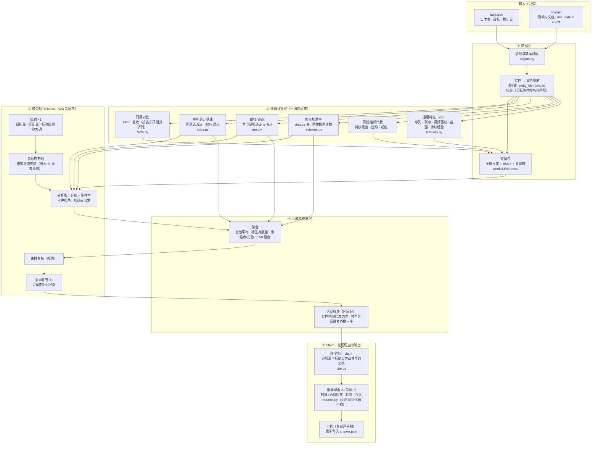
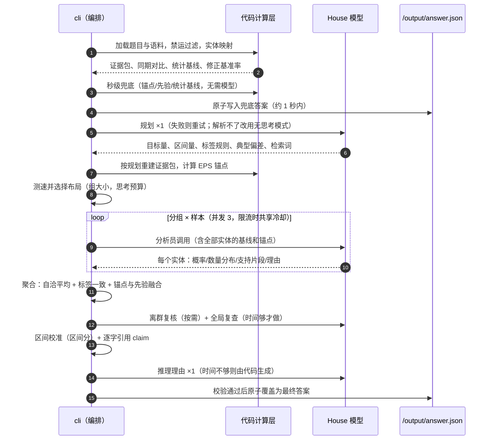

# t4agent v21.14：Agenthon 2026 Track 4（scorer 5.3.0）

## v21.14（2026-10-23）：v21.13 + 阈值与输出一致性检查

源码仍在 `agent_v21_11/` 目录，`__version__` 和 nowcast 的 `models[]` 行改为 21.14.0。代码 = 分支 `review/t4-hybrid-dc`（`dcbaa91`）：在 v21.13 上增加任务阈值与输出一致性检查，保留原预测算法和 360/290 时钟。
- 分类题的标签和点预测矛盾时，保留标签，把点挪到标签区域内最近的合法发布网格值；区间只在必须包住新点时才放宽。标签从不改。挪不进去时保留 v21.13 的原行。
- 数量类型按 `finalize` 的逐行语义识别，当前行声明的单位优先，显式阈值幅度与闭区间端点保留。
- 公开 11 单元离线：78 行里 7 行点预测变化，全在分类题（官方评分不计分类题的点）；标签、区间、claims、理由不变。

验证记录在 `sub/verification-v21_14/`；阈值检查的开发记录见 [数量与断言修复记录](../sub/verification-hybrid-dc-semantics/report.md) 和 [单位修复记录](../sub/verification-hybrid-dc-unit-fix/report.md)。

## v21.13（2026-10-21）：claim 选句、模型阶段超时保护、理由截断抢救、EPS 负号

源码仍在 `agent_v21_11/` 目录，`__version__` 和 nowcast 的 `models[]` 行改为 21.13.0。代码来自分支 `dx/t4-a1-v2113`（`5756ab9`）的 T4 部分；镜像沿用 v21.11 的时钟上限 360/290。
- **claim 选句**（`cite.py`，S8）：只引整句或整表行，按固定规则打分：提到本实体 +3，含数字 +1，只提到别的实体 −4；标题一律不引。公开 11 单元上 claims 从 312 条减到 255 条，官方 `check_claim_rules` 两版都是 0 条问题。
- **模型阶段超时保护**（`cli.py`）：
  - 模型阶段放进工作线程，主线程最多等到 LLM 截止后 20 s（不晚于硬停前 20 s），然后保留已写好的答案退出。360/290 时这一刻是 310 s。
  - 写理由之前先把模型预测落盘一份。
- **在途请求**（`llm.py`）：到 LLM 截止就放弃，原来要多等 15 s。
- **理由截断抢救**（`llm.py` `salvage_array`、`reasons.py`）：回复被 4000 token 截断时，保留已经完整的理由。
- **EPS 负号**（`facts.py`）：`-0.40` 以前会被读成 +0.40。

预测不变：公开 11 单元的点、区间和标签与 v21.11 逐字相同，离线和 fake House 两种模式都是；代码写的理由也相同。验证记录在 `sub/verification-v21_13/`，评审和预注册规则在 `sub/verification-a0/`、`sub/verification-a1/`。

## v21.11（2026-10-20）：数值目标语义守卫与 canary 过滤

规划器误报概率时，回归、排序和有数值区间腿的分类行不再被强制夹进 [0, 1]；真正的概率回归也不再被同单元其他行或日历列误判为数值。
百分号等度量单位和概率列名按完整词识别；答案构建的任务行兜底与标签不会重新带回 canary。规划器正常时，11 个公开单元的输出与 v21.10 相同。
Round 2 将 `_`/camelCase 字段按词元和日期值形状识别年月、季度、期间与 vintage，并补齐分类/兜底、`per-cent`、概率列及标识符/任务行的 canary 边界。
Round 3 恢复 T4-002 的整单元前置守卫：只有所有行的非日历朴素值都在 [0, 1] 外时，才在分析员调用前撤销概率旗标；混合单元在 `finalize` 逐行决定，日历字段按字段词元、值形状和数量字段后缀区分。F1–F7 的守卫与 H1–H4 覆盖量纲、概率列和 canary，H5 新增默认关闭、只降不升的 `T4_CAP_TIME_BUDGET` / `T4_CAP_LLM_DEADLINE`；Final 镜像在 Dockerfile 的 ENV 块里设为 360 / 290（`timeout_sec = 600` 的卡片：硬停 470→360 s，LLM 截止 400→290 s；卡片时限更短时仍按卡片）。
Round 4 要求日历字段同时具备纯日历角色名和匹配的日期形状；月份/季度词元内的数量字段保持水平值，并补齐复数、粘连名、Excel 日期序号及常见短日历形状。缺值、非有限值或仅日历行不再否决其他全在 [0, 1] 外的数值行撤旗。

## v21.10（2026-10-11）：区间要不要交成概率 [0, 1]，看题目结构，不看题面里的词

**来源**：开发分支 `dx/t4-r2-e7a01ca`（提交 `5cdb85b`、`e7a01ca`）的两处改动，另加一处限制。

**改了什么**：
- **判断依据**：不再看题面里有没有 "probability" 这个词。分类题在以下任一情况交 [0, 1]：
  - 规划器明确说是概率；
  - 题目的值 schema，或每行共同的单位，写明是概率（概率类型或单位、0/1 枚举、上下界为 0 和 1）；
  - 卡片声明了 `interval_leg = false`；
  - 每行的 `value` 列全是 0 或 1。

  其余情况，有度量单位（比率、基点、百分比、水平值等）的就交数值区间。
- **补数值**：分类题的模型回复只有标签、没有数值，或者没有回复时，用目标或实体已经对应上的序列预测补上数值，不再交 [0, 1]。
- **另加的限制**：上面这些新判断只用于分类题。回归题和排序题仍然只认规划器明确说的“是概率”，和 v21.8 一样。否则一道回归题只要每行有个碰巧全是 0 的 `value` 列，−20 基点就会被交成 0、区间 [0, 1]。

**依据**：只用公开规则，没有看任何结果，也没有看代理评审的分数。
- 官方 README：题目要数值时，点预测和区间都放在题目单位的数值上；概率区间永远盖不住美元结果。
- CONCEPTS.md：只有真值只是 0/1 标签编码的分类题，才会声明 `interval_leg = false`，只按标签计分。

**影响范围**：
- 27 道题（11 道公开题、16 道压力题）离线答案与 v21.8 逐字相同，只差版本号。
- 规划器给出任何一种标志时，判断结果都与 v21.8 相同，只有一处例外：credit-event 在规划器说“不是概率”时改判为 [0, 1]，而它的区间本来就不计分。
- v21.7 到 v21.9 的 76 次接模型实跑里，交成 [0, 1] 的只有 credit-event，没有一行缺数值。

所以这次改动防的是 Final 里没见过的题型。


## v21.8（2026-10-10）：答案行超过 3,000 字节时多做一档四舍五入

推理评审读到的逐实体答案超过 3,000 字节时，这道题的理由一律不评，推理分直接为 0。

**v14 的做法**：只允许区间放宽 1%、点预测移动 0.5% 来压缩，排序题完全不动。

**v21.8 的做法**：保留 v14 这一档，先按它压。放不下时再试第二档：
- 区间只向外取整，最多放宽 5% 宽度；
- 点预测四舍五入，最多移动 2.5% 宽度，并保持在区间内；
- 排序题也可以压，但只在所有点的先后顺序和并列关系完全不变时才压，所以排名一定不变；
- 实体太多、怎么压都放不下时（约 37 行以上，光字段名就占满上限），保持原样。

**依据**：只用公开的评分规则，没有看任何结果，也没有看代理评审的分数。
- 超过上限，推理分必定是 0；
- 推理分是只加不减的奖励，挤进上限只会让期望分不降；
- 区间放宽 5% 以内，按区间分公式，IQ 最多降约 0.25 × 5%，折到 Final 每道题最多约 0.005；
- 点预测是无偏的四舍五入，移动这么小，期望绝对误差只有二阶变化。

**影响范围**：公开单元和压力单元的答案都在上限以内，或者怎么压都放不下（51 行的 stateur），所以提交的数字都没有变化。实际受益的是大约 25 到 33 个实体、数字又较长的题，特别是以前完全不动的排序题。

## v21.7（2026-10-10）：v21.6 + 固定 Python 哈希种子

以 v21.6 为底，只加了一处构建改动：镜像设 `PYTHONHASHSEED=0`。

- **作用**：Python 每个进程会随机化集合的遍历顺序，固定后提示内容在每次运行都一样。官方复核时会换一个新的 `QFBENCH_SEED` 重跑 Final，这一项配合 v21.5 的常数种子，让重跑结果尽量一致。
- **不变的部分**：常数、能力日期界线、代码路径都和 v21.6 相同，公开单元的答案也与 v21.6 相同。
- **provenance**：样本内例外一段补了 v2 → v3（区间 ×4，v7 已去掉）；构建一节注明无 VOLUME 和哈希种子。
- **关于另外两个镜像**：工作目录里并行做过一版截止日开关，以 v14 规则作兜底，已推送为 Docker Hub 的 `21.5.0` 和 `21.6.0`。那两版已被本版的 `ArtifactPolicy` 取代，不是本源码。

## v21.6（2026-10-10）：按任务 cutoff 控制历史校准资格

统一的 `ArtifactPolicy` 覆盖统计方法与区间表、CPI nowcast、修订先验、EPS 锚点和混合权重。
数据可得日期包括拟合数据和用于决定保留方法的选择数据；具体保守门槛见
[ARTIFACT_PROVENANCE.md](ARTIFACT_PROVENANCE.md)。未知/无效 cutoff 或缺少 policy 的入口不启用历史校准。
同一 policy 同时约束预测、区间、发给模型的摘要以及由可靠性决定的预算分配；不依赖任务 ID 白名单。

不满足日期条件时，仍从当前语料提取序列，使用末值/零变化及观察步长波动计算的理论区间。
该区间不冒充经过回测的 90% 覆盖率，也不承诺预测分提升。公开日期已满足条件的任务保留原有能力。
验收证据见 [verification-v21_6](../sub/verification-v21_6/README.md)，根因和后续实验见
[T4 错题本](../error_book/README.md)。下方 v21.5 及更早章节是历史说明。

## v21.5（2026-10-09）：v21.3 + 审计确认的健壮性修复

以 v21.3 为底，只加审计和对抗复核都确认过的修复；没有新的拟合参数，不含 v21.4 的任何功能（SCHEMA、CODE_POINT、EPS_KEEPFLIP、veto）。公开单元上，除下面注明的两处兜底变化外，提交的数字与 v21.3 相同。

| 编号 | 改动（文件） | 一句话 |
|---|---|---|
| B1 | `answer.py` `task_table` / `task_claim` / `task_claim_ok`，`build_answer`、`validate`、`claim_ok` | 实体没有任何可引文档时（文档全在截止日后、或没有 text 字段），claim 改为逐字引用它自己那一行任务表（doc_id `"task"`），不再写空 claims 让整单元 0 分；`validate`/`claim_ok` 认这种引用，模型路径的答案不再因此被丢弃 |
| B2 | `cli.py` `_rows`、`emergency_row`、`emergency_answer`、`run` | 兜底阶段任何异常都会写出应急答案（分类行：现状标签，数量区间由 finalize 按任务表算出，不需要语料，什么数值都不知道时才是 [0, 1]；数值行：朴素值 + 默认半宽；claim 引任务表）；单个实体的 finalize/引用出错只影响它自己（保留它的兜底行或应急行） |
| B3 | `corpus.py` | (a) 没有字符串 `text` 字段的文档只作证据、claim 不再引用它（评分器切 claim 只读 `text`）；理由仍可引用（理由检查按空格拼接 spans 解析，`citation_rail._doc_text`）；(b) 清单标签先读根目录 manifest，再读 corpus/manifest.json（与评分器同序） |
| B4 | `llm.py` `_text`、`_completion_tokens`、`chat` | 任何发送异常都按传输错误处理；奇怪的回复形状（字符串 choices、列表 usage、分段 content）不再让模型路径崩溃，usage 单独解析，不会把可用回复判成 malformed |
| B5 | `llm.py` `HouseClient._post` | 每次请求放进守护线程，最晚在 LLM 截止 + 15 秒返回（抛 `LLMUnavailable`）；更早地，超过本次的连接 + 读超时 + 5 秒仍未返回就按超时放弃（传输错误，时间够时 `chat()` 会重试）。被放弃的请求仍计入已用次数。注意：POST 在独立线程里发出，测试替身或录放工具必须按请求内容区分调用，不能靠调用线程的 thread-local |
| B6 | `cli.py` `run` | 看门狗在硬停时刻触发（600 秒单元为 470 秒；v21.3 是 500 秒） |
| B7 | `config.py` `derive_clock`，`task.py` `card_timeout`，`llm.py` `margin`，`predict.py`/`reasons.py` 各处余量 | 时钟按单元卡片 `[agent].timeout_sec`（缺省 600）推导：硬停 = min(470, T−90)，LLM 截止 = min(400, 硬停−70)，模型路径的所有绝对余量乘以 LLM 截止/400；T=600 时与 v21.3 完全相同，T=300 时为 210/140 秒、余量 ×0.35。卡片里只读这一个值 |
| B8 | `calibrate.py` `quantity_range` | 公告窗口收益率（`event_return_sd` 已知）在没有数值量时以 0 为中心，全兜底时财报反应题的区间从 [0, 1] 变为 [−7, 7]；这些分类行同时多带一个 `point_forecast: 0.0`（v21.3 不写），对得分中性：官方对齐把缺省的分类点也读作 0.0（`qfbench2_track_analysis/alignment.py:479-485`） |
| B9 | `reasons.py` `fold`、`denied`、`build_reasons`、`_fit_list`、`_plain_fact`、`_code_reason` | (a) 禁用词按评审的折叠视图检查（NFKC、斜杠/冒号形近字、格式字符和韩文填充符）；(b) 模型理由不再要求至少一个实体有模型预测：有模型预测时只看剩余请求和时间；没有时还要求线路最近成功调用的中位往返时间在截止前放得下（慢线路上不再空等一次必然的读超时）；(c) 含义过长时在最后一个完整条目处截断并以句号结尾；(d) 兜底理由去重、整句截断、不出现内部 doc_id 和回测术语，方法名换成白话 |
| B10 | `predict.py` `_combine_with_stats`、`_baselines_rank`、`_place_uninformed` | 排序题没有模型回复的行用代码基线值（全兜底时按基线排序，即团队的 next step 6），但只在这些基线出自同一条规则时（比例变化的均值回归规则，即 CFTC 回放 0.565 的那条；或全部同一方法）；逐实体挑出的不同方法会按方法而不是证据排序（v17：方法切换两项指标都输，动量 0.479），这时保留 v21.3 的常数。从无名表读出的序列（`kind` 为 own）仍只用于区间宽度，v21.1 的规则不变；既无回复也无这类基线的行，在水平值目标上放到其他行的中位数（0 会排到最后），变化量目标仍为 0 |
| B11 | `predict.py` `_eps_units` | 收益率类目标（公告窗口收益率，或目标名含 reaction / return）不再挂 EPS 美元锚点；其他含 earnings 的目标照旧（包括没有规划、名字带下划线的 `earnings_per_share`）；11 个公开单元离线和 echo 输出逐字节不变 |
| B12 | `config.py` `SEED` | House 种子改为代码常量 0（不再读 `QFBENCH_SEED`），派生的各次调用种子与以往验证时相同 |
| B13 | `cli.py` `_parse` | 参数用 `parse_known_args`，缺省为合同路径；多余或残缺的参数不再导致 exit 2、不写答案 |
| B14 | `facts.py` `SUBLABEL_SPAN` | 子标签正则只在 400 个字符内匹配，消除长空白串上的二次回溯；公开单元输出逐字节不变 |

复核后的修复轮（四路复核的发现，2026-10-09）：

| 改动（文件） | 一句话 |
|---|---|
| `predict.py` `_late_replies` | 分析员截止时仍在途、且所在组有实体还没有任何样本的调用，等到理由闸门为止并保留回复（模型预测比模型写的理由更值钱，理由退回代码版）。卡片 300 秒时分析员截止在 98 秒，正落在一次 House 往返（18–52 秒）里，回复晚到 0.1–2 秒就被丢掉 |
| `predict.py` `run_plan` | 规划阶段的其他异常（奇怪的规划或单元形态让周边代码出错）不再丢掉整个模型阶段：记 `planner crashed`，不用规划，分析员照常运行；表格统计出错同样只记日志 |
| `task.py` `card_timeout`，`cli.py` `run` | 卡片时限是超大整数、inf/nan、负数、布尔或字符串时都按缺省时钟；推导时钟整段有保护（v21.5 初版遇到 401 位整数会 OverflowError、不写答案） |
| `answer.py` `TASK_CLAIM_CHARS` | 任务表 claim 最长 300 字符（原来整行兜底可到 600 字符，中文约 1 token/字，会超过判官 400 token 的 claim 上限而判为 malformed） |
| `reasons.py` `_plain_fact` | 剩余空间 ≤ 0 时不写事实（负数会让 `rfind` 从字符串末尾倒数，返回超长事实，机理被截在句中） |

复核提出、本版没做的三件：分析员重试同时到期时请求数可能越过给理由留的余量 1–2 次（v21.3 就有；按轮次快照计数的改法在假 House 上没消除波动，精确做法要在 `HouseClient` 的计数里加原子下限，留作单独改动）；理由预留按线路实际往返时间设定（卡片 300 秒时预留 42 秒、读超时约 37 秒，比不少正常回复短；改法会把分析员截止再提前约 11 秒，没有 A/B 过，600 秒卡片不受影响）；30 行单元的答案字节压缩（不在本版范围）。

另外：`__version__` 和 `LOCAL_MODELS` 版本为 21.5.0；删除 `submission/make_submission.py`（Final 只用 `../sub/tools/pack.py`）；`ARTIFACT_PROVENANCE.md` 补了 GH#24 样本内例外、nowcast 版本、EPS 公司数、本地测试钩子说明和 v21.5 一节。

**验证（离线，无外部调用）**：
- 测试 159 通过、7 跳过（v21.3 原有 135 通过 + 7 跳过不变；新增 24 个 `test_v215_*`，在 v21.3 上全部失败，其中修复轮加的 11 个里有 9 个在修复轮之前的构建上失败）。
- 11 个公开单元离线：`qfbench2-smoke` 全部 admissible，`check_claim_rules` 0 条、因子 1.0（判官 tokenizer 已用），`check_submitted_reasons` 0 条；echo 模拟的模型路径同样全部通过。
- 与 v21.3 相比，离线答案只在三处变化：持仓排名按基线排序，连带两条持仓理由的含义句跟着新数值变（B10，`code_implication` 本身没改）；财报反应区间 [0, 1] → [−7, 7] 并多带点 0.0（B8）；7 个单元的兜底理由机理句（B9d）。B9c 在公开单元上没有影响。claims 全部不变。
- 持仓单元的兜底理由，agent 自己日志里的驱动覆盖从 3/3 变成 2/3（未覆盖 "positioning levels and crowdedness"）：原来是内部方法名 `level_revert` 里的词干 level 碰巧匹配，B9d 把方法名换成白话后就匹配不上了，不是覆盖真的变少（真实评审的影响没测，需要外部模型）。
- 39 个压力变体：v21.3 有 5 个整单元不受理（v10/v11/v25/v29/v33），v21.5 全部受理且因子 1.0；v19 因子 0.9 → 1.0（B3b），v20 因子 0.0 → 1.0（B3a），v20 的 2 条理由仍会被评审。余下 v18/v27/v39 是组织方故障形态，v28 是已知的答案字节上限问题（30 行单元的逐实体答案超过评审 3,000 字节上限，理由不被评审；压缩不在本版范围），两版相同。
- 时钟（进程内假 House）：卡片 300 秒的单元，正常延迟下 128–135 秒定稿、全部实体来自模型；每次 45–52 秒的慢延迟下，修复轮之前 credit/macrorev 有 0/8、6/12 的情况，修复轮后 6 次全部覆盖。卡片 600 秒、正常延迟下答案与修复轮之前逐字段相同。600 秒下规划请求卡死时，约 185 秒放弃并重试，8/8 来自模型（修复轮之前 415 秒放弃、0/8）。

---


> **一句话**：代码把能算的全部先算好（同期对比、统计锚点、基准率、波动尺度），House 模型只做有边界的判断；规划先读原文，凭记忆写出的数字和截止日后的事件进不了分析员的提示（v8）；区间按"区间分"（宽度 + 20 × 漏出距离）校准到真实的 90%，实测过的自身尺度不再被模型区间撑宽（v8）；由水平推导目标时按目标的单位换算，收益率水平（百分数）推出的变化以 bp 提交（v9）；推理理由按任务说明列出的驱动因素规划覆盖，含义由代码核对与答案一致（v10）；标签与提交区间出自同一个分布（v11）；统计基线按任务对目标的定义计算，理由须声明论证方向并点名所引材料的出处（v12）；用公开语料改造成没见过的题型做压力测试，修掉暴露的通用缺陷：档位标签按任务自己的数值定义读取、修正基准率剔除年度/基准更新、离谱量级的第二意见不采用、理由被拦下时补写（v13）；只读绝对数值阈值、规则失败时换下一个来源、负值序列修正方向、为评审上限压缩数字时绝不改变预测（v14）；区间尺度用 2021 年底前公开的美国政府数据校准（v15）；校准目标改为评分器自己的区间分（按尺度加权的分位数），不再按覆盖率（v16）；统计基线的方法按 2022 年前公开数据上的回放选择：增长率类用自适应 AR(1) 回归、变化量更难离开"不变"、持仓变化向自身均值回归（v17）；EPS 锚点按 2022 年前 SEC 财报校准：隔季不再延续、区间放宽、方向标签加入校准过的涨跌概率（v18）；持仓这类比例变化的回归幅度随期限增长，明显的趋势在强证据下会被跟随，方法回放按日期对齐、首发值按当时可得的实时数据回放（v19）；CPI 汽油、能源、总 CPI 用语料里的周度油价直推（2022 年前数据拟合的季节差），EPS 锚点按同股本口径的样本重新校准（v20）；请求按用途重新分配：去掉全局复查，有可靠代码基线的回归题少采样，分类题对分歧标签追加单独投票，省下的请求给理由多轮补写，JSON 先在代码里恢复（v21）；每条 claim 都是被引段落的逐字原文，不会被判为假；最后由模型写 1–3 条推理理由（`submitted_reasons`），供 Final 的推理评审加分。

---

## 目录

0. [一页总结](#0-一页总结)
1. [比赛与评分：我们在优化什么](#1-比赛与评分我们在优化什么)
2. [设计依据：从结果和实验中学到的](#2-设计依据从结果和实验中学到的)
3. [架构总览](#3-架构总览)
4. [端到端流程（一个单元的生命周期）](#4-端到端流程一个单元的生命周期)
5. [代码计算层：模型不用再算的东西](#5-代码计算层模型不用再算的东西)
6. [模型层：怎么花好 25 次请求](#6-模型层怎么花好-25-次请求)
7. [区间校准：区间分](#7-区间校准区间分)
8. [Claim 与推理理由](#8-claim-与推理理由)
9. [合规与安全](#9-合规与安全)
10. [验证与成绩](#10-验证与成绩)
11. [版本演进 v1 → v21](#11-版本演进-v1--v21)
12. [目录结构与常用命令](#12-目录结构与常用命令)
13. [已知局限与下一步](#13-已知局限与下一步)

---

## 0. 一页总结

**任务**：每个评测"单元"给一张实体表（公司、国债期限、CPI 分项、宏观序列……），加一个冻结的证据语料（文档日期都不晚于截止日），以及要预测的目标。目标分三类：分类（如 EPS 同比涨/跌、是否发生信用事件）、回归（如 EPS 增速、拍卖认购倍数、收益率变化）、排序（如持仓变化排名）。提交物是一个 Docker 镜像：读 `/input/task.json` 和 `/input/corpus/`，写 `/output/answer.json`。答案包含每个实体的标签、点预测、90% 区间，以及引用。

**约束**：
- 模型只能用官方托管的 House 模型（Nemotron-3-Super-120B-A12B，FP8，NVIDIA NIM 部署）。
- 每个单元最多 25 次请求，每次最多 4,000 个输出 token（思考过程也算在内），输入 token 不限。
- 每个单元 600 秒，无外网。
- 只能使用冻结语料作为证据。

**我们的方案（v12）分六层**：
1. **证据层**：只读清单内、截止日前的文档；把实体映射到它自己的文档；用 BM25 和金融关键句挑出证据片段。
2. **代码计算层**（v3–v6 的核心）：
   - 同期对比：从财报自带的表格里读 EPS 和营收，按表头日期对齐列。
   - EPS 统计锚点：季节随机游走。
   - 宏观修正基准率：来自 vintage 表。
   - 序列统计基线：在实体自己的历史上回测选方法。
   - 波动尺度。
   - 这些全由代码算好，直接写进提示里。
3. **模型层**：1 次规划，然后分组调用分析员（多样本、多视角）。代码根据线路实测速度，自动选"每组几个实体、思考预算多少"。最后用 1 次全局复查，只纠正明显矛盾。
   - v8：规划先读原文（小语料全文；大语料为每个实体由代码算好的事实和关键段落）。规划里的驱动因素、标签线索如果写了任务和语料里都没有的数字，或者提到截止日之后的日期，由代码直接删掉；剩下的在分析员提示里标为"未核实的提示，与原文冲突时以原文为准"。
   - v9：规划要求"先预测水平、再由水平和实体表的基数推出目标"时，代码按目标单位换算（水平是百分数、目标是 bp 时乘以 100）；两边单位对不上就不用这条规则，分析员直接预测目标。
4. **合成与校准层**：
   - 模型和代码锚点按 50/50 合成；实体没有自身历史可回测时，与朴素规则（零变化或沿用最新值）50/50 合成（v8），模型预测不会不经收缩就提交。
   - 标签概率与数量预测保持一致。
   - 离群值会触发二次复核。
   - 区间按区间分校准（v8）：自身尺度若是在实体历史上实测的（≥4 个回测起点的误差分位数，或 vintage 表的修正幅度），直接使用，不受模型区间影响；若只是外推或规则估计（短历史的随机游走外推、EPS 锚点的规则），模型区间更宽时取两者的几何平均；没有自身尺度时才把模型区间加宽 2 倍。
5. **Claim 层**：每个实体 2–4 条 claim，全部是被引段落的逐字原文，而且只引用清单标给该实体（或标为共享）的文档。按官方 5.2.2 规则，逐字引用一定通过数字核对，也不会送去判官。
6. **推理理由层**（v7 新增，v10 重写）：预测定稿后再调用 1 次模型，写 3 条 `submitted_reasons`（前提 = 语料原文，机制，对答案的含义）。v10 先从任务说明里拆出它要求的驱动因素，每条理由负责 1–3 个，前提引用第一个驱动的原文、其余驱动各附一段引文，三条合起来覆盖全部驱动；含义里的数值、标签和方向词由代码对照提交的答案检查，不一致就改用由答案生成的含义。没有时间就由代码按同样的驱动生成。逐条按官方的格式、上限和禁用词检查，不合格的直接丢掉。

**当前状态**：
- 115 个离线测试通过，其中包括用官方代码（`citation_rail.check_claim_rules`、`check_submitted_reasons`、smoke 门）检查全部 11 个公开单元：假 claim 0 条，忠实性系数 1.0，推理理由全部会被评审。
- 有模型的实测结果见第 10 节。
- 历史 Dev 成绩：v2 为 0.1277，但那是旧评分器 3.1.0 下的分数，与现在的榜单不可比。

---

## 1. 比赛与评分：我们在优化什么

### 1.1 每个单元的得分（评分器 5.2.2，Dev 自 2026-09-30 起使用，也是 Final 的规则）

```
analysis  = 忠实性系数 × (0.7 × 预测分 + 0.3 × 区间分)      （没有区间腿的单元：analysis = 预测分）
榜单分    = −0.27 + 1.27 × 所有单元 analysis 的平均           （范围 −0.27 ~ 1.0）
Final     = 榜单分 + 0.25 × 推理分（只在 Final 的保密单元上评）
失败（格式错、超时、清单外文档等） = analysis 0，即榜单上的 −0.27，并且仍计入分母
```

| 目标类型 | 预测分的定义（都以该单元保密的"朴素规则"为锚） | 要点 |
|---|---|---|
| 分类 | 准确率线性映射：0 → 0，朴素规则的准确率 → 0.5，全对 → 1 | 只有比朴素规则准才能超过 0.5 |
| 回归 | 朴素MAE / (朴素MAE + 我们的MAE) | 与朴素规则一样准 = 0.5；更准才 > 0.5 |
| 排序 | Spearman 换算到 [0, 1] 后同样以朴素规则（或常数预测的 0.5）为锚 | 常数预测 = 0.5 |

**区间分**：每个实体的区间分 = 宽度 + 20 × 真值落在区间外的距离（90% 区间的标准 interval score），取单元平均，再与朴素规则的区间比：`朴素 / (朴素 + 我们)`，相同为 0.5。并且区间分不能超过 max(0.5, 预测分)：点预测不比朴素规则好，区间再窄也拿不到 0.5 以上。**宽度和漏覆盖都要付钱**，最优就是真实的 5%/95% 分位数。信用事件这类卡片声明 `interval_leg = false` 的分类单元没有区间腿。

一个直观的刻度：所有单元都照抄朴素规则，analysis ≈ 0.5，榜单分 ≈ 0.365。

### 1.2 忠实性：逐条 claim 扣分

- 每条 claim 要么"假"，要么"中性"。单元的 analysis 乘以 `1 − F / (F + min(T, 3E))`（F = 假 claim 数，T = 其他 claim 数，E = 实体数）。没有假 claim 就不扣分。
- 判为假的情况：引用了清单没标给该实体（也没标共享）的文档；偏移越界；超过 4,000 字符或 400 个判官 token；**claim 里有任何数字不在所引段落里**；所引段落超过 8,000 字符；空洞套话（"Evidence selected for the prediction."）；带了已废弃的 `citations` 列表；在 Final 中还会被 NLI 判官判"矛盾"（概率 > 0.9）。
- **逐字引用的例外**：claim 如果就是所引段落的一部分原文，数字核对整体通过，也不送判官。v7 正是利用这一点：所有 claim 都是逐字原文。

### 1.3 资源与规则

| 项目 | 约束 |
|---|---|
| 模型 | 只能用 House 模型（`MODEL_ENDPOINT/v1/chat/completions`），不能自带模型或适配器 |
| 请求 | 每单元 25 次"已准入"请求；重试也算；不能一次要多个候选 |
| 输出 | 每次 ≤ 4,000 token（含思考）；输入不限 |
| 时间 | 每单元 600 秒，包含容器创建 |
| 网络 | 只允许经审计代理访问 House；供应商侧工具（联网搜索、代码执行、检索）必须关闭 |
| 数据 | 推理时只能用题目和冻结语料；离线拟合或调参用到的标签必须早于截止日 |

---

## 2. 设计依据：从结果和实验中学到的

### 2.1 v2 的 Dev 成绩拆解（0.1277，旧评分器 3.1.0）

| 单元 | 得分 | 诊断 |
|---|---|---|
| FOMC 2022-07 | −0.27 | Q=0，覆盖 0/6：一次共同的利率变动让所有期限都落到"90%"区间外 |
| FOMC 2024-09 | −0.22 | Q=0，覆盖 1/6，原因同上 |
| 拍卖 / CPI / 银行 EPS 增速 | −0.03 / −0.03 / −0.01 | 回归技能为 0（基线拿到了真值均值） |
| 信用事件 / eps 同比 / 宏观修正 / 财报反应 / 持仓排序 | 0.41 / 0.33 / 0.35 / 0.40 / 0.35 | 接近抛硬币，或者排序没有信息量 |

**当时的结论**：最便宜、最确定的提升是覆盖率，这催生了 v3 的"覆盖优先"（区间 ×4）。**在 5.2.2 下这条结论已经失效**：区间分对宽度收费，×4 会让区间分远低于朴素规则，所以 v7 去掉了它（见第 7 节）。

### 2.2 Claude 与 Nemotron 的推理对比实验

用完全相同的提示和证据做了对比，只评推理过程，不按真实结果打分。Nemotron 的错误**主要是系统性的**：

- **跨期比较**：拿 IBM 2023 年 Q1 的 EPS（1.02）去比上年 Q2（1.53），得出"下降"。而财报原文写着同季度同比 **+39.7%**。
- **说了要算却没算**：CPI 汽油项。它自己写了"需要考虑季节调整"，然后直接把未季调的油价变化（−2.4%）当季调值用。
- **忽视基准率**：大型股财报日的波动通常有好几个百分点，它却给出 ±2.5% 的区间，然后选了"flat"（波动不超过 ±1%）。它自己算出 P(flat)=0.41，最后却写了 0.55–0.60。
- **一次性项目**：把含一次性收益的季度（JPM 的 Visa 换股收益）当成常态去外推。
- 4,000 token 上限下思考常被截断，修复步骤再从半截笔记里抠数字，于是出现了 GS 增速 +118.6% 这类离谱值。

**结论**：
- 多抽样只能抵消随机错误，抵消不了系统性错误。
- 更有效的办法是让**代码先算好**同期对比、锚点、基准率，再让模型在这个基础上做有边界的判断。
- 这就是 v4 和 v5 的架构原则：**代码算，模型判**。

### 2.3 运行层面

- 共享线路（OpenRouter、NVIDIA 公共 API）有限流（429）和过载（503），而且延迟波动大：同样的调用，耗时从 39 秒到 167 秒不等。
- House 线路的速度和并发规格没有公布，所以调度必须**自适应**、**耐限流**。

---

## 3. 架构总览



**模块对照**

| 模块 | 职责 |
|---|---|
| `t4agent/cli.py` | 入口与编排：先写兜底答案，再规划 → 分析 → 聚合 → 校准 → 引用 → 校验 → 原子写入；看门狗计时 |
| `t4agent/task.py` | 读题和评分卡；目标规格；复刻评分器的假设句 |
| `t4agent/corpus.py` | 只读清单内文档，严格保证 `doc_date ≤ cutoff`；按偏移精确切块；读清单的实体标签，决定实体可以引用哪些文档 |
| `t4agent/retrieval.py` | BM25；金融关键句线索 |
| `t4agent/tables.py` | 竖线表格解析；逐列统计（给提示用） |
| `t4agent/facts.py` | 关键事实片段；风险指标计数；**同期对比**（EPS、营收）的结构化抽取 |
| `t4agent/stats.py` | 实体自身序列上的回测统计基线 |
| `t4agent/eps.py` | EPS 季节随机游走锚点 |
| `t4agent/revisions.py` | 宏观数据修正方向的基准率 |
| `t4agent/features.py` | v6：序列特征、同伴联动、高频驱动与季调差距、截面排名、持续经营三态判定 |
| `t4agent/labels.py` | 阈值型标签规则的安全求值；由数量分布推出标签概率；方向型默认规则 |
| `t4agent/llm.py` | House 客户端：请求预算、重试、共享冷却、测速、JSON 模式、`reasoning_budget` |
| `t4agent/prompts.py` | 规划、分析员、修复、复核、全局复查的提示 |
| `t4agent/predict.py` | 证据包；规划；锚点；自适应布局；分组调度；聚合；离群复核；全局复查；兜底 |
| `t4agent/calibrate.py` | 标签选择、点预测、按区间分校准区间、精度与取整 |
| `t4agent/cite.py` | 逐字引用的 claim（只引允许的文档，避开空洞片段） |
| `t4agent/reasons.py` | v7：`submitted_reasons` 的候选前提、模型撰写、代码兜底、格式/上限/禁用词检查 |
| `t4agent/answer.py` | 组装答案；复刻评分器的校验（含 claim 逐字检查）；原子写入 |
| `t4agent/grounding.py` | v8：规划内容的落地检查（数字必须出现在任务、实体表或语料里；不得出现截止日后的日期） |

---

## 4. 端到端流程（一个单元的生命周期）



**时间与请求预算（生产设置）**

| 阶段 | 时间 | 请求 |
|---|---|---|
| 启动、兜底答案 | 约 1 秒 | 0 |
| 规划 | 约 30–60 秒（视线路速度） | 1 次（最多 4 次尝试，必要时再加 1 次无思考重试） |
| 分析员 | 到"LLM 截止 − 160 秒 − 25 秒"为止 | 剩余请求减去 4 次保留 |
| 离群复核、JSON 修复 | 按需 | 保留的 2 次 |
| 全局复查 | 约 30 秒 | 保留的 1 次 |
| 推理理由 | 约 20–40 秒 | 保留的 1 次 |
| 校准、引用、写入 | 几秒 | 0 |
| **合计** | LLM 截止 400 秒，答案 470 秒内定稿（上限 600 秒） | ≤ 23 次（上限 25） |

**容错**：
- 任何一步失败都不会让单元出错。兜底答案在 1 秒内就已落盘。
- 看门狗在 470 秒强制退出（v21.5；v21.3 为 500 秒），此时盘上一定已有合法答案。
- 最终答案必须先通过自检（复刻评分器）才会覆盖兜底答案。

---

## 5. 代码计算层：模型不用再算的东西

这一层**不消耗任何请求**，结果写进提示里，同时也参与最终的数值合成。

### 5.1 同期对比（`facts.py`）

问题：模型常拿不同的季度相互比较。解决办法：从**财报自己的表格**里读数，按**表头日期**对齐列，然后明确写出"本期 vs 上年同期"。

- 识别多种 EPS 行写法："Diluted EPS"、"Earnings per share – diluted"、"Assuming dilution: Continuing operations"、"Basic $… Diluted $…"、带脚注编号和子标签的行等。
- 只接受**表格形态**的连续数字，避免把"…$8.62 for the second quarter of 2024…"这类句子里的年份当成数值。
- 列对齐兼容这些情况：
  - 上年在前的倒序列（Amazon）；
  - 季度趋势表（Wells Fargo 的"本季、上季、上年同季"）；
  - 每类股一列（Meta 的 A/B 股，数值相同则合并）；
  - 52/53 周财年（上年同期的月份允许相差 ±1）；
  - 只有年份的表头：只接受标准布局，否则跳过。
- **对齐有歧义就什么都不输出**：错误的"计算事实"比没有更糟。
- 10-Q 有年初至今列时，顺便推出本财年前几个季度的合计（例如 GS 上半年 20.21 减 Q2 8.62，得 Q1 ≈ 11.59）。
- v5 增加了**营收**的同期对比。净利润行容易误抓到"终止经营"或"少数股东"行，调研时出过错，所以没有加入。
- 在 28 份公开财报上逐一核对：EPS 27/28 正确（剩下 1 份是没有表格的摘录，自动跳过）；营收在能识别的 13 份上全部正确。

提示中的样子：

```
LIKE-FOR-LIKE (computed by code from the row 'Assuming dilution: Continuing operations' in EDGAR_…_10Q_20230425,
a 10-Q for the period ending 2023-03): quarter ending 2023-03: 1.02 vs 0.73 in the same quarter a year earlier (+39.7%).
These are reported periods; compare the target period with the same period a year earlier, never with a different quarter.
```

### 5.2 EPS 统计锚点（`eps.py`）

季节随机游走，并部分延续最新的同比变化（Foster 1977；Brown & Rozeff 1979）：

```
E[EPS_t] = EPS_{t−4} + φ^k · (EPS_{t−k} − EPS_{t−k−4})        φ = 0.4（文献值，不拟合）
```

- `EPS_{t−4}`：目标季度的上年同期值，来自实体表，例如 `prior_year_q_eps`。
- `EPS_{t−k}` 和 `EPS_{t−k−4}`：最新已报告季度及其上年同期，来自 5.1 的结构化记录；k 为距目标的季度数（1–3）。
- 误差尺度：sd = max(0.25 × max(|锚点|, |基数|), 0.5 × |最新同比变化| × φ^(k−1), 0.02)。
- 目标单位按规划判断：EPS 水平、相对基数的百分比变化，或绝对差。
- 用法：
  - **回归**：作为该实体的统计基线，与模型 50/50 合成，并作为区间下限。
  - **分类**：先把模型给出的 EPS 数量与锚点 50/50 合成，再从合成后的分布推出标签。如果规划没给标签规则，而标签是"涨/跌"这类方向型，代码自动生成"高于基数 = 涨"的规则。
- 例子：GS 的锚点为 5.47 + 0.4 × (8.62 − 3.08) = **7.69（+40.5%）**；IBM 为 1.53 + 0.4 × (1.02 − 0.73) = **1.65（涨）**。

### 5.3 宏观修正基准率（`revisions.py`）

用于"下一次公布的估计值会上修还是下修"这类方向型分类。

- 解析 vintage 表：每一行是一个参考期，每一列是一个发布日的数值。
- 目标所处的"阶段" = 截至最新 vintage，该参考期已经发布过几次估计。
- "步数" = 从最新 vintage 到解析发布日之间隔了几次发布。
  - 发布节奏取表中相邻发布日间隔的中位数。
  - 例如非农 8 月数据在 11 月 1 日解析，相隔 2 步。
- 历史类比：取其他参考期在**同阶段、同步数**下的修正方向，统计上修和下修的频数。
- **只计历史完整可见的参考期**：如果某期第一个可见值出现在表格第一列，且距期末的天数明显长于常规首发滞后，说明更早的估计看不到，这一期就不计入。
- 平滑：
  - 全阶段频率先用 Beta(2,2) 向 0.5 收缩；
  - 同阶段频率再以强度 2 向全阶段频率收缩。
- 与模型的标签概率 50/50 合成；模型没有回复时，单独使用。
- 例子：非农在 2024 年的每一次修正都是下修，所以同阶段下修的概率很高。

### 5.4 序列统计基线（`stats.py`）

适用于实体在语料表格里有自己的历史序列的情况，例如拍卖认购倍数、CPI 分项、持仓。

- **下一期取值类**目标：在序列上一步一步回测几种方法，取 MAE 最小的：上期值、近 3/6 期均值、近 6 期中位数、指数平滑、漂移。
- **区间变化类**目标：方法换成零变化、漂移、动量、反转，在目标时间跨度上回测；历史太短时，用随机游走给出尺度。
- **简约规则**：除非另一种方法回测好 ≥10%，**且**回测起点 ≥8 个，否则保留默认方法。
  - 序列本身就是变化率（环比 %、收益率）时，默认用**近 6 期中位数**，而不是上期值，因为随机游走水平的增量近似独立。
- 输出：基线预测值，以及 90% 回测误差（带小样本放大），后者用作区间下限。
- **v12：比例列按任务定义计算变化**。表头是"X 占 Y 的比例"（如 `net_%OI`、`net % of OI`）而目标是一段时间内的变化时，在同一张表里找分子列和分母列，用表格自己的数据核对"比例 = 分子 / 分母 ×100（或 ×1）"逐行成立，再按（分子[t+h] − 分子[t]）/ 分母[t] 计算变化，回测、方法选择、点预测和区间都用这个量；核对不通过就不用这一列。v11 直接对打印出来的比例求差：未平仓量变动时两者不同，持仓单元的历史里有 15 个窗口方向相反（黄金 2024-06-18→07-23：按任务定义 +6.75，求差得 −7.00）。
- **v12：增长率列预测下一期值**。增长率目标配上本身就是增长率或变化率的列（列名带 growth、change、yoy、m/m、return），直接预测它的下一期值；v11 仍对它求差（增长率一直 10%，预测成 0%）。单纯带 % 的占比列不算变化率。
- **v12：区间尺度用同一条序列**。表格尺度（`series_half_width`）改为在统计基线所用的同一条序列上计算，单位保护随之一致；v11 的表格尺度自己选列，增长率目标会读到 EPS 美元（金额乘 10，区间放大 √10 倍）。
- **v11：相对变化目标不用水平列**。增长率、百分比变化这类目标，只匹配本身就是变化率的列（列名带 growth、change、%、yoy 等）；v10 会把名为 "EPS" 的水平列当作增长率目标的序列，按美元求差值（同一历史乘 10，"增长率"也乘 10）。EPS 增速由 EPS 锚点按规划的百分比变化规则处理。

### 5.5 风险指标与关键事实

- **风险计数**：统计实体自己的文件里"持续经营/重大疑虑、契约豁免、违约、破产/重组、退市、净亏损、减值"等短语出现的次数。这只是特征，不下结论。
- **关键事实片段**：每股收益、净利润、营收、指引、困境与流动性相关句子，排在证据最前面，不会被预算截掉。

### 5.6 通用特征（v6，`features.py`）

v6 把剩下几类原本要模型自己算的东西也交给代码，全部写进提示，不占请求。任何一项算不明确就不输出。

| 特征 | 内容 | 例子 |
|---|---|---|
| **序列特征**（SERIES FEATURES） | 实体自身序列的最新值；较上期、3 期前、12 期前的变化；最新值在自身历史中的百分位和 z 值；月度数据满两年时，往年同一日历月的平均变化 | 欧元持仓净头寸处于 26 周历史的第 0 百分位（z −2.0），是极端值 |
| **同伴联动**（CO-MOVEMENT） | 与同一张表里**其他实体的序列**之间的斜率和相关系数；只报告最强的一条，且要求 \|相关\| ≥ 0.85，因为期数少时较弱的相关多是偶然 | 能源每变动 1 点，约随汽油变动 **0.50** 点（相关 0.97） |
| **高频驱动**（DRIVER） | 语料里与实体同名的周度或日度序列，按目标月取平均，给出未季调的环比；同时列出重叠月份里"公布的季调变化减驱动变化"的逐月差距，提醒先估计目标月的季节效应 | 10 月汽油零售价均值较 9 月 −2.4%；2 至 9 月的差距依次为 −0.7、−4.9、−2.6、−3.4、+0.3、−0.8、+2.1、+1.1 |
| **截面排名**（CROSS-SECTION） | 实体表中每个数值列上的名次和中位数；各行单位不一致时跳过（比如不同宏观序列） | GS 的上年同季 EPS 5.47，在 8 家银行中排第 1 |
| **持续经营**（GOING CONCERN） | 读实体自己的文件，区分三种状态：管理层**得出**重大疑虑的结论；疑虑曾被提出、管理层称其计划**可以消除**；只有**程序性或条件性**措辞 | BBBY：已得出结论；WeWork：曾提出、称可消除；其余公司：无 |

配套修正：表格解析器以前只识别至少有两个 `|` 的行，所以"日期 \| 数值"这种两列表格（如周度油价）对整条流水线都不可见。现在也能识别。

### 5.7 秒级兜底

启动后约 1 秒内，代码就用锚点、先验和统计基线写出一份**合法且有信息量**的答案，不调用模型。之后即使模型线路完全不可用，或进程被强制结束，盘上留下的也是代码预测，而不是粗糙的规则值。

---

## 6. 模型层：怎么花好 25 次请求

### 6.1 原则

- **加样本收益有限**：25 次是硬上限；自洽投票的收益在 5 个样本左右以后很小，而且投票消除不了系统性错误。v10 把每组上限从 5 提到 9：队列先跑完每组的第一个样本，离分析截止还有 25 秒就不再发新请求，所以上限提高只会用掉小单元原本闲置的预算（v9 的 6 实体单元只用了 23 次中的 8 次），不会挤占复查和理由。
- **工具调用太贵**：模型会调用工具，但一次只算一步。每一个来回都要再占一次请求，算一家银行的锚点大约要 4 个来回。所以选择**预计算**，0 额外请求。
- **思考预算和回复共用 4,000 token**：回复越短，留给思考的空间越大。
- 把请求花在不同的工作上：规划 → 分组分析 → 全局复查。

### 6.2 规划（1 次）

规划输出这些结构化字段：
- 目标量（含单位）；
- 区间要放在哪个量上；
- 天真基线与基线列；
- 时间跨度内的典型偏差；
- 精度；
- 是否"由水平推导目标"（例如由 EPS 水平和上年值推出增速）；换算到目标单位由代码负责（v9，见 6.6）；
- 关键驱动因素；
- 检索词；
- 各标签的线索词；
- **标签规则**：用 `Q > 表格列…`、`otherwise` 这种可安全求值的形式写出。

容错：
- 最多尝试 4 次；
- 如果回复截断、解析不了，再用"关闭思考"的模式重试一次；
- 规划彻底失败时，后续步骤自动降级，不会中断。

**规划落地到原文（v8，`grounding.py`）**。v7 的规划只看到任务、实体表、表格统计和文档目录，看不到正文，于是会凭记忆补事实，而这些话会原样进入每一次分析员调用。实测出过两类问题：
- 与原文矛盾：FOMC 2024-09 单元里写"维持 5.25–5.50% 区间"，而语料里的声明写的是降息 50 个基点到 4-3/4 至 5 厘；
- 截止日之后的事件：持仓单元（截止 2024-10-31）的驱动因素写了"2024-11-05 美国大选的结果"。

v8 的做法：
1. 规划先读原文：小语料（≤ 36,000 字符）给全文；大语料给每个实体由代码算好的事实（同期对比、持续经营判断等）和前 4 段关键段落，上限 40,000 字符；
2. 规划提示写明：记忆里的事实可能与本任务不符，计划里不得出现凭记忆写的数字、水平、决定或结果；
3. 代码检查（不调用模型）：驱动因素、标签线索、朴素基线说明里，只要有一个数字在任务、实体表和语料里都找不到，或者出现截止日之后的日期，就整条删掉，并写进日志。截止日之后的日期只有一种情况保留：语料里写明了这个日期（已排期的会议、选举日），而且这条内容没有谈事件的结果（outcome、result、won、after the 等）。各种 Unicode 连字符先统一成 ASCII 再识别日期；
4. 分析员、复核、全局复查提示里，规划的内容标为"PLANNER NOTES：读证据之前写的提示，不是事实；与原文冲突时以原文为准"。

### 6.3 自适应调用布局（v5）

规划结束后，客户端用成功调用实测出线路速度（输出 token/秒）。然后在下表中按从深到浅的顺序，选**第一个能保证每组至少 2 个样本**的布局：

| 布局 | 每组实体数 | 思考预算 |
|---|---|---|
| 最深 | 3 | 2,800 |
| | 4 | 2,400 |
| | 6 | 2,000 |
| 最广 | 8 | 1,500 |

判定公式：

```
单次耗时 ≈ 1.25 × (思考预算 + 230 × 组内实体数 + 200) / 实测速度
可用调用数 = 并发数(3) × 剩余窗口 / 单次耗时   ≥   2 × 组数
```

- 线路快：小组、深思考。线路慢：大组、浅思考，保证每个实体都有模型回复。
- 每次调用的思考预算还受 `3,800 − 230 × 组内实体数` 约束，确保回复不会被截断。
- 共享语料的小单元（如 FOMC 期限结构），以及 ≤ 8 个实体的排序单元，整组一起问，因为它们本来就是截面上的相对判断。

实测（NVIDIA 公共 API，生产时钟）：

| 单元 | 线路速度 | 选中的布局 | 结果 |
|---|---|---|---|
| eps 同比 | 13 tok/s | 一组 6 个，思考 1,500 | 每个实体 3 个样本 |
| 宏观修正 | 29 tok/s | 每组 6 个，思考 2,000 | **12/12 实体，每个 4–5 个样本**（固定布局时只有 3/12） |

### 6.4 分析员提示

每次调用都包含：
- 题目原文与规划要点；
- 完整实体表；
- 语料表格的统计摘要；
- **全部实体**的统计基线、锚点和先验（输入不限量，小组也能看到整个截面）；
- 本组实体的证据片段：关键事实和同期对比排在最前；
- 输出格式。

协议（写在系统提示里）：
1. **基线**：先写出代码给的统计基线或锚点的数值，从它出发；任何偏离都要说明是哪条证据、偏离多少。
2. **证据**：挑 2–4 条最关键的事实，写明方向和大致幅度。
3. **预测**：证据支持到哪里，就只移动到哪里；复核算术和期间。
4. **不确定性**：按回测误差或历史波动确定 5%–95% 区间。语料里没有历史时，用同类事件的典型幅度；"没有方向判断"不等于"幅度小"。
5. **由阈值定义的标签**：从自己的数量分布推出概率。"中间"类标签（inline、flat、unchanged）只有在同类结果通常落在该区间内时才可能最大。

另有专门的规则：
- 期间与季节性要对齐；
- 季调目标不能直接搬用未季调的驱动变化；
- 基期和锚定期都要剔除一次性项目；
- 增速类目标先预测水平，再推出增速；
- 只引用本实体的片段。

**多视角抽样**：样本轮流使用 4 种框架，目的是让样本之间的误差不那么相关：
- 中性；
- 基准率优先；
- 证据优先；
- 自我质疑。

### 6.5 截断处理与修复

- 一次回复撞到 4,000 上限后，后续调用的思考预算降为 0.75 倍（最低 0.5 倍）。
- **修复**：用"关闭思考"的单次调用，把截断的笔记整理成 JSON。修复提示里写明完整的输出格式，并附上**各实体自己的表格行**。笔记里没有覆盖到的实体直接省略，**绝不把一个实体的数字挪给另一个**。
- 截断且修复失败时，把这一组拆成两半重新排队。
- 解析得出、但没有一个可用预测的回复，按失败处理。

### 6.6 聚合

- **自洽平均**：分类平均各样本的标签概率；数量取各样本中位数的中位数。
- **标签与数量一致**（v11 重写）：
  1. 先按第 7 节算出这一行将要提交的区间（`calibrate.quantity_range`，与最终答案同一个函数、同一组输入），再由规划的标签规则（或实体表的条件列、方向型默认规则）在这个分布上推出各标签的隐含概率。分布取中位数两侧各一个半正态、各占一半质量，所以点预测就是中位数，区间端点就是 5%/95% 分位数。
  2. 与模型自己给的概率（单独保存，不含任何合成）按 0.75 : 0.25 合成，再与修正基准率合成。
  3. 提交的区间整个落在某个标签的区域内（该标签概率 ≥ 0.95）时，标签就是它。
  4. 全局复查之后重新做一遍（v10 的复查直接从混合后的概率重选标签，绕过了这一步）。
  5. 尺度保护：如果阈值离中位数超过 50 个标准差，说明规则和数量不在一个尺度上，忽略该规则。
  - v10 的问题：标签读的是"模型区间 ×2"，提交的区间用的是实体自身尺度或几何平均；而且把给定的中位数当成"两段正态"的众数，各侧质量按尺度比例分，导致中位数向窄的一侧偏移（中位数 0、p05 −1、p95 9 时算出 P(Q>1)=0.77）。用 IBM 的公开实体可以构造出：提交 2.0（上年 1.53）、区间 [1.0, 2.7]、标签却是 down。v10 实测中每轮约 22 个分类实体里有 1–4 个标签与自己的点预测不一致。
- **代码锚点与先验**：
  - 回归、排序与统计基线 50/50 合成；
  - 分类的数量与 EPS 锚点 50/50 合成；
  - 分类的概率与修正基准率 50/50 合成。
- **由水平推导目标的单位换算**（v9）：规划给出 `target_from_level` 时，分析员报的是水平，代码用公式（`pct_change` 得百分比，`difference` 得水平单位的差）推出目标，再乘以单位系数。目标单位先从任务自己的目标名和实体表的 unit 列读（`bps` 或 `pct`），任务没写才看规划对目标的描述；水平单位从基数列名和规划写的水平说明读。百分数水平对 bp 目标乘以 100，反过来乘以 0.01，单位相同乘以 1；水平本身是百分数时不接受 `pct_change`（v11：收益率的变化只能是差值，v9/v10 会把 2.85%→3.05% 算成 702 bp）；目标有单位而水平单位说不清（例如百分比目标对美元或合约数的水平）时，这条规则不用。v8 及更早版本没有这一步：FOMC 2022 的一次实测里，规划让分析员报收益率水平（如 3.05% 对基数 2.85%），代码把 0.2 个百分点当作 0.2 bp，收缩后六个期限全部提交 0 bp。v4–v8 约 14 次 FOMC 实测中出现过 2 次。
- **标签规则的兜底**（v8）：规划没给标签规则时（或规划失败），从实体表自带的 `<标签>_condition` 列读出规则（如 EPS 超预期单元的 beat/miss 条件），标签仍按数量分布推出，不会只听模型自报的概率而偏向中间档。
- **修正值与基准率合成**（v8）：宏观修正这类分类单元，模型给出的修正后数值先与 vintage 表基准率的期望值 50/50 合成，再据此读出标签概率，区间也以合成后的值为中心；两者相差超过最新估计的一半时视为量纲不同，不合成。
- **离群复核**：截面稳健 z 值 > 4，或偏离自身基线超过 3 倍回测误差，就对这些实体单独再问一次。如果复核做不了（没时间、没预算或失败），就把它**拉回到标记它的参照值的一半处**，区间则同时覆盖两者。

### 6.7 全局复查（v5，1 次）

- 一次调用看到所有实体的"代码事实 + 当前合成预测"，**只报告明显矛盾**：
  - 标签与自身数量冲突；
  - 尺度或期间错误；
  - 无理由地大幅偏离锚点或基准率。
- 每条纠正与当前预测 50/50 合成，标签与数量一起移动，区间覆盖两者。
- 思考预算 1,500；分析员为它提前 100 秒收工，并多留 1 次请求。
- 以下情况自动跳过：没有任何模型回复；按实测速度估计来不及完成。

### 6.8 限流与容错（`llm.py`）

- 收到 429 或 5xx 后，**所有线程共享一个冷却期**：5 → 10 → 20 → 40 → 60 秒，不会越过截止前的余量；成功一次就重置。
- 被限流的分析任务不消耗它的重试次数，而是等待线路容量（仍受请求预算和截止时间约束）。
- 401/403（准入前拒绝）不计费；其他尝试都计入 25 次。
- JSON 模式在线路返回 400/422 时自动关闭。
- 请求超时 170 秒；读取超时或传输错误会重新排队。
- v8：每次请求的超时在冷却和限速等待之后重新计算，任何请求都不会越过 LLM 截止时间（v7 的算法在等待之前就算好了超时，实测中一次冷却后发出的请求在截止后 94 秒才返回，最终答案拖到第 494 秒）。最终答案写完后进程立即退出，不再等仍在途中、已经用不上的请求。

---

## 7. 区间校准：区间分

```
自身尺度 = 实体自己的回测误差（统计基线 / EPS 锚点 / 修正基准率的 90% 误差）与表格波动尺度的几何平均
半宽     = 自身尺度                              （自身尺度是实测的：≥4 个回测起点的误差分位数、vintage 修正幅度）
         = 自身尺度                              （自身尺度是估计的，且模型自报半宽 ≤ 自身尺度）
         = √(自身尺度 × 模型自报半宽)             （自身尺度是估计的，模型更宽：对数尺度上的中点）
         = max(2 × 模型自报半宽, 1.645 × 规划的典型偏差)   （没有自身尺度时：模型的"90%"一贯偏窄）
           且 ≥ 1.645 × 4 个百分点                  （v10：数量是公告窗口的股票收益，如财报日异常收益）
         = max(按量纲的默认值, 3% × |点值|)              （什么都没有时）
```

v8 的改动：v7 让更宽的模型区间把自身尺度"往外推一半"（算术中点）。实测中模型区间在两个方向上都会差好几倍：7 周利率变动只给 ±4 bp，修正后的非农却给了修正幅度 10 倍左右的区间，结果 v7 的宏观修正区间比实测尺度宽了 5–10 倍。v8 区分两种自身尺度：实测的直接使用；外推或规则估计的，与更宽的模型区间取几何平均。宏观修正的尺度：同阶段的历史修正 ≥ 4 次时直接用；不足 4 次时（例如住房开工只有 2 次，其中 1 次为 0，得出 ±0.1%），与该序列全部阶段的修正幅度在对数尺度上取中点，全部阶段 ≥ 4 次即算实测（区间分对宽度误差在对数尺度上大致对称：正态误差下宽 2 倍多付约 60%，窄一半多付约 52%）。规划给的典型偏差是全单元一个数，实体表里各行单位不同时（如宏观修正单元）直接忽略。

| 规则 | 原因 |
|---|---|
| 不再乘 ×4 | 区间分 = 宽度 + 20 × 漏出距离，最优解是真实的 5%/95% 分位数。对正态误差：区间宽 2 倍，期望区间分高约 60%；宽 4 倍高约 220%；窄 40% 高约 29% |
| 以实体自身尺度为准 | 它来自实体自己的截止日前历史，是现成的校准；规划给的典型偏差是全单元一个数，会把稳定的成员撑得过宽。有了自身尺度就不再把模型区间 ×2（实测会重复加宽：核心 CPI 曾到 ±0.5） |
| 小样本放大改为 1 + 0.75/√n | 原来 1 + 1.5/√n 是为覆盖率准备的；宽度要收费后改温和 |
| 朴素值在区间外时，区间向它延伸一半 | 预测离朴素值较远时的对冲：多付一半距离的宽度，换掉朴素值成真时 20 倍的漏出罚分 |
| 宏观修正用修正幅度作尺度 | 修正通常只有千分之几；v6 的 10% 相对下限会把区间放大几十倍。v8 起它算实测尺度，不再被模型区间撑宽，标签概率也按它读取 |
| 向外取整；排序目标多保留 2 位小数 | 取整不缩小区间；不因取整制造并列 |
| 概率型目标的区间 = [0, 1] | 信用事件单元本来就没有区间腿 |
| 公告窗口收益的尺度下限 4 个百分点（v10） | 大型美股财报日一天的异常收益，标准差在事件研究和公告波动率文献里约 4–6 个百分点，取下端。v9 由规划给的一个典型偏差决定（一次 1.5、一次 3.0），偏差小时 ±1% 的 flat 区间会被读成最可能的标签；用了下限后，中位数在 0 附近时 flat 的概率约 0.2，低于两个方向各约 0.4。标签读取和提交区间用同一个尺度 |

---

## 8. Claim 与推理理由

**Claim（只会扣分，不会加分）**
- 每个实体最多 4 条，按顺序取：分析员投票最多的支持片段 → 代码找到的关键事实 → 该实体可引文档里 BM25 最匹配的片段 → 兜底用文档开头。
- 每条 claim 的文字 = 所引偏移区间的原文（不超过 600 字符，在行或句子边界截断），保证逐字；没有数字且实词少于 5 个的片段不用（避免"空洞"判定）。
- 文档必须是清单标给该实体或标为共享的；写盘前再按评分器规则复查一遍（逐字、≤ 8,000 字符、无 `citations` 键）。
- 官方检查结果：v5 的答案在 10 个单元里都有"数字不在段落里"的假 claim，系数 0.69–0.96（平均约 0.81）；v7 在全部公开单元上为 0 条假 claim，系数 1.0。

**推理理由 `submitted_reasons`（只在 Final 的保密单元上评，最多 +0.25）**
- 评审（多个 LLM 投票）把我们的理由和单元的隐藏目标理由比较，看四项：覆盖了多少目标理由（没被覆盖的目标理由记 0）、前提是否有语料依据、推理链是否成立、与提交的答案是否一致；另有矛盾标记。
- **v10：按驱动因素规划覆盖**。任务说明通常写明要从哪些因素推理（"Reason from …: a, b, c"，例如银行 EPS 的净利息收入、拨备、投行/交易、手续费、费用）。代码把这句话拆成驱动清单（括号里列出的短项逐个展开）；任务说明没写时，用规划给出的关键驱动（已经过落地检查）。v9 每条理由只讲一个驱动，覆盖了列出驱动的约 55–65%。
- **候选原文**：每个驱动找 2 段最匹配的原文（来自不同文档）。段落必须是成句的文字（不是表格行或表头），至少包含驱动的 2 个实词（单词驱动 1 个），按命中比例、相邻词组原样出现（如 going concern）、是否被分析员实际引用排序；连字符拆开检索（"going-concern" 在文件里写作 "going concern"）。再加上分析员最常引用的片段和代码找到的关键事实，最多 22 段。
- **模型写理由**：给它任务、最终答案、代码算好的事实、驱动清单（D1…Dn）和标注了"为哪个驱动找到、属于哪个实体"的候选原文。要求 3 条理由合起来覆盖全部驱动，每条 1–3 个驱动：`premise_id` 是第一个驱动的最强证据（逐字引用），`support_ids` 最多再引 2 段作为其余驱动的证据；机制逐个驱动说明方向和大致幅度（≤ 100 词），含义按提交的值或标签点名实体（≤ 70 词）。并要求三条理由互不矛盾、不把方向词套在答案方向相反的实体上、一次性损益不当作持续驱动；每条理由都必须支持提交的答案：某个驱动的证据与某实体的答案方向相反时，要么说明为什么被其他证据压过，要么把这个驱动用在它支持的实体上，不许写"这条理由不适用"。数字只能取自引文、代码算好的事实或任务表（取自任务表要说明），照原样写，不许写没有依据的数字或比较（v10 第三轮出现过把苹果 6.13 美元的 EPS 说成"低于上年"）。评审模型看不到段落和驱动编号，所以要求用文字指代证据（如"该公司最新的季度报告"），残留的 P/D 编号由代码换成文字。
- **v12：方向声明与出处**。理由的 `entities` 改为 `{"id", "argues"}`：模型为每个实体声明它论证的方向（分类为标签，变化类为 up/down，水平类为比朴素值高/低），代码与提交的答案比对，不一致就搁置这条理由。引用了哪个实体自己的文档，理由里就必须点名它（实体代码、序列代码、去掉公司后缀的名称、名称里别家没有的词，或长词的 4 字母以上缩写，如 Citi→Citigroup）。没点名时再看机制有没有用到那份文档独有的内容（它的数字，或 2 个以上别处没有的 6 字母以上的词）：用到了，或那份文档就是前提本身，等于把同业的事实安在别家头上，搁置这条理由；没用到，只是多引了一段，就删掉那条引用、保留理由。反过来，机制里用强名称（代码、全名、5 字母以上的独有词，不含 bank、best 这类常见短词）谈到了某个实体，却没有引用它自己的文档或共享文档，也搁置（v12 前两轮实测里有理由引用美银和摩根大通的文件，却顺带讲了花旗的 Visa 收益和 PNC 的指引；在 33 条实测理由上离线评估，这条规则拦下 3 条，都属此类）。自我否定只认明确与提交答案对立的说法（"but the submitted answer is…"、"contradicts the submitted…"），"对其他实体不适用"这类范围说明不算（v12 第一轮实测曾因此误删两条信用事件理由）。模型把含义写成对象或列表时先展开成文本再检查。v11 的两个实测反例：持仓理由论证"平掉日元空仓、净头寸变得不那么负"，答案却是 −9.3（含义被判不可用、按答案重建，掩盖了矛盾）；GS 的理由把花旗的 Visa 收益和美银的投行费用写成高盛的业绩。
- **含义一致性由代码核对**：逐子句（含 while/but 等转折处）检查实体 id 后紧跟的数字是否等于提交值或区间端点、子句点名的标签是否等于该实体的标签、方向词（higher/positive/up…与 lower/negative/down…）是否与该实体答案的方向一致。不一致就改用由答案生成的含义（按标签或涨跌分组列出）。判断方向时先去掉括号里的补充说明（"PNC (-0.5%，被负面拨备抵消)" 不能掩盖"正增长"）。含义或机制里出现自我否定（does not apply、not assigned、contradicts the submitted…）的理由直接丢弃。含义把方向或标签套在答案相反的实体上，说明这条推理本身就指向另一边：先搁置，只有剩下的理由不足 2 条时才用，并且含义去掉冲突实体后由答案重建；只是数字写错的，直接由答案重建含义。
- 前提一律用原文逐字引用（至少 3 个词），并附上所在段落（≤ 1,500 字符）作为引用；逐字前提也不受禁用词检查。
- **v12：理由回复解析失败时关思考重试一次**（与规划相同）：在不认思考预算的线路上（OpenRouter），理由回复会写满 4,000 token 的上限、JSON 被截断；重试需要还剩 1 次请求和 30 秒，否则沿用代码生成的理由。
- 机制限长 650 字符、含义 450 字符（v9 都是 420），排版用的长横线、弯引号转成 ASCII（省字节）；检查禁用词；字节上限按官方口径留余量（理由 ≤ 6,000 字节，引文 ≤ 42,000 字节）。思考预算 1,100（v9 为 900），预留 75 秒。
- **兜底（代码生成）**：同样按驱动分成 3 组，每组用各驱动的最佳原文作前提和引文，机制写明这些驱动和代码算出的事实，含义由答案生成（按标签或涨跌分组），找不到原文的驱动在机制里如实说明。没有驱动清单时，按答案的标签或方向分组。v9 的兜底按"同类计算事实"分组，会把 credit_event 和 no_event 的实体写进同一条含义。
- 格式错误的理由块会让整个单元作废，所以任何一条不合格就丢掉；一条都不剩就不写这个字段（不写不扣分）。
- **代理评审**（`tools/judge_reasons.py`，只在开发时用）：用 OpenRouter 上的同一个 Nemotron（v12 之前是 deepinfra/bf16，之后默认免费端点；比较版本时只用同一个后端）按官方的四项打分，目标理由取任务说明列出的驱动（没列的由评审模型只看任务说明写 3–4 条，缓存后各版本共用），每个单元 3 票。它比官方评审宽松，只用来比较版本。

---

## 9. 合规与安全

- **推理时只用冻结语料**；不联网，不引入外部文档，不存储答案查找表。
- **只用 House 模型**：没有第二个语言模型，也没有自托管的神经网络。本地判官（DeBERTa）只用于开发，不进镜像。
- **所有常量都是事先设定的**：φ=0.4、×2、0.75、50/50、Beta(2,2)、布局表、区间规则等等。出处和理由逐条记录在 `ARTIFACT_PROVENANCE.md`，**都没有用截止日后的结果拟合**。v7 的区间规则由区间分的数学性质推出，没有在任何结果上调参。
- **不做的事**：
  - 不为了区间分故意把某个区间做窄或做漏；
  - 不利用模型对公开单元结果的"记忆"：提示明确要求只用语料，与语料冲突时以语料为准；
  - 不利用评分器漏洞。
- **密钥管理**：
  - 队伍密钥只在本地打包时读入内存，不进镜像，不写日志；
  - 本地测试用的 API 密钥放在权限为 600 的本地文件里，只传给子进程，不打印；
  - 镜像里没有任何密钥，生产环境由平台注入 `MODEL_ENDPOINT`、`MODEL_NAME`、`MODEL_TOKEN`。

---

## 10. 验证与成绩

### 10.1 验证手段

| 手段 | 内容 |
|---|---|
| 离线测试（55 个） | 官方 schema、对齐、禁运代码；**官方 5.2.2 claim 规则**（`check_claim_rules`，含判官分词器的 400 token 检查）和 `submitted_reasons` 检查在全部 11 个公开单元上跑兜底答案；区间规则；清单实体标签；理由的禁用词/逐字/上限/去重过滤；以及 v1–v6 留下的各项测试 |
| 官方检查工具 | `tools/check_answers.py`：schema、smoke 门（g0–g3）、claim 规则与忠实性系数、理由检查与评审计划，全部调用组织方自己的代码 |
| 容器验证 | 在平台同等限制的 amd64 容器里跑全部公开单元、过官方 smoke 门。v7 镜像（2026-10-02）：11/11 可受理；另在容器里接模型实测 FOMC 2024（OpenRouter deepinfra/bf16）：6/6 实体有模型预测，10 次请求，226 秒，可受理 |
| 实测（有模型） | 生产时钟，全部 11 个公开单元，跑完自动做官方检查。v5–v12 用 NVIDIA 托管 API（与 House 同为 NIM 栈）；2026-10-03 晚起用 OpenRouter 免费端点（提供方 Nvidia） |

### 10.2 v7 全量实测（2026-10-02，生产时钟，3 个单元并行）

| 单元 | 模型覆盖实体 | 耗时 | 理由 | 假 claim / 系数 | 可受理 |
|---|---|---|---|---|---|
| 示例：EPS 超预期 | 1/1 | 72 s | 3 条（模型） | 0 / 1.0 | 是 |
| 拍卖认购倍数 | 7/7 | 360 s | 3 条（代码兜底） | 0 / 1.0 | 是 |
| 持仓变化排序 | 7/10 | 241 s | 3 条（模型） | 0 / 1.0 | 是 |
| CPI 分项 | 11/11 | 343 s | 3 条（模型） | 0 / 1.0 | 是 |
| 信用事件 | 8/8 | 202 s | 3 条（模型） | 0 / 1.0 | 是 |
| 银行 EPS 增速 | 4/8 | 327 s | 3 条（代码兜底） | 0 / 1.0 | 是 |
| eps 同比方向 | 3/6 | 316 s | 3 条（模型） | 0 / 1.0 | 是 |
| FOMC 2022 | 6/6 | 217 s | 3 条（模型） | 0 / 1.0 | 是 |
| FOMC 2024 | 6/6 | 290 s | 3 条（代码兜底） | 0 / 1.0 | 是 |
| 宏观修正方向 | 12/12 | 233 s | 3 条（代码兜底） | 0 / 1.0 | 是 |
| 财报反应 | 3/3 | 286 s | 3 条（模型） | 0 / 1.0 | 是 |
| **合计** | **68/78** | **全部 ≤ 360 s（上限 470 s）** | **33 条全部会被评审** | **0 / 1.0** | **11/11** |

- 这一轮 3 个单元并行，NVIDIA 测试接口每个单元返回了 21–32 次 429 限流，耗掉了请求预算：3 个单元有部分实体退回代码锚点，4 个单元的理由由代码生成。正式的 House 线路组织方确认没有 rpm 限制。
- 把受影响的 3 个单元改为逐个运行（并行 1）补测：持仓排序 10/10（210 s）、银行 EPS 8/8（229 s）、eps 同比 6/6（259 s），全部可受理、系数 1.0、理由 3/3 会被评审。前一轮 2 个单元并行时（CPI、信用事件）模型覆盖也是 19/19。
- 区间规则最后一次调整（有自身尺度时不再把模型区间 ×2）后，CPI 单元单独复测：11/11 有模型预测、273 s、系数 1.0、理由 3/3（模型撰写），各分项区间比上一轮窄 25–35%（例如总指数从 [−0.34, 0.71] 收到 [−0.17, 0.57]）。
- 每个单元的"按实体答案"在 82–1,262 字节之间，都低于理由评审的 3,000 字节上限。

### 10.3 成绩与预估

- **v2 Dev 实际成绩：0.1277**（旧评分器 3.1.0；与现在的榜单不可比）。
- **新刻度下的参照**：全部照抄朴素规则 ≈ 0.365；2026-10-02 榜单第 4–10 名 0.45–0.51，即 analysis 只比朴素规则高 0.07–0.11。第 1、2 名（0.99、0.77）需要回归题几乎精确命中，诚实预测做不到，而这些 Dev 单元官方注明容易被模型记住答案。
- **v5/v6 放在 5.2.2 下**：claim 系数平均约 0.81，×4 区间的区间分远低于 0.5，粗估只有 0.18 左右。
- **v7 预估（未实测）**：系数 1.0，区间回到校准水平。预测分若平均 0.52–0.60、区间分 0.40–0.55，analysis 约 0.48–0.58，榜单约 **0.34–0.47**，中心约 0.40。Final 另有推理理由加分（最多 +0.25，Dev 上看不到）。
- **v8 预估（未实测）**：主要收益在区间分（实测尺度不再被模型区间撑宽，宏观修正单元的平均区间分预计降到 v7 的约 1/4）和少数单元的预测分（FOMC 2022 不再提交未经收缩的模型预测）。粗估比 v7 高 0.01–0.04（榜单刻度）。榜单 0.5 需要 analysis 平均约 0.606，即大多数单元都要明显好于朴素规则；在不用记忆、不按公开单元结果调参的前提下，这无法保证，只能靠 Dev 实测检验。

### 10.4 v8 实测（2026-10-02/03，NVIDIA API，生产时钟）

最终代码，同一时间 1–2 个单元（测试接口每分钟 38 次请求的上限由并行单元平分；正式 House 线路组织方确认没有该上限）：

| 单元 | 模型覆盖实体 | 耗时 | 假 claim / 系数 | 理由 | 可受理 |
|---|---|---|---|---|---|
| 示例：EPS 超预期 | 1/1（判 beat） | 269 s | 0 / 1.0 | 3/3 | 是 |
| 拍卖认购倍数 | 7/7 | 349 s | 0 / 1.0 | 3/3 | 是 |
| 持仓变化排序 | 10/10 | 375 s | 0 / 1.0 | 3/3 | 是 |
| CPI 分项 | 11/11 | 277 s | 0 / 1.0 | 3/3 | 是 |
| 信用事件 | 8/8 | 233 s | 0 / 1.0 | 3/3 | 是 |
| 银行 EPS 增速 | 4/8（规划被 429 拒 4 次，其余用锚点） | 375 s | 0 / 1.0 | 3/3 | 是 |
| eps 同比方向 | 6/6 | 375 s | 0 / 1.0 | 3/3 | 是 |
| FOMC 2022 | 6/6 | 306 s | 0 / 1.0 | 3/3 | 是 |
| FOMC 2024 | 6/6 | 349 s | 0 / 1.0 | 3/3 | 是 |
| 宏观修正方向 | 12/12 | 254 s | 0 / 1.0 | 3/3 | 是 |
| 财报反应 | 3/3 | 215 s | 0 / 1.0 | 3/3 | 是 |
| **合计** | **74/78** | **全部 ≤ 375 s** | **0 / 1.0** | **33/33** | **11/11** |

- 规划落地：持仓单元的规划两次写出"2024-11-05 大选结果（民主党还是共和党获胜）""11 月 FOMC 会议结果"，都被代码删掉；FOMC 2024 的规划写对了"降息 50 bp、SEP 年底中位数 4.4%"。
- 与 v7 相比的区间宽度（中位数，v8/v7）：拍卖 0.72、持仓 0.78、银行 EPS 0.72、eps 同比 0.68、FOMC 2022 0.83、FOMC 2024 0.74、宏观修正 0.46（非农约 1/7，耐用品约 1/28）；CPI 不变（v7 最后一轮已按自身尺度）。
- 运行中发现并修复：冷却等待后发出的请求超时按等待前计算，一次请求在截止后 94 秒才返回（见 6.8）；一轮实测期间本机睡眠，两个单元的单调时钟停走 85 分钟，与代码无关（生产环境是不会睡眠的 Linux 容器）。
- 容器验证（最终镜像 `sha256:87a3a059…`）：11/11 可受理；容器内接模型实测 FOMC 2024（OpenRouter deepinfra/bf16）6/6、231 s。

### 10.5 v9 验证（2026-10-03）

v9 只改了"由水平推导目标"的单位换算（6.6），其余代码与 v8 相同。

- **离线**：68 个测试通过（新增 4 个：百分数水平 → bp 目标；已经同单位的规则不变；单位对不上的规则不用；目标单位先读任务）。新增测试在 v8 代码上全部失败。11 个公开单元的兜底答案全部可受理，0 条假 claim，系数 1.0，理由全部可评。
- **强制复现**（NVIDIA API，生产时钟）：FOMC 2022 按 v8nv3 出错时的规划强制使用水平规则，其余步骤全部真实调用。v9 记录"按 start_yield_pct 求差 ×100"，六个期限提交 2Y +15、3Y +12、5Y +10、7Y +7、10Y +5、30Y +2 bp（v8 在同样规则下全部是 0）。116 s，8 次请求，官方检查通过。
- **实测**（NVIDIA API，生产时钟，同时 2 个单元；出现过水平规则的 4 个单元）：

| 单元 | 水平规则 | 模型覆盖实体 | 耗时 | 假 claim / 系数 | 理由 |
|---|---|---|---|---|---|
| FOMC 2022 | 规划自己给出，按 ×100 换算；2Y +15 … 30Y +2 bp | 6/6 | 191 s | 0 / 1.0 | 3/3 |
| FOMC 2024 | 无 | 6/6 | 148 s | 0 / 1.0 | 3/3 |
| 银行 EPS 增速 | `pct_change` ×1（行为不变） | 8/8 | 306 s | 0 / 1.0 | 3/3 |
| 持仓变化排序 | 无 | 10/10 | 267 s | 0 / 1.0 | 3/3 |

- **触发频率比原先估计的高**：v8 起规划先读原文，FOMC 2022 的规划在 4 次中有 3 次选择水平规则（v8nv3、强制测试那次的原始规划、v9nv1），v4–v7 约 12 次中只有 1 次。所以 v8 在这个单元上很可能提交全 0。
- **容器验证**（镜像 `sha256:a6f77b97…`）：11/11 可受理；容器内接模型实测 FOMC 2022（OpenRouter deepinfra/bf16）6/6、274 s、可受理。
- 其余 7 个单元没有重新实测：它们从未出现过水平规则，代码路径与 v8 相同，离线和容器检查均通过。

### 10.6 v10 验证（2026-10-03）

- **离线**：78 个测试通过（新增 10 个：驱动拆分、含义一致性检查、驱动段落需命中 2 个实词、模型理由多段引文与含义重建、编号清除和括号说明、自我否定的理由丢弃、方向冲突的理由搁置、否定句和比较句不判方向、公告窗口收益尺度、采样上限）。11 个公开单元的兜底答案全部可受理，0 条假 claim，理由全部可评。
- **实测**（NVIDIA API，生产时钟，同时 2 个单元，全部 11 个单元跑了三轮：v10nv1 为第一版，v10nv2 加了编号清除和括号规则，v10nv3 加了"理由必须支持答案"）：每轮都是 11/11 可受理、0 条假 claim、系数 1.0、33/33 条理由可评，理由全部由模型写出（v9 的 30 次单元实测里有 11 次落到兜底），78/78 个实体由模型给出，最长 286 s，最多用 22 次请求。
- **采样**：小单元 1 组 × 9 个样本（v9 为 5），2 组 × 9，3 组 × 6，4 组 × 4（不变）。
- **财报反应**：两轮都不再判 flat（v9 一轮 negative、一轮 flat），区间约 ±6.6（v9 约 ±3）。
- **理由的代理评审**（`tools/judge_reasons.py`，OpenRouter deepinfra/bf16，每个单元 3 票，11 个单元平均；目标理由 = 任务说明列出的驱动）：

| 版本 | 覆盖 | 依据 | 推理链 | 一致性 | 矛盾 | 综合 |
|---|---|---|---|---|---|---|
| v9（最近一次实测） | 0.62 | 0.74 | 0.68 | 0.98 | 0.03 | 0.50 |
| v10nv1 | 0.79 | 0.83 | 0.69 | 0.97 | 0.08 | 0.66 |
| v10nv2 | 0.80 | 0.83 | 0.77 | 0.97 | 0.09 | 0.68 |
| v10nv3（加"理由必须支持答案"） | 0.82 | 0.85 | 0.76 | 0.99 | 0.11 | 0.72 |
| v10nv4（方向冲突的理由先搁置、比较须有引文） | 0.74 | 0.84 | 0.77 | 0.96 | 0.03 | 0.63 |
| **v10nv6（最终代码）** | **0.79** | **0.88** | **0.78** | **1.00** | **0.03** | **0.70** |

  - 代理评审比官方宽松（v9 银行理由里"正增长"配 BAC −2.8% 的矛盾，单票时没看出来），只用来比较版本；Dev 榜单看不到理由分。
  - v10nv2 的矛盾率上升来自强制覆盖：EPS 同比单元里模型为了覆盖"费用"这个驱动，写了一条与 Amgen 的答案相反、再声明"不适用"的理由；拍卖单元的一条理由把新发说成续发。v10nv3 针对前者加了规则。
  - 之后几轮的调整：v10nv3 的财报反应单元有一条理由用苹果的回购论证股价上涨（答案是负面），代码只重建了含义 → v10nv4 起方向或标签冲突的理由先搁置；同一轮还把苹果 6.13 美元的 EPS 说成"低于上年" → 要求数字照引文、计算事实或任务表原样写（v10nv4 的"比较必须两边都有引文"让模型开始含糊其辞，v10nv5 放宽）；v10nv5 发现检查本身的误判（"不适用于 BBY"被当成自我否定，否定句和"less than"被当成方向）→ v10nv6 收紧：自我否定只认明确指向理由或提交答案的说法，含否定或 than 的子句不判方向，只看实体 80 字符以内最近的方向词。
  - 最终代码（v10nv6）：11/11 可受理、0 条假 claim、系数 1.0，理由全部由模型写出；被搁置 2 条（信用事件一条把 YELL 写成 credit_event；FOMC 2022 一条），所以这两个单元各 2 条理由。这一轮 NVIDIA 测试接口限流很重（部分单元 23 次请求只成功 8–11 次），正式线路没有每分钟上限。
  - 同一单元的代理分在几轮之间会差 ±0.1–0.15（单元少、每单元 3 票），所以 v10 各轮之间的差别大多在噪声内；与 v9 的差距（0.50 → 0.63–0.72）在每一轮都成立。
- **容器验证**（最终镜像 `sha256:8ab5904a…`，amd64 清单 `sha256:bd17130b…`）：11/11 可受理；容器内接模型实测信用事件（OpenRouter deepinfra/bf16）8/8、330 s、可受理。

### 10.7 v11 验证（2026-10-03）

v11 修复了对 v9/v10 的代码审查发现的 5 个问题（第 1–4 条在 v10 中均已复现）：

| # | 问题 | v11 的做法 |
|---|---|---|
| 1 | 标签概率把给定中位数当成"两段正态"的众数：中位数 0、p05 −1、p95 9 时 P(Q>1)=0.77 | 中位数两侧各一个半正态、各占一半质量；P(Q>0)=0.5，p05/p95 处正好 0.05/0.95 |
| 2 | 标签读"模型区间 ×2"，提交区间用自身尺度：IBM 提交 2.0（上年 1.53）、区间 [1.0, 2.7]、标签 down | 标签从提交区间的同一分布读（`calibrate.quantity_range`）；复查后重定；区间整个落在一侧时标签随之 |
| 3 | 增长率目标匹配到 EPS 水平列，按美元求差值（乘 10 则"增长率"乘 10） | 相对变化目标只用本身是变化率的列 |
| 4 | 百分数水平选 `pct_change` 时乘 100：2.85%→3.05% 变成 702 bp | 百分数水平不接受 `pct_change` |
| 5 | 理由拿一家公司的材料支持别家；没讲 Q2→Q3；GS、MS 没被解释 | 含义只能点名被引文档所属的实体（否则去掉并重建）；要求讲清从最近一期到目标期；把偏离朴素基准最大的答案列给模型 |

- **离线**：85 个测试通过（新增 7 个，均在 v10 代码上失败：中位数不偏移、标签与提交的数量一致（IBM）、区间整个落在一侧决定标签、水平列不预测增长率、收益率的百分比变化被拒、理由只替有证据的实体说话、优先解释偏离最大的答案）。11 个公开单元的兜底答案全部可受理。
- **实测**（NVIDIA API，生产时钟）：全部 11 个单元 11/11 可受理、0 条假 claim、系数 1.0、理由全部可评、78/78 实体由模型给出、最长 289 s。这一轮测试接口限流很重（多数单元 23 次请求只成功 6–11 次），拍卖、持仓、CPI 的理由调用没拿到预算而用了兜底；单并发重跑这 3 个单元后都由模型写出。
- **标签一致性**：没有任何标签与"整个落在一侧"的提交区间矛盾；与点预测不一致的 2 例都在财报反应单元（点预测 0.6、0.5 落在 ±1% 的 flat 区间内，按公告收益尺度正面概率约 0.45 高于 flat 的约 0.2；区间横跨三档，评审只看标签和区间）。EPS 同比、宏观修正、示例单元 0 例。
- **重点答案**：大多数单元的理由点名了偏离最大的答案（银行漏了 USB，宏观修正漏了一行 HOUST）。
- **代理评审**（同一轮、每单元 3 票）：v10 最终版 0.67 → v11 0.72（覆盖 0.76 → 0.83，依据 0.87 → 0.89，推理链 0.78 → 0.79，一致性 1.00 → 0.98，矛盾 0.01 → 0.03）。在噪声范围内略好；v11 的主要价值是第 1–4 条的正确性修复，由测试保证。
- **容器验证**（镜像 `sha256:447530eb…`，amd64 清单 `sha256:84f4453a…`）：11/11 可受理；容器内接模型实测 EPS 同比（OpenRouter deepinfra/bf16）6/6、346 s、可受理。

### 10.8 v12 验证（2026-10-03）

v12 修复了对 v11 的代码审查提出的 4 个风险（均先在 v11 上复现）：

| # | 风险 | 公开单元是否触发 | v12 的做法 |
|---|---|---|---|
| 1 | 持仓统计基线对打印出来的 net_%OI 求差，而任务的目标是（净头寸变化）/ 起始未平仓量；历史上 15 个窗口方向相反（黄金 +6.75 对 −7.00） | 是（持仓 10 个市场的基线与区间） | 比例列核对"比例 = 分子/分母"后按任务定义计算变化；核对不过不用 |
| 2 | 理由把同业的事实安在别家头上（GS 用花旗、美银的数据），机制方向与答案相反（日元"不那么负"对 −9.3），含义重建掩盖了矛盾 | 是 | 方向声明对比答案；引用谁的文档就得点名谁（用了没点名文档的内容则搁置，没用到则只删引用）；机制谈到没有证据的实体则搁置；对象/列表形式的含义先展开再检查 |
| 3 | 增长率列仍被求差（10% 不变 → 预测 0%） | 否 | 同类变化率列预测下一期值 |
| 4 | 表格尺度对增长率目标读到 EPS 美元（区间放大 √10） | 否 | 表格尺度与统计基线用同一条序列 |

- **离线**：92 个测试通过（新增 7 个，均在 v11 代码上失败或针对 v12 新规则：比例变化的定义、增长率列、区间尺度不读水平列、方向声明、未点名的同业材料（冒用与多余引用两种情况）、谈到没有证据的实体、理由回复解析失败关思考重试）。11 个公开单元的兜底答案全部可受理。晚间又加 1 个（本地思考预算换算在正式线路上不生效），共 93 个。
- **测试后端变化**：NVIDIA 托管 API 下午限流严重（每单元 22–23 次请求只成功 6–11 次），约 18:50 起对该模型返回 HTTP 410（已下线）。之后的实测改用 OpenRouter 的 deepinfra/bf16（AGENTS.md 指定），它不认思考预算，所以用本地时钟；正式线路的耗时已无法在本地测试。
- **在 OpenRouter 上暴露并修复**：理由回复写满 4,000 token 上限、JSON 被截断。加了与规划相同的关思考重试，11 个单元中 9 个由模型写出理由（其余 2 个预算用尽，用代码理由）。
- **最终一轮实测**（OpenRouter，最终代码）：11/11 可受理、0 条假 claim、系数 1.0、理由全部可评、78/78 实体由模型给出。新规则在实测中各自生效：CPI 一条理由声明的方向与核心 CPI 的答案相反被搁置；银行两条理由引用了花旗、摩根大通的文档却没点名被搁置；财报反应一条理由引用 META 的文档未点名被搁置。
- **持仓单元**：统计基线现在按任务定义计算（黄金的基线从 v11 的 reversal +3.02 变为 zero 0.00）。v12 实测里各条理由只谈自己引用了文档的市场，方向与答案一致（日元 0 →"基本不变"，欧元 +7.27 →"转向净多"）。
- **代理评审**（只作检查，不据此调参）：v11 0.67 → v12 0.65，在噪声范围内持平。依据 0.85 → 0.88、一致性 0.97 → 0.98、矛盾 0.05 → 0.045 略好；覆盖 0.78 → 0.76 略低，因为更严的检查搁置了有问题的理由。两次运行的后端不同（NVIDIA 对 OpenRouter），比较仅供参考。
- **改用 OpenRouter 免费端点**（2026-10-03 晚）：`nvidia/nemotron-3-super-120b-a12b:free`，提供方 Nvidia。它只认 `reasoning.max_tokens`，本地设 `T4_REASONING_FIELD=openrouter` 把每次调用的思考预算换过去（镜像里不设，正式请求体不变），所以又能用生产时钟测试了。约 200 tok/s，比当初 House 线路快，生产时钟下的耗时偏乐观。
- **免费端点全量实测**（生产时钟，同时 2 个单元）：11/11 可受理、0 条假 claim、系数 1.0、理由全部可评；**理由 11/11 由模型写出**；78/78 实体由模型给出；最长 193 s（生产 LLM 截止 400 s）；共 183 次请求，0 次 429/5xx。被搁置的理由都符合规则：银行 1 条（C 的答案是 +2.0，理由却论证下降）；信用事件 2 条（一条引用 WBA 的文档却没点名，一条谈到 6 个实体却没引用它们自己的文档）；拍卖 1 条（引用 10 年期拍卖的文档却没点名）。
- **容器验证**（最终镜像 `sha256:b106c426…`，amd64 清单 `sha256:8a861334…`，加入本地预算换算后重建）：11/11 可受理；容器内接模型实测信用事件（免费端点，生产时钟）8/8、102 s、可受理。重建前的镜像 `sha256:a109dfb1…` 在 deepinfra/bf16 上同样是 8/8。

### 10.9 v13 验证（2026-10-03）

v13 的目标是向"诚实上限"推进，只做通用改动：不看任何结果，不按公开单元调参。方法是先找出 agent 在**没见过的题型**上会出什么错。官方说 Final 的测试集"大多数家族没有公开对应"。

**新题型压力测试**（`tools/stress_units.py`）：把公开单元的冻结语料改造成 11 种新形状，例如：
- 收益率变化改用百分点；
- FOMC 改为排序题；
- 持仓预测水平而非变化；
- CPI 改为"加速/减速"分类；
- 拍卖改为"认购强/弱"两档；
- EPS 预测水平；
- 银行增速分五档；
- 修正幅度改为回归；
- 财报反应预测收益率；
- 信用事件三分类；
- CPI 去掉上期值列。

每种都离线跑一遍、按生产时钟在线跑一遍，查官方 schema、smoke 门、claim 规则、理由检查，以及数值的先验量级（比如百分点题的点预测不应超过 ±1.5）。整个过程不用任何结果。发现并修复：

| # | 问题 | 新题型中的表现 | v13 的做法 |
|---|---|---|---|
| 1 | 规划的标签规则只能写单边条件（`Q > x`），写不出"−20% 到 −5%"这样的档位 | 银行五档：8 家里 4 家的档位与自己提交的增速矛盾（−2.4% 标成"下降"） | 直接读任务自己的 `label_assertions` 中的数值阈值和区间（"above 2.50"、"from -20% to below -5%"、"between -1% and 1%"）；与其他量的比较（"高于一致预期 5%"）和时间段（"12 个月内"）不读；规划可写 `lo < Q < hi`；某个来源的规则在该行读不通就换下一个来源 |
| 2 | 复核意见按水平规则换算，复核员却按目标单位作答 | 修正幅度：INDPRO 的 −0.40% 被当成水平值，换算成 −100% 的修正，50/50 混合后提交 −50% | 复查/复核给出的数量若偏离当前预测超过其尺度的 10 倍，就不采用 |
| 3 | 回归形式的修正题没有实测尺度，区间用规划的单一偏差（2.5 个百分点） | 就业人数的修正区间 ±5%（实际修正通常 <0.1%） | 回归行若问的是 vintage 序列的下一次估计（水平值，或经水平规则换算的修正幅度），用修正基准率的期望和 90% 尺度（换算到目标单位） |

公开单元里也找到并修复了同类问题：
- **修正基准率被年度更新污染**：2024-09-27 的 NIPA 年度更新把个人收入每个月都上修约 3%，v12 把它当成下一次常规修正的大小和方向，7 月个人收入的区间达到 ±5%，修正均值 +1.65%。现在会识别"一次发布同时改了已经稳定的旧月份"的年度/基准更新，把它从基准率和尺度里剔除（如果还剩常规修正）。个人收入的区间变成 ±0.16–0.20%，基准率转为偏下修。其他 5 个序列不受影响。
- **理由被拦下后只剩两条**：v12 在 11 个单元中有 4 个只提交了两条理由（第三条因与答案方向矛盾、引用未点名等被拦下）。覆盖率按全部目标理由计分，少交一条理由不会更高。v13 在可用理由不足 3 条时追加一次请求，告诉模型哪条为什么不能用、哪些驱动还没覆盖，请它换前提补写；重复使用已有前提的不收。为此理由预留时间从 75 秒增加到 90 秒，补写至少需要离截止还有 45 秒。
- **长名单超出评审上限**：评审读到的逐实体答案超过 3,000 字节时整个单元的理由不评。v13 在超限时降低数字的有效位数，区间只向外取整，点预测留在区间内。公开单元都远低于上限，不受影响。
- **理由的含义写成对结果的陈述**（"ABC (down): …"），不再写"本理由论证……"，也不再原样引用驱动清单。

验证结果：
- **离线**：100 个测试通过（新增 7 个，覆盖上面每一处改动；改动了 2 个旧测试的桩以适应新接口）。
- **压力测试（在线，最终代码前一版）**：11 种新形状全部可受理、系数 1.0；修复后，五档标签与提交数值一致，修正幅度题的区间回到实测尺度。
- **全量实测**（免费端点，生产时钟，同时 2 个单元，v13free1）：11/11 可受理、0 条假 claim、系数 1.0、理由全部可评、78/78 实体由模型给出、最长 207 s。10/11 个单元提交了 3 条理由（v12 是 7/11），补写在信用事件和银行单元生效。与 v12 相比，标签变化只有：个人收入两行由上修改为下修（修正基准率修复所致）；信用事件 WE、财报反应 AAPL 各一行（抽样波动）。
- **容器验证**（镜像 `sha256:e507c9e8…`，amd64 清单 `sha256:7255befe…`）：11/11 可受理；容器内接模型实测银行 EPS（免费端点，生产时钟）8/8、154 s、可受理。

### 10.10 v14 验证（2026-10-03）

v14 修复了对 v13 的审查提出的 6 个问题，每一个都先在 v13 代码上复现：

| # | 问题 | 在 v13 上的复现 | v14 的做法 |
|---|---|---|---|
| 1 | 为评审上限压缩数字时破坏预测 | 26 个接近的排序点全部变成 158689.0；1 个单位宽的区间变成 1,000，点挪了 308，压缩后仍有 3,541 字节 | 排序不压缩；区间最多变宽 1%，点最多移动区间宽度的 0.5%，做不到就原样返回（预测分确定，理由加分不确定） |
| 2 | 相对阈值被读成绝对阈值 | "more than 5 percent above the consensus" 读成 `Q > 5`（单位词被"还"给了数字）；一致预期 3、预测 4、区间 [3.2, 4.8]，应为 beat，结果 inline | 数字与单位原子匹配；定义里提到一致预期、估计、上期、去年、平均、基准、倍数、versus、relative 等参照量的，一律不读；数字后紧跟 above/below/than/from 等关系词的也不读 |
| 3 | 负值序列的期望修正方向反了 | 上修概率 0.96，期望值 −100.97 | 期望值 = 最新值 + \|最新值\| × 平均相对修正，方向与概率一致 |
| 4 | 规则写错时没有回退 | `2.6 < Q < 2.3` 通过语法检查，概率计算失败，任务给出的正确档位没被尝试，区间整个在 mid 却标成 low | 规则检查要求档位下界小于上界；标签按来源顺序逐个在实际分布上计算，失败（写反、区域重叠、尺度不符）就换下一个来源 |
| 5 | 统计基线增益有限，50% 混合未验证 | 截止日前历史的样本外回放（5.2.2 预测分，朴素规则 = 0.5）：拍卖 0.51、持仓 0.49、CPI 0.57（只有 3 个起点）；拍卖 71%、持仓 81% 的预测选中的就是朴素规则本身 | 保留 50%（文献的未调参默认值），在配置和来源记录里注明"未在本 agent 的预测上验证"，并附回放证据。要验证需在历史伪截止日上跑模型，模型可能记得历史，暂不做 |
| 6 | `historical_skill.py` 过时 | 写死导入 `agent_v2`，用旧公式 `1 − MAE / MAE(截面均值)` | 改用当前代码和 5.2.2 公式，路径相对本目录；删除 v1/v2 时代的 `compare_versions.py`、`estimate_calibration.py`（旧版本目录里仍保留） |

- **离线**：104 个测试通过。新增 4 个，都在 v13 代码上失败；改了 2 个旧测试的桩以适应新接口。11 个公开单元的兜底答案全部可受理。
- **压力测试**：离线 11 种新形状的结果与 v13 相同，3 个只在兜底路径出现的已知局限：排序兜底是常数；分类题没有数值基线时区间为 [0, 1]；回归形式修正题的兜底区间偏宽。在线复测银行五档、拍卖两档都可受理，档位与提交数值一致（BAC −1.7 → flat，GS 23.3 → sharp_growth）。
- **在线实测**（免费端点，生产时钟）：宏观修正、财报反应 2/2 可受理、系数 1.0、理由 3/3。v14 的改动只在规则失败、负值序列、名单超长时生效，公开单元的正常路径与 v13 相同，所以这次没有再跑 11 个单元的全量。
- **容器验证**（最终镜像 `sha256:c5a5962e…`，amd64 清单 `sha256:a9c5d011…`，补入来源记录后重建）：11/11 可受理；容器内接模型实测财报反应（免费端点，生产时钟）3/3、74 s、可受理。首次构建 `sha256:5433c7b7…` 上实测宏观修正 12/12、116 s。
- **发布**：Docker Hub `greedyshark/t4-agent:14.0.0`（amd64 `sha256:a9c5d011…`），`sub/v14.zip`。

### 10.11 v15：区间尺度校准（2026-10-04）

区间分是"诚实能补"里最大的一块。v15 用 Track 4 训练政策允许的方式校准区间尺度：只用截止日之前已经公开的公开数据，离线测量，结果作为常数写进代码，并在 `ARTIFACT_PROVENANCE.md` 里记录来源、首次公开日期和校验和。

**数据**（放在工作区的 `calib_data/`，不进镜像）：
- FRED 日度序列，1990-01-02 至 2021-12-31：国债收益率 9 个期限、美元汇率 4 个（H.10）、WTI 原油现货；
- ALFRED 中 11 个 CPI 分项在 2021-12-31 的实时 vintage。

都是美国政府公开数据，最晚在 2022 年 1 月初已经公开，早于所有任务截止日（Dev 最早是 2022-07-28）。没有用到任何单元的结果。

**测到了什么**：区间分下，尺度族 `半宽 = k × s` 的最优 k，就是 |误差| / s 的 90% 分位数。把 agent 自己的尺度估计放到历史上回放：
- **短窗口随机游走外推**（如 FOMC 快照里约 10 个日收盘，外推 7 周）：正态理论给 1.645；实测 n = 10、h = 40 时为 2.11，窗口越短、期限越长越大（n = 5、h = 120 时为 2.74）。原因是短窗口对波动率估计不准，加上多步变化的尾部更厚。agent 原来的两个估计（1.645 和 1.645 × 1.25）取几何平均约 1.84，偏窄约 13%。
- **月度 CPI 分项（9 个月窗口，下一期）**：原来的 90% 半宽实际只覆盖 86.8%。改用日度数据测出的乘数表后，覆盖率为 89.2%，这是样本外验证：表来自日度数据，CPI 只用来检验。
- **回测误差的小样本放大**：期限 h 步的回测误差彼此重叠，独立误差只有约 n / h 个。原来按 n 计，在日度序列上，120 天窗口、20 天期限偏窄 27%；改后已校准。

- **发布**：Docker Hub `greedyshark/t4-agent:15.0.0`（amd64 `sha256:5f568251…`，镜像 `sha256:236d5ac6…`），`sub/v15.zip`；容器验证 11/11，容器内实测宏观修正 12/12、197 s。

**修正基准率**（用 FRED 实时序列补做）：14 个常被修正的美国月度序列（就业、工业生产、零售、开工、耐用品订单、个人收入、消费支出、许可、建筑支出、库存、产能利用率、制造业就业、核心资本品订单、实际可支配收入）在 2003–2021 年的实时 vintage。在 2006 年以后的每个发布日，按当天能看到的数据重建一张和 Dev 单元一样形状的 vintage 表（5 个 vintage × 8 个参考月），让 agent 的 `_prior` 预测最近两个参考月的下一次估计（往后一次和两次发布），共 12,758 次。下一次估计本身也是 2021-12-23 之前的发布。结果：
- **方向概率**：照原样用比抛硬币还差（Brier 0.291，抛硬币 0.250），过去修正的方向只有约 53% 能对上下一次。现在只保留它偏离 0.5 的 15%（Brier 0.2485）。按序列分两组交叉验证，一组略好于抛硬币、一组略差，所以信号本来就很弱。
- **期望值**：在最新估计上加历史平均修正反而更差（平均误差 46bp，直接用最新值 36bp）。现在期望值就是最新估计。
- **区间**：原来只覆盖 84%（往后一次发布 87%、两次 84%），现在放宽 1.22 / 1.51 倍。按时间分两段做样本外检验，覆盖率在 89.2–90.7% 之间。
- **Dev 单元的离线答案**：标签不变，区间放宽 1.16–1.51 倍，区间中心移到最新估计。

**改动**：`stats.py` 的 `series_half_width` 和随机游走基线改用实测的 `rw_k(n, h)` 表（在 log n、log h 上双线性插值，网格外取边界值）；`_inflation` 按 n / h 计。EPS 锚点（季度）和财报日收益尺度没有可用的公开数据，不动。

**效果**：
- **离线答案**：FOMC 2024 区间放宽约 12%，持仓 14%，CPI 8%，拍卖 5%，其他单元不变，点预测和标签不变。
- **校准后的覆盖率**：日度 90.0–90.2%（在校准数据上，样本内；分两个时段看，乘数相差约 9%），月度 CPI 89.2%（样本外）。
- **离线测试**：109 个通过。新增 5 个：乘数表和插值、尺度函数用上了它、表能从公开数据复现、修正基准率的校准、修正回放能复现；改了 v14 那个负值序列的测试，因为期望值不再加平移，不存在方向反了的问题。

### 10.12 v16：按评分器自己的损失校准，并检验 50% 混合（2026-10-04）

对 v15 的复核指出：覆盖率达到 90% 不等于区间分最低。v16 逐条复现后确认，并做了两件事。

**1. 校准目标改为平均区间分。** 尺度族 `半宽 = k × s` 下，区间分最优的 k 满足"未覆盖样本的尺度之和 = 总尺度的 10%"，是按尺度加权的分位数。v15 用的是不加权的 90% 分位数（覆盖率标准），样本尺度差别大时会把 k 高估。按官方 `mean_interval_score` 重算，各序列等权：

| 部分 | v15 | v16 | 样本外检验（相对 v14 = 1，越低越好） |
|---|---|---|---|
| 日度外推乘数 k(n, h) | 不加权分位数（n = 10、h = 40 时 2.11） | 区间分最优（1.89） | 按 1990–2005 / 2006–2021 切分：v16 0.989–1.005，v15 0.999–1.034 |
| 回测误差放大 | 按 n / h 计 | 改回按 n 计（v14） | 按区间分 n / h 并不更好（0.997–1.003） |
| CPI 月度（9 个月窗口） | 偏宽 | 与 v14 持平 | v16 1.000，v15 1.005 |
| 修正题区间系数 | ×1.22 / ×1.51 | ×0.76（v14 原本就偏宽：历史修正大的序列区间过宽，宽度主导损失） | 按 2006–2013 / 2014–2021 切分：v16 0.952–0.954，v15 1.069 |

v15 里修正题的另外两处改动经检验是对的，v16 保留：期望值取最新估计（平均误差 46bp → 36bp），方向概率只保留 15% 的偏离（Brier 0.291 → 0.2485）。

**2. 检验 50% 混合：用伪任务测模型自己的点预测。** 复核指出固定 50% 可能限制有效预测：模型对、基线错时只拿到一半收益。这要看模型本身准不准，基线的回放回答不了。`tools/pseudo_auctions.py` 按 Dev 拍卖单元的格式，用 2016–2019 年 TreasuryDirect 的真实结果造了 12 个伪任务（72 场拍卖）。截止日避开 2016 年大选和 2020 年，避免模型凭记忆知道后来发生了什么。关闭混合（`T4_STAT_WEIGHT=0`）跑模型，再离线算出统计基线，比较不同权重下的预测分。判定规则在运行前就写在脚本里：只有 0.25 或 0.75 比 0.5 至少高 0.01、并在至少三分之二的伪任务上胜出，才改权重。

| 统计基线权重 | 0（只用模型） | 0.25 | 0.5 | 0.75 | 1（只用基线） |
|---|---|---|---|---|---|
| 预测分（朴素 = 上一场） | 0.505 | 0.510 | 0.512 | 0.513 | 0.515 |
| 预测分（朴素 = 近 6 场均值） | 0.479 | 0.484 | 0.486 | 0.488 | 0.490 |

在拍卖题上，模型单独预测（0.505）还略差于统计基线，增加基线权重反而略好，但没达到改动门槛，所以 50% 保持不变。注意事项：只测了一个题型；伪任务没有 Dev 单元那种背景说明；也不能完全排除模型记得当年的结果。这个实验不支持"降低基线权重能提分"。

**验证**：109 个离线测试通过。校准相关的测试改为检查"系数等于区间分最优、v14 和 v15 的系数都更差"。

### 10.13 v17：点预测与排序，统计基线的方法选择（2026-10-04）

统计基线在每个回归预测里占 50% 权重，分类标签也从数量分布读出，所以它的方法选择直接影响点预测和判断。v17 在 2022 年前的公开数据上（`calib_data/`：CPI 分项、12 个宏观序列、日度收益率/汇率/原油、国债拍卖、CFTC 持仓 2010–2021），按评分器 5.2.2 的预测分（相对朴素规则，0.5 = 与朴素规则一样）回放了各类序列，结论都在 `tools/calibrate_methods.py` 里可复现：

| 序列类型 | v16 | v17 | 改动 |
|---|---|---|---|
| 增长率/环比的下一期（CPI 分项 / 12 个宏观序列 / 日度收益率） | 0.516 / 0.584 / 0.560 | 0.525 / 0.592 / 0.574 | 默认从"近 6 期中位数"改为自适应 AR(1)：上一期 + (1 − 一阶自相关) × (均值 − 上一期)。6 个半段里胜 5 个 |
| 水平值的下一期（收益率、汇率、原油、拍卖） | — | 与 v16 完全相同 | AR(1) 不进水平值候选：它在随机游走上会损失 0.002 |
| 变化量（随机游走：收益率 / 汇率原油 20 天变化） | 0.473 / 0.472 | 0.483 / 0.482 | v16 的换方法规则在 63% 的窗口里放弃"不变"，反而输给"不变"。现在要求好 25% 且回测前后两半都胜出 |
| 变化量（有趋势：宏观水平 / CPI 指数月变化） | 0.576 / 0.549 | 0.569 / 0.543 | 上一行的代价：真实趋势仍能识别，少量损失 |
| 持仓排名（10 个市场，5 周变化占起始持仓的比例） | 排名 0.500，数值 0.487 | 排名 0.567（前后半段 0.583 / 0.551），数值 0.502 | 比例变化固定"向窗口均值回归 15%"。原来的基线几乎总是 0，不提供排序；动量方向是反的（0.479） |

另外两项回放后决定**不改**：
- 水平值序列的换方法规则：更严的门槛在随机游走上能挽回约 0.005，但在拍卖上损失约 0.012，合计略差。
- 国债拍卖：近 6 场均值最好（0.557，现行 0.544），但同一个默认值在随机游走上会大幅亏损，而且无法从窗口可靠区分两类。

分类判断方面：现在没有合规可得的 2022 年前数据来检验 EPS、信用事件、财报反应的标签。v17 对分类的改进只来自更好的数量预测，标签是从数量分布读出的。

**验证**：
- 112 个离线测试通过：新增 3 个，改了 1 个旧测试，4 个都在 v16 代码上失败。
- 在线全量（免费端点，生产时钟，v17free1）：11/11 可受理、0 条假 claim、系数 1.0、78/78 实体由模型给出、最长 177 s。
- 持仓和 CPI 的统计基线确认改为 `level_revert` / `ar1`。
- 容器验证（镜像 `sha256:4c10abf0…`，amd64 清单 `sha256:b3c6fffc…`）：11/11 可受理；容器内接模型实测持仓 10/10、162 s。

### 10.14 v18：EPS 锚点校准（2026-10-04）

EPS 类题目在公开单元里有 3 个（EPS 同比方向、银行 EPS 增速、示例的超预期题），Final 里大概率更多。锚点公式原来全部取自文献，从没在数据上检验过。v18 用 SEC EDGAR 的 XBRL 摊薄 EPS（145 家大公司，只读 2022-01-01 之前提交的财报），按 Dev 单元的设定重建了 5,318 次伪预测（134 家公司，2010–2021）：基数是去年同季的首次公布值，最新信息是目标季度公布前最后一份 10-Q，结果是目标季度的首次公布值。`tools/calibrate_eps.py` 可复现：

| 项目 | 回放结果 | v18 |
|---|---|---|
| 隔一季的延续系数 | 0.4 最优（预测分 0.505；0.2：0.501，0.6：0.503，1.0：0.480）。分段看 2010–2015 年 0.519、2016–2021 年 0.492，后一段含疫情冲击 | 保留 0.4 |
| 隔两季以上 | 任何延续都更差（0.16：0.495，不延续：0.500） | 不延续（原为 0.4² = 0.16） |
| 同比方向 | 上季同比上升后，下季上升的比例为 73%（两段 0.739 / 0.723）；上季下降后为 49%（0.497 / 0.491），近乎抛硬币。原锚点在"下降"一侧过度自信：给出上升概率 0.2 时，实际上升 43% | 方向标签与 0.73 / 0.49 等权混合 |
| 区间 | 只看锚点时，区间分最优系数为 2.19（隔一季）/ 2.37（更远），两段 1.88–2.59 | ×1.8：考虑 50% 混入了模型预测，按推理取值，没有拟合 |

效果：离线和在线答案里，EPS 同比和银行单元的区间约为原来的 1.8 倍（示例单元在线约 1.34 倍）；这次运行标签没有变化。方向先验只在标签比较的是"目标 EPS 对去年同季"时生效，超预期这类相对一致预期的标签不受影响。SEC 要求请求头带联系人，用的是开发者的联系方式，存在本地 `../.sec.env`，不在任何文档、代码或镜像里。

**验证**：
- 115 个离线测试通过（新增 3 个，其中一个复现校准结果）。
- 在线（免费端点，生产时钟）：3 个 EPS 单元全部可受理、系数 1.0、理由 3/3。
- 容器验证（镜像 `sha256:d8289ac9…`，amd64 清单 `sha256:edbbb9ad…`）：11/11 可受理；容器内接模型实测 EPS 同比 6/6、208 s。

### 10.15 v19：审查修复——比例变化随期限、回放按日期对齐、首发值实时回放（2026-10-04）

针对 v17 的审查意见（v18 同样存在）：

| 问题 | v19 的处理 | 回放证据（`tools/calibrate_methods.py`，2022 年前公开数据） |
|---|---|---|
| 比例变化（持仓占持仓量的变化）强制向均值回归，且不分期限都回归 15%：稳定上升 +5 的趋势在任何期限都预测 −1.9 | 回归比例改为随期限累积：1 − exp(−0.003 × 天数)（5 周 0.10，13 周 0.24）；窗口内的漂移只有在回测误差减半、且前后两半都胜出时才替换回归 | CFTC 十个市场 2011–2021，按 1–26 周多个期限拟合，0.003–0.004/天结果持平，取下端。2 / 5 / 8 周排名 0.532 / 0.565 / 0.575（v18 为 0.532 / 0.567 / 0.581），数值 0.501 / 0.501 / 0.498（v18 为 0.495 / 0.502 / 0.504）。线性趋势：1 周、5 周预测 +1、+5（v18 为 −0.3、−1.9） |
| 日度回放按数组下标分组：各序列起始年份不同（欧元 1999 年起、美债 1990 年起），一个"截面"混了不同年份 | 所有截面按同一日期或同一月份分组 | 日度收益：中位数 0.562，AR(1) 0.578（前后两半都胜）。随机游走变化量 0.472 / 0.476 → 0.484 / 0.492；趋势 0.576 / 0.550 → 0.569 / 0.543（结论不变） |
| 首发值（first print）回放读的是 2021 年修订后的数据，而 agent 实际看到的是当时的首发值 | 新下载 11 个 CPI 分项的实时 vintage（ALFRED 2002–2021，校验和在 `calib_data/README.md`）；回放时窗口取发布前一天已知的历史，结果取首发值 | CPI 分项：中位数 0.508，AR(1) 0.524；12 个宏观序列：0.592 / 0.597。6 个半段 AR(1) 全胜，**保留 AR(1)，代码不改** |

关于"换到漂移"的门槛：如果沿用变化量规则的"好 25%"，CFTC 上 5 周有 4% 的预测会换成漂移，排名损失 0.006，8 周 10%、损失 0.024；门槛改为"误差减半"后，5 周换 1%、损失 0.002，8 周换 4%、损失 0.007，大约一个标准误。合成趋势（每周 +1，每周噪声标准差 0.5）仍有 99% 的窗口会跟随趋势。持仓数据本身更支持回归，之所以保留跟随趋势的能力，是因为官方说明 Final 有大量没公开过的题型，其中可能出现会持续走趋势的比例。13 周这类期限在 26 周窗口里没有回测样本，按默认回归处理。

另外修了一处细节：Dev 持仓单元的 `horizon_days` 是从截止日算起的 32 天，而变化实际跨 5 份周报，也就是 35 天。回归比例现在按变化实际跨越的周期数计算。

**验证**：
- 117 个离线测试通过：新增 2 个、改了 1 个，持仓相关的 2 个在 v18 代码上失败。
- 离线全单元 11/11 可受理，答案与 v18 相比只有持仓区间有微小变化（±1%）。
- 持仓单元统计基线：10/10 仍是 `level_revert`，数值约为 v18 的 0.66 倍；排序不变。
- 在线（免费端点，生产时钟）：持仓、CPI 两个单元都可受理，系数 1.0，0 条假 claim，理由 3/3，模型给出了 10/10 和 11/11 个实体。
- 容器验证（镜像 `sha256:fb92e4e5…`，amd64 清单 `sha256:734a4466…`）：11/11 可受理；容器内接模型实测持仓 10/10、140 s。
- 2026-10-04 推送为 `greedyshark/t4-agent:19.0.0`（amd64 清单 `sha256:734a4466…`），打包为 `sub/v19.zip`（SHA-256 `e9371552…`），所有发布检查通过。
- 离线压力测试（11 个改造题型）：8 个通过；另外 3 个标记（排序全平、数量题给了概率区间、百分比形状的修正题区间偏宽）来自没有模型时的兜底路径，与 v18 完全相同，见第 13 节。

### 10.16 v20：CPI 用油价直推，EPS 按同口径样本重新校准（2026-10-04）

处理 v19 审核（`agent_v19/AUDIT.md`）里的两项。审核里的其他几项（题目标签条件优先于规划、显式 bp 单位、复查的融合权重）不在这一版。

**1. CPI：汽油、能源、总 CPI 用周度油价直推**

- **问题：** 统计基线占 50% 权重，但只看序列自身的历史（v17–v19 用 AR(1)，之前用近 6 期中位数），没有用到语料里覆盖目标月的 EIA 每周汽油零售价。分析员只看到未季调的油价变化，以及 2024 年各月的季节差；目标月（10 月）的季节差语料里没有，只能靠模型猜。
- **做法：** 首发值 = 斜率 × 目标月平均油价相对上月的变化 + 该日历月份的季节差。
  - 斜率和 12 个月份的季节差都用 2022 年前的数据拟合：汽油用 2011–2021 年的首发值（实时数据从 2011 年开始），能源和总 CPI 用 2002–2021 年的；周度油价用 EIA 1990–2021 年的数据。
  - 只在三种情况同时满足时启用：实体是这三个序列之一；目标是季调环比；语料里目标月至少有 2 个周度油价。否则仍用 AR(1)。
  - 区间宽度取样本外误差的区间分最优分位数，分"目标月看到 2 周"和"3 周及以上"两档。
- **2022 年前样本外回放**（预测分，对比上期首发值，0.5 = 一样好）：

| 序列 | 油价直推（前 / 后半段） | 只看到目标月 2 周 | AR(1) |
|---|---|---|---|
| 汽油 | **0.754**（0.753 / 0.755） | 0.710 | 0.525 |
| 能源 | **0.745**（0.757 / 0.728） | 0.723 | 0.525 |
| 总 CPI | **0.662**（0.703 / 0.608） | 0.664 | 0.520 |

  - 用前半段拟合、在后半段检验，或者反过来：汽油 0.726 / 0.725，能源 0.730 / 0.736，总 CPI 0.631 / 0.685。
  - 固定的月份季节差，比"只用近 5 年"和"按近 9 个月的残差平移"两种做法都好。
- **Dev CPI 单元（2024 年 10 月）：**
  - 直推结果：汽油 +0.28，能源 +0.04，总 CPI +0.15。v19 的 AR(1) 是 −0.99 / −0.71 / +0.19。
  - 在线实跑的提交值：汽油从 −1.45 变成 +0.35，能源从 −0.73 变成 +0.05。模型看到直推后也跟着调整了。
- **合规：** 这是一个拟合的线性模型，共 45 个数。按 ARTIFACT-POLICY，它在 `submission.json` 的 `models[]` 里以 `access: "local"` 披露，revision 用系数的 SHA-256。打包脚本自动读取 `t4agent.LOCAL_MODELS`，有测试保证披露的摘要就是实际发布的系数。

**2. EPS：用同口径样本重新校准**

- **问题：** v18 的 5,318 个伪预测里，有 151 个的基数和结果不在同一股本口径上（拆股、重述；其中 82 个同比方向因此颠倒），另有 5 个 XBRL 数量级录入错误。区间系数 1.8 依赖一个没验证过的假设："模型融合能把误差降到锚点的 0.71–0.87"。
- **做法：** 目标季度的财报会列出上年同季数；它与基数相差超过 20% 的样本剔除，数量级错误的样本也剔除。这个数只用来判断两者是否可比，不作为预测特征，因为它和结果同时公布。剔除后剩 5,162 个。
- **结果：**

| 项目 | 同口径样本 | v20 |
|---|---|---|
| 隔一季的延续系数 | 0.4 最好：预测分 0.520，前后半段 0.525 / 0.515；按百分比增长算 0.512（0.3 为 0.513）。两个时段、两种目标单位下都高于 0.5 | 保留 0.4 |
| 隔两季以上 | 延续 0.16 好于不延续（0.508 对 0.500）。v18 改成不延续，是被口径错误的样本带出来的 | 恢复 0.4² = 0.16 |
| 同比方向 | 上季上升后，下季上升 75%（两段 0.761 / 0.733）；上季下降后 50%（0.504 / 0.493） | 0.75 / 0.50 |
| 区间系数 | 区间分最优：隔一季 1.97，更远 2.22；分段为 1.75–2.13 和 1.82–2.53 | 1.97 / 2.22 |

- **为什么直接用锚点的最优系数：** 实测发现模型的 EPS 预测基本照抄锚点。5 次保存的实跑里，模型偏离锚点的中位数只有锚点误差的 0–8%，提交区间也就是锚点区间（宽度比 1.00）。所以融合后的误差就是锚点的误差，"融合降误差"的假设不成立。
- **效果：** EPS 区间宽 1.08–1.12 倍，标签不变。用分段系数在另一半样本上检验，与 1.8 相比区间分差别在 ±2% 以内；只有后半段拟合的远期系数在前半段差 6%。区间分在这个范围内很平。

**3. 推理理由：方向检查的容差，以及写理由时给出上期值（由代理评审发现）**

- **问题：** 用代理评审（`tools/judge_reasons.py`，你的 OpenRouter key）给全量实跑打分，v20 的 CPI 理由覆盖率从 v17 的 0.85 掉到 0.68。日志显示，讲"10 月油价季节性回升"的两条理由都被方向检查拦下了：总 CPI 的提交值 0.17 只比上期 0.18 低 0.01，就被当成"答案向下"，与理由说的"走高"矛盾，结果汽油和能源都没有理由解释。另一个根因是写理由的提示里每个答案只给数值和区间，没有上期值；模型看不到上期值，常把"环比为正"当成"比上期高"，于是更多理由被拦。
- **做法：**
  - 对"与上期值比较"的水平类目标，答案离上期值不到其 90% 区间半宽的 10%（约 0.16 个标准差）时，视为没有方向判断，不再算冲突。变化量目标仍按正负号严格检查（例如答案 −3% 时说"上升"仍算矛盾）。
  - 提示里给每个水平类答案标注"比上期值高 / 低 / 持平"。
- **验证：** 修复后两次 CPI 实跑都是 3 条理由全部保留，任务的 4 个驱动全部覆盖，不再需要补写。代理评审分 0.75 和 0.60（修复前 0.61–0.63，v17 0.71）。同一批答案评两次，平均分会差 0.03，单个单元最多差 0.16，所以评审分只能看大方向。

**验证：**
- **离线测试：** 122 个通过。新增 5 个（直推、无直推的情形、常数复现、`models[]` 披露、理由方向容差），改了 4 个，其中 8 个在 v19 代码上失败。剩下 1 个改动只是把 AR(1) 的检查从汽油移到核心 CPI。
- **离线全单元：** 11/11 可受理。与 v19 相比只有 CPI 的 3 个实体和两个 EPS 单元的区间变了。
- **在线**（免费端点，生产时钟）：CPI、银行 EPS、EPS 同比、EPS 示例 4 个单元都可受理，系数 1.0，0 条假 claim，理由 3/3（EPS 同比 2/2），所有实体都由模型给出，最长 178 s。
- **全量在线实跑**（免费端点，生产时钟，两路并行）：11/11 可受理，系数 1.0，312 条 claim 中 0 条假 claim，理由全部可评审，78/78 实体由模型给出，最长 284 s（CPI），共 194 次请求。
- **2022 年前的伪 CPI 单元**（2014–2021 年 92 个月，只评统计基线，官方公式，朴素规则假定为上期首发值）：预测分 v19 0.520 → v20 0.626，平均区间分降为 0.62 倍，78% 的单元 v20 更好。
- **容器验证**（理由修复后重建，镜像 `sha256:6c71d060…`，amd64 清单 `sha256:d8c1e7f1…`）：11/11 可受理；容器内接模型实跑 CPI 11/11。当天免费端点的 1000 次额度已用完，这次改走付费 deepinfra/bf16 线路，用时 336 s，23 次请求。打包时 `submission.json` 会多一行 `models[]`：`t4agent-cpi-pump-price-nowcast`，`access: "local"`。
- 2026-10-05 推送为 `greedyshark/t4-agent:20.0.0`（amd64 清单 `sha256:d8c1e7f1…`），打包为 `sub/v20.zip`（SHA-256 `5100d75a…`），所有发布检查通过；描述文件的 `models[]` 含 House 模型和本地直推模型两行。
- **代理评审**（`tools/judge_reasons.py`，免费 Nemotron，每单元 3 票，同一次运行内与 v17 对比）：v20 全量 0.641，同一批答案再评一次 0.670；v17 为 0.692。差距主要来自 CPI，原因见上面第 3 项，已修复。

### 10.17 v21：按作用重新分配 23 次请求（2026-10-05）

**依据：** v20 全量实跑的日志，不涉及任何结果。
- 194 次请求里，72% 是分析员采样。有代码基线的回归题，模型只把答案挪动了 0.01–0.25 个标准差（银行 EPS 0.01、CPI 0.05、拍卖 0.09）。
- 8% 花在 JSON 修复上。
- 全局复查在 11 个单元里只改了 1 处。
- 模型在 30 个分类标签里只改了 5 个，而这几个正是不同运行之间来回变的标签。

**改动：**

| 项目 | v20 | v21 |
|---|---|---|
| JSON 解析失败 | 立即发修复请求 | 先在代码里恢复：修正多余逗号、NaN、Python 写法，再从思考文本取最后一版；都失败才发修复请求 |
| 全局复查 | 1 次请求，二次意见以 50% 权重并入 | 关闭（`T4_REVIEW=1` 可打开）；单位、期间和量级仍由代码检查 |
| 回归题采样 | 每组最多 9 个样本 | 每个实体都有可靠代码基线时（CPI、银行 EPS、拍卖），每组最多 3 个 |
| 分类题采样 | 只有一轮 | 留出 4 次请求；对样本最多一类不到 75% 的实体追加单独投票，分歧最大的优先 |
| 理由补写 | 至多 1 轮 | 至多 2 轮；有 2 个以上数字既不在引文、也不在题目和答案里的理由，会被干净的重写版替换 |
| 标签规则来源 | 规划写的规则优先 | 题目实体表条件 → 题目标签声明 → 规划规则 → 方向规则（审核文档 P1） |

**验证：**

在 OpenRouter 付费 deepinfra/bf16 线路上，与 v20 在相同条件下做 A/B：
- 两个版本各全量跑一次；
- 5 个分类单元各再跑 2 次；
- 2016–2019 年拍卖伪任务两个版本各跑一次。

这条线路遇到长提示时会把思考写进正文，JSON 修复远多于正式线路（两版都约 50 次），所以下面比较的是相对差别。

| 指标 | v20 | v21 |
|---|---|---|
| 同一版本两次运行之间平均不同的标签数（5 个分类单元） | 1.07 | **0.27**（信用事件 1.33 → 0，财报反应 0.67 → 0，宏观修正 3.33 → 1.33） |
| 代理评审，两轮平均（全量 11 个单元） | 0.672 | 0.667 |
| 其中两版都由模型写理由的 8 个单元 | 基准 | 高约 0.04（拍卖、EPS 同比、宏观修正各高约 0.15–0.2） |
| 拍卖伪任务预测分：模型单独 / 实际提交 | 0.5027 / 0.5098 | 0.5028 / 0.5106 |
| 拍卖伪任务每单元请求数 | 21–23 | 9–23（平均约 14） |
| 模型给出的实体 | 76/78 | 78/78 |

- **修复后重跑：** 用修好的 v21 重跑 CPI、持仓、财报反应，3 个单元的理由都由模型写出（各 3 条），而 deepinfra 上仍各有 7–9 次 JSON 修复。代理评审两轮平均：持仓 0.75（v20 为 0.795），CPI 0.655（v20 为 0.79），财报反应 0.45（v20 为 0.44）。代入后 v21 全量约 0.685，v20 为 0.672，在评审噪声（约 ±0.03）之内。CPI 汽油这条理由有一个固有难点：原文只说油价下降，答案却转正，转正靠的是季节差，而季节差在语料里没有出处。
- **A/B 中发现的预算问题：** 关掉复查后，收尾阶段留的请求从 4 次变成 3 次。JSON 修复把预算吃光后，3 个单元（CPI、持仓、财报反应）的理由没有请求可以重试，退回了代码模板，每个单元的评审分因此低 0.1–0.2。已修复：收尾固定保留"离群复核 1 次 + 理由 2 次"，JSON 修复不能占用这部分。
- **离线测试：** 129 个通过。新增 7 个，覆盖 JSON 恢复、标签规则顺序、少采样、追加投票、理由数字核对、复查关闭、理由预算；另改动了若干旧测试。
- **离线全单元：** 11/11 可受理，答案与 v20 完全相同（改动都在模型调用这一侧）。
- **容器验证**（镜像 `sha256:1e6c95f5…`，amd64 清单 `sha256:aca3989d…`）：11/11 可受理；容器内接模型实跑信用事件 8/8，走付费 deepinfra 线路、按正式时限，287 s，18 次请求。
- **待确认：** 和正式 House 线路行为一致的免费 Nvidia 端点，当天额度已用完（悉尼时间 11:00 重置）。请求分配在正式线路上的效果需要在那里再确认一次。

### 10.18 v21.1：没见过的表格形态和兜底规则（2026-10-07）

**依据：** Final 的保密集"题型多得多，大部分没公开过"。我们用 2022 年以前的公开数据（FRED/ALFRED 当时公布的历史版本、美联储声明原文）造了 10 个公开单元里没有的题型（`../units_pre2022/`，工具 `tools/build_pre2022_units.py`，官方校验器全部通过），再加上 11 个公开语料的变形单元（`tools/stress_units.py`），先在不调用模型的情况下跑。结果在 2022 年前就已公布，按训练规则可以用来比较版本；模型多半见过这些结果，所以分数只用来看稳健性和版本间的相对变化，不代表真实预测水平。打分用官方评分器自己的 `_composite`（`tools/score_pre2022.py`）。

**v21 暴露的问题（都是通用问题，换到 Final 的新题型上同样会出）：**

| 问题 | 例子 |
|---|---|
| 统计模块只认"列名就是序列代码"的表格 | "日期 \| 数值"两列表、历史版本表识别不了，没有基线也没有波动尺度 |
| 目标是百分比变化时用了水平值 | 工业生产环比，v21 提交 110（指数水平），真实值 −0.5 |
| 表里没有最新值时预测 0 | 新屋开工 0，真实值 1201 |
| 没有尺度时区间用默认值 | 失业率 [−17, 24]，州失业率变化 ±20 个百分点；区间过宽又把点预测取整成整数（3.9 → 4） |
| 不认识的标签集取第一个 | 汇率默认"升值"，议息默认"降息" |
| 只有实体名称的标题行被当作论据 | 官方先把实体名称抹掉再判"无内容"，因子降到 0.79–0.83 |

**改动：**

| 项目 | v21 | v21.1 |
|---|---|---|
| 实体自己文档里的日期表 | 不认 | 列名不是序列名时，按日期排列的单序列表（两列表，或历史版本表的最新一列）作为该实体的序列；只在回归和排序题、以及数值量是相对变化的分类题里用 |
| 百分比变化目标 | 只接受本身就是变化率的列 | 水平序列取 100 × ln(水平)，按变化量处理；同比不推导（基期是 12 期前） |
| 相对其他参照的目标（修订、超预期、超额收益） | — | 不用实体自己的序列做基线（修订题仍用历史版本表的修订尺度） |
| 水平值多步预测（如日度价格一周后） | 按一步误差回测 | 实体自己的表按预测期限回测，区间也按期限放大 |
| 序列在窗口内完全不变 | 尺度为 0，退回默认 ±20 | 用数据的最小变动或打印精度做下限（1.2 → ±0.1 量级） |
| 变化类目标的基线 | 只认 change/growth 等词；"mom" 目标会误取水平列 | 加上 mom/qoq/yoy；表里有"最新一期的同一变化"（如 `latest_mom_pct`）就沿用，否则为 0，绝不用水平列 |
| 未知标签集的兜底标签 | 第一个标签 | 现有顺序之后加"维持现状"类（hold、unchanged、stable、flat 等） |
| 引用的内容检查 | 有数字或 5 个实词 | 先抹掉单元里的实体名称、代码、ticker，和官方规则一致 |

**验证：**

| 检查 | 结果 |
|---|---|
| 新单元，不调用模型（兜底路径），官方评分公式 | v21 平均 0.327 → v21.1 **0.487**（9/10 更好）；因子全部 1.0 |
| 公开 11 个单元，不调用模型 | 预测与 v21 **完全相同**；cpicomp 5 行、eps-yoy 1 行换了引用（避开标题行），因子都是 1.0 |
| 变形单元，不调用模型 | 与 v21 相同：8/11 通过；剩下 3 个都只在模型完全不可用时出现（排序给常数是有意设计，官方对常数排序固定给 0.5） |
| 离线测试 | 137 个通过（新增 8 个） |
| 接模型的 A/B（免费端点；v21 用第一个 key，v21.1 用第二个 key；每个 key 每分钟最多 16 次；本地时限） | 见下表 |

**接模型的 A/B（2026-10-07）：**

| 测试 | v21 | v21.1 |
|---|---|---|
| 公开 11 个单元 | 11/11 合规，因子 1.0，模型给出全部实体，166 次请求 | 11/11 合规，因子 1.0，模型给出全部实体，165 次请求 |
| 变形 11 个单元 | 11/11 合规，因子 1.0，合理性检查 0 个告警 | 同左 |
| 新 10 个单元，两轮平均（官方评分公式） | 0.4745（两轮 0.489 / 0.461） | **0.5230**（0.525 / 0.521） |
| 其中点预测 / 区间 | 0.529 / 0.369 | 0.557 / **0.443** |
| 每单元请求数 | 14.7 | 10.8 |

- 配对差 +0.0485（标准误 0.030），10 个单元里 6 个更好。v21 调用模型时也会引标题行（能源因子 0.88、利差 0.94），v21.1 都是 1.0。
- **A/B 中发现并修复：** 排序题把实体自己表格的统计基线按一半权重合并进点预测，各州方法不一（43 个"不变"、7 个"动量"、1 个"趋势"），把排序打乱了：51 个州的秩相关从只用模型的 0.58 掉到 0.24。现在排序题里，这类序列只用来定区间宽度（`_combine_with_stats`）。修复后两轮 0.451 / 0.445，v21 是 0.452 / 0.462。
- **正式时限（400 s / 470 s）：** 51 个州的单元 262 s 完成，17 次请求，51/51 由模型给出（自动分成 7 组 × 2 个样本）；FX 单元 262 s，8/8。
- **免费端点按种子给出确定的回复：** 部分单元两轮分数完全相同，所以两轮不是完全独立的样本。
- **仍未解决（只在模型完全不可用时出现）：** 分类题的数值量来自表格历史时，兜底给 [0, 1] 区间（拍卖"是否高于 2.5"变形）；修订百分比题没有规划时区间偏宽。
- **离线测试：** 138 个通过。

### 10.19 v21.2：按数值定义的标签读对、变化量不拿水平值当基线（2026-10-07）

**依据：** v21.1 的新单元（汇率三分类，2022 年前数据）在接模型时，标签和数值预测对不上（−0.3% 标"升值"）、区间被拉到荒唐的宽度（日元 [−2.6, 57]）。离线回放 81 个 2022 年前 FRED 序列（`tools/replay_intervals.py`，20,817 个时点）另外确认：代码路径的区间已接近最优（整体放宽或收窄都不更好：IQ 0.509 / 0.510 / 0.504 对应 ×0.85 / ×1.0 / ×1.2），所以 v21.2 不改宽度规则。

| 问题 | v21.1 | v21.2 |
|---|---|---|
| 标签说明 "falls by more than 1.0%" | 读成 Q > 1.0（与"上涨超过 1%"相同） | Q < −1.0；"rises/widens … by more than X" 为 Q > X |
| "1.0% or less in either direction"、"±X" | 读成 Q < 1.0 | −X < Q < X |
| 分类行的数值量是变化（百分比变化、bp 变化、收益率），规划给的基线字段却是水平（汇率报价） | 区间按"向基线对冲"被拉向报价，标签概率也被带偏 | 水平字段不作为变化量的基线 |

**没有做的：** 罕见事件（违约、降级）的判定门槛——Dev 结果不能用来调，2022 年前的事件模型多半见过，没有合规的验证数据，盲调可能有害；"降息/维持/加息"这类无数字的说法也不解析（"维持"是恰好为 0，连续分布下概率为 0，会系统性压低"维持"）。

**兜底标签按规则（v21.2 后加）：** 没有模型回复、也没有代码锚点的分类行，按它的规则（实体表条件列、任务的标签定义）在基线数值处取标签：数值取该行给的最新一期（同一变化量或水平），变化量没有就取 0；标签族本身有校准过的先验（beat、up、no_event 等）时保持先验。v21 取标签列表的第一个（收益率三分类取"rise"、CPI 阈值取"above"）。

**新增 4 个按数值定义标签的新单元**（`units_pre2022/`，共 14 个，官方校验器全部通过），各走一条标签路径：收益率一个月变动三分类（新解析的"超过 X / 任一方向 X 以内"）、CPI 分项环比是否高于 0.2%（绝对阈值）、各州失业金周度升降（相对上周的方向标签）、零售销售强/平/弱（实体表条件列）。兜底路径：v21.1 → v21.2 为 收益率 0.145 → 0.437、CPI 0.360 → 0.500、零售销售 0.746 → 0.500（v21.1 的 0.746 是取第一个标签"strong"碰巧蒙对 6/8）、失业金 0.073 → 0.155；兜底现在等于基线做法。

**接模型（4 个门槛单元，各一轮，免费端点）：** v21.1 平均 0.546 → v21.2 0.598。收益率三分类 0.250 → 0.342：v21.1 把 −2 到 −5 bp 的预测标成"下跌超过 10 bp"（规则读错后被丢弃，标签全听模型），v21.2 的标签跟着数值走（7 个对 5 个，v21.1 对 3 个）；零售销售 0.576 → 0.693（差别在阈值附近，属于噪声）；CPI 阈值 0.500 / 0.500；失业金方向 0.859 / 0.855。全部可受理、因子 1.0。

**文字类新单元（SEC 原文，2022 年前）：** `tools/build_text_units.py` 用每家公司截止日前最近的 10-Q 全文和最近一份财报新闻稿（8-K 附件 99.1）全文造了两个单元（`units_pre2022/`，共 16 个，官方校验器全部通过）：2019 Q3 EPS 对上年同季 超/符合/不及（±5%，实体表条件列，与官方示例同一写法；12 家公司，285 万字符）和 2021 Q1 EPS 增长三档（只用文字、相对上年同季描述，代码不解析；11 家，237 万字符）。接模型、正式时限：342 s / 283 s，20 / 18 次请求，实体全部由模型给出，因子 1.0，理由 3/3；代码从 10-Q 和新闻稿原文读出的上年同季 EPS 与 XBRL 全部一致。

**"符合"档几乎不选是否该改：** 不改。2022 年前 SEC 回放 4,759 个样本：真实落在上年 ±5% 以内 11.9%（超 57.9%、不及 30.3%），两段正态给的"符合"概率平均 6.6%，确实偏低（锚点贴近上年时 22% 对 7.6%）；但标签准确率仍是现在的取概率最大 0.603 最高，按点预测套规则 0.471，一律"符合" 0.119。

**验证：** 公开单元的标签规则与兜底预测与 v21 完全相同；离线测试 141 个通过（新增 3 个）；汇率单元接模型复跑：区间回到 ±2–4%，标签与数值预测一致（−1.35% 贬值、+1.8% 升值、±1% 内持平），得分 0.483 → 0.525（单次运行）。

### 10.20 v21.3：没有标签规则的分类兜底也用 EPS 锚点（2026-10-08）

v21.2 推送之后，用 SEC 原文造的文字单元发现：标签只用文字、相对上年同季描述（代码不解析）的分类行，在没有模型回复时完全不用代码已经从 10-Q 和新闻稿读出的 EPS 锚点，数值取上年值、区间按目标名里的"growth"给了 ±20（如 UNH 4.0 [−17, 24]）。v21.3 让这类兜底也用锚点的数值和校准尺度（UNH 3.5 [0.2, 6.8]），标签仍按兜底规则。增长三档单元兜底：区间分 0.157 → 0.427，分数 0.397 → 0.478；公开单元的兜底答案与 v21 完全相同；离线测试 142 个通过。

---

## 11. 版本演进 v1 → v21

| 版本 | 主题 | 主要改动 | 结果 |
|---|---|---|---|
| v1 | 跑通 | 规划 → 分组分析 → 校准 → 引用；兜底答案；引用策略在本地判官上 11/11 | 可提交 |
| v2 | 准确率 | 回测统计基线；关键事实；标签由数量推出；"先水平后增速"；离群复核；多视角样本 | **Dev 0.1277** |
| v3 | 覆盖优先 + 稳健 | 区间 ×4；截断拆组、带 schema 修复；标签读加宽后的分布；同期 EPS；变化率序列默认中位数；实体尺度下限；限流退避 | 本地 11/11 |
| v4 | 代码算，模型判 | EPS 季节随机游走锚点；宏观修正基准率；提示要求从锚点出发；锚点兜底；共享冷却 | 本地 11/11 |
| v5 | 请求分配 | 按线路速度自适应（组大小、思考预算）；全截面基线；营收同期对比；全局复查；测试平台回到 NVIDIA NIM | **生产时钟下 78/78 实体有模型回复；本地 11/11** |
| v6 | 把计算都写好 | 序列特征、同伴联动、高频驱动与季调差距、截面排名、持续经营三态判定；两列表格解析 | 部分实测（暂停） |
| v7 | 适配评分器 5.2.2 | 去掉 ×4，区间按区间分校准；claim 全部逐字引用、按清单实体标签取文档；新增 `submitted_reasons`（模型撰写 + 代码兜底 + 官方规则自检）；官方检查工具 `tools/check_answers.py` | 容器 11/11；镜像 `greedyshark/t4-agent:7.0.0` |
| v8 | 原文优先 + 实测尺度 | 规划先读原文，凭记忆写的数字和截止日后的事件由代码删掉，规划内容在下游标为未核实提示；实测的自身尺度不再被模型区间撑宽，估计的尺度与模型区间取几何平均；没有自身历史时与朴素规则 50/50 合成；全单元典型偏差在单位不一致时忽略 | 见第 10 节 |
| v9 | 单位修复 | 由水平推导目标时按目标单位换算（百分数水平 → bp 目标 × 100），单位对不上的规则不用；新增 4 个测试 | 见 10.5 |
| v10 | 理由覆盖 + 稳定性 | 理由按任务说明的驱动因素规划覆盖（每条 1–3 个驱动、多段引文），含义由代码核对与答案一致，兜底理由按驱动和答案方向生成；财报日这类公告窗口收益的尺度下限 4 个百分点（不再由规划的单个典型偏差决定 flat 还是方向）；每组最多 9 个样本（v9 为 5） | 见 10.6 |
| v11 | 审查修复 | 标签从提交区间的同一分布读取（分位数一致的半正态，复查后重定，区间整个落在一侧时标签随之）；增长率目标不用水平列；百分数水平不接受 `pct_change`；理由只替被引文档所属的实体说话、讲清从最近一期到目标期的推导、优先解释偏离朴素基准最大的答案 | 见 10.7 |
| v12 | 目标定义与推理一致 | 比例列按"分子变化 / 起始分母"计算（表格逐行核对比例）；增长率列预测下一期值；区间尺度与统计基线用同一条序列；理由声明每个实体的论证方向并与答案比对、引用谁的文档就必须点名谁 | 见 10.8 |
| v13 | 没见过的题型 | 新题型压力测试工具（公开语料改造成 11 种新形状，不用任何结果）；档位标签按任务的数值定义读取（规划可写区间档位）；修正基准率剔除年度/基准更新；回归形式的修正题用 vintage 表的尺度；离谱量级的复查/复核意见不采用；理由被拦下时补写一次；长名单的数字缩到评审 3,000 字节上限内 | 见 10.9 |
| v14 | 审查修复 | 为评审 3,000 字节上限压缩数字时绝不改变预测（排序不压，区间最多宽 1%、点最多移 0.5% 区间宽，否则原样）；任务定义只读绝对阈值（相对一致预期、上期、平均、倍数的不读，数字与单位原子匹配）；规则在实际分布上失败就换下一个来源，档位上下界写反不通过；负值序列的期望修正与上修概率同向；统计基线的 50% 权重注明未验证并附回放证据；`historical_skill.py` 改用当前代码和 5.2.2 公式 | 见 10.10 |
| v15 | 区间与基准率校准 | 随机游走外推的 90% 乘数改用在公开数据（国债收益率、美元汇率、WTI，1990–2021）上实测的 k(n, h) 表（原为正态理论 1.645）；回测误差的小样本放大按独立误差数（n / h）计算；修正基准率在 14 个序列 2003–2021 年的实时 vintage 上回放校准：方向概率只保留 15% 的偏离、期望值取最新估计、区间按一次/两次发布放宽 1.22/1.51 倍；数据、来源、校验和、截止日依据记录在 `calib_data/README.md` 和 `ARTIFACT_PROVENANCE.md` | 见 10.11 |
| v16 | 按区间分校准 + 检验混合权重 | 所有区间系数改为最小化官方平均区间分（按尺度加权的分位数）：日度乘数表重算、回测放大改回按 n、修正题区间 ×0.76（v15 为 ×1.22/1.51）；用 2016–2019 年国债拍卖伪任务实测模型自身预测，50% 混合按事先规则保留 | 见 10.12 |
| v17 | 点预测与排序：统计基线的方法选择 | 增长率/环比类默认自适应 AR(1) 均值回归（原为近 6 期中位数）；变化量目标离开"不变"需好 25% 且回测前后两半都胜出；持仓这类比例变化固定向窗口均值回归 15%；全部在 2022 年前公开数据上按 5.2.2 预测分回放选择 | 见 10.13 |
| v18 | EPS 锚点校准 | 用 134 家大公司 2010–2021 年的 SEC 财报（5,318 次伪预测）校准：隔一季延续 0.4 保留、隔两季以上不延续；区间 ×1.8；同比方向标签与校准概率（上季上升后 73% 上升，下降后 49%）等权混合 | 见 10.14 |
| v19 | 审查修复 | 比例变化的回归比例随期限累积（1 − exp(−0.003 × 天数)），漂移需把回测误差减半且前后两半都胜出才替换回归；校准回放按日期对齐；首发值按实时 vintage 回放（AR(1) 再次确认，代码不改） | 见 10.15 |
| v20 | CPI 直推 + EPS 重新校准 | 汽油、能源、总 CPI 的统计基线改为周度油价直推（斜率 + 月份季节差，2022 年前首发值拟合，作为本地线性模型在 models[] 披露）；EPS 剔除口径不一致和录入错误的样本后重新校准：延续 0.4 / 0.16、区间 ×1.97 / ×2.22、方向 0.75 / 0.50 | 见 10.16 |
| v21 | 请求重新分配 | 去掉全局复查；有可靠代码基线的回归题每组 3 个样本；分类题对分歧标签追加单独投票；理由至多 2 轮补写并替换数字无出处的理由；JSON 先在代码里恢复；题目的标签条件优先于规划规则 | 见 10.17 |

---

## 12. 目录结构与常用命令

```
agent_v21/
├── Dockerfile                 # python:3.13-slim，只复制 t4agent/ 和 ARTIFACT_PROVENANCE.md
├── requirements.txt           # 只有 requests 及其依赖，版本固定
├── ARTIFACT_PROVENANCE.md     # 每个常量的取值、依据、数据来源（供组织方核查）
├── README.md                  # 本文档
├── t4agent/                   # 提交代码（见第 3 节的模块对照）
├── tests/test_offline.py      # 129 个离线测试
└── tools/                     # 只用于开发，不进镜像
    ├── run_units.py           # 跑公开单元（离线或接模型），跑完自动做官方检查
    ├── check_answers.py       # 用官方代码检查答案：schema、smoke 门、claim 规则与系数、submitted_reasons
    ├── judge_reasons.py       # v10：理由的代理评审（覆盖、依据、推理链、一致性；目标理由取任务说明列出的驱动）
    ├── stress_units.py        # v13：没见过的题型压力测试（公开语料改造，查 schema、claim、理由、数值量级，不用结果）
    ├── historical_skill.py    # v14：统计基线在截止日前历史上的样本外回放，按评分器 5.2.2 的预测分对比朴素规则
    ├── calibrate_scales.py    # v15：用 ../calib_data 的公开数据（2021 年底前）校准区间尺度乘数
    ├── calibrate_revisions.py # v15：在 2003–2021 年的实时 vintage 上回放修正基准率并校准（v16：按区间分）
    ├── pseudo_auctions.py     # v16：用 2016–2019 年国债拍卖造伪任务，测模型自身相对统计基线的点预测能力；v21：可选版本和线路（--agent、--backend、--tag）
    ├── calibrate_methods.py   # v17：按序列类型回放统计基线的方法选择（增长率、水平值、变化量、持仓排名）；v19：截面按日期对齐、首发值实时回放、持仓多期限
    ├── calibrate_eps.py       # v18：用 2022 年前的 SEC 财报（XBRL）回放并校准 EPS 锚点；v20：只用同股本口径的样本
    ├── calibrate_nowcast.py   # v20：用 2022 年前的周度油价和实时首发值拟合 CPI 油价直推
    └── …                      # 其他诊断脚本
```

常用命令（在 `agent_v21/` 目录下执行）：

```bash
../.venv/bin/python tools/stress_units.py --parallel 2
```


```bash
../.venv/bin/python -m pytest -q tests
```

```bash
../.venv/bin/python tools/run_units.py --offline
```

```bash
../.venv/bin/python tools/run_units.py --parallel 2 --prod-clocks
```

```bash
docker buildx build --platform linux/amd64 --load -t t4agent-v21:21.0.0 .
```

- 有模型的本地运行默认使用 OpenRouter 的免费端点 `nvidia/nemotron-3-super-120b-a12b:free`（2026-10-03 起；NVIDIA 托管 API 已对该模型返回 410）。密钥从上级目录的 `.openrouter.env`（权限 600）读入，只传给子进程。`--backend openrouter-deepinfra` 仍可用。
- 免费端点只认 `reasoning.max_tokens` 这一种思考预算，所以本地设置 `T4_REASONING_FIELD=openrouter`，把每次调用的 `reasoning_budget` 换成它；镜像里不设这个变量，正式线路的请求体不变（有测试保证）。
- `--prod-clocks` 使用生产环境的截止时间；多个单元并行时，自动平分每分钟的请求上限。
- `T4_*` 环境变量只用于本地测试；`t4agent/config.py` 里的默认值就是生产设置。
- 构建、验证、推送、打包的完整流程见上级目录的 `sub/PIPELINE.md`：
  - 镜像按 linux/amd64 清单摘要引用；
  - 打包前检查匿名拉取；
  - ZIP 里只有提交描述和队伍认领文件，不含任何密钥。

---

## 13. 已知局限与下一步

**局限**
- **朴素规则不公开**：预测分以它为锚，我们只能猜它的形式（延续上期、零变化、基率），无法确认。
- **区间尺度来自"简单方法"的回测误差**：当模型用到更强的信息（例如用周度油价推汽油 CPI）时，真实误差更小，区间可能偏宽。
- **推理理由的质量在 Dev 上测不到**：只在 Final 的保密单元上评；目前只能保证格式、上限和"前提逐字有据"。
- **样本小、方差大**：每个单元 3–12 个实体，单次上传的成绩噪声明显。
- **House 线路速度未知**：自适应布局能兜住；测试接口的限流会让部分实体退回锚点（正式线路应不受影响）。

**下一步**
1. 上传到 Dev，拿到新刻度下的实测分：v7、v8、v9 已推送并打包；v10 已构建未推送；v11 已推送为 `greedyshark/t4-agent:11.0.0`（amd64 清单 `sha256:84f4453a…`）并打包 `sub/v11.zip`（v10 未推送，被 v11 取代）。v12 镜像已构建并通过容器验证（`sub/verification-v12`），确认后推送为 `greedyshark/t4-agent:12.0.0` 并打包 `sub/v12.zip`。Dev 只显示预测分：v10 与 v9 的预测部分只差采样数和公告窗口收益的尺度，理由的改进只在 Final 计分。
1a. 理由：没有驱动清单的单元（EPS 同比、财报反应）依赖规划给的关键驱动，各轮差别大（一轮全是税率、稀释股数这类会计细节）；可以考虑在这类单元固定加入"目标量自身的近期趋势"这类通用驱动。
2. 事件日回报这类没有历史尺度的数量：区间与"中间档"标签取决于规划给的单一典型偏差，各次运行在 1.5–3.0 之间波动（财报反应单元因此在 flat 与正/负反应之间摇摆）；需要一个不依赖单次规划的尺度来源。
3. 驱动型预测的误差尺度：用代码算出"驱动直推"在历史月份的误差（v6 的季调差距），作为该类实体的自身尺度。
4. 理由质量：按任务说明列出的驱动因素逐条覆盖；在开发集上人工检查理由与答案的一致性。
5. 截止日前的回测基准（标签早于所有截止日），用来替换手设常量。
6. 模型完全失败时的兜底：排序题现在给常数（没有排序信息，得 0.5）。持仓这类有统计基线的单元可以改用基线（CFTC 回放排名 0.565）。离线压力测试的 3 个标记都来自这条路径，正式线路上模型正常回复时不会走到。
